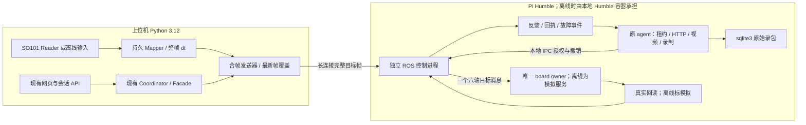

# LanderPi 本地 ROS 2 环境与离线控制开发方案

日期：2026-11-05。本文是开发方案，不是环境安装或实机验收报告。

目标：先在上位机完成与 Pi 同发行版的 ROS 2 离线闭环，消除每周期多次跨网络
同步请求；再将同一控制实现部署到 Pi 的既有 MentorPi 容器进行联调。
第一阶段保持底盘锁定，只做五轴机械臂、夹爪、视频、observe/grasp 两阶段与 6D 数据。
本轮仅新增方案与执行 prompt；未连接 Pi、未安装环境、未启停服务、未操作设备。

## 1. 本次核对与历史记录的区别

| 项目 | 本次只读核对 | 对方案的影响 |
| --- | --- | --- |
| 上位机 | Ubuntu 24.04.4、x86_64 | 不把 Jammy 的 Humble deb 包混装进 Noble |
| ROS 命令 | 当前 shell PATH 未找到 docker、podman、ros2、colcon；不是“机器从未安装”的证明 | 环境脚本先探测，不假定容器运行时可用 |
| 已有隔离环境 | `work/ros2_collection/envs/ros_jazzy/` 存在 python、ros2、colcon 与 package-lock | 可保留用于快速测试；本次未验证它的运行健康 |
| LeLab 环境 | `app_ros_mobile/.venv/pyvenv.cfg` 为 Python 3.12.16，基于上述 Jazzy 环境；pyproject 要求 >=3.12 | 不原地升级/降级，不在该环境注入 Humble Python 扩展 |
| 源码边界 | `app`、`current/app` 指向发布快照；当前 ROS 开发在 `app_ros_mobile/` 与 `ros2_ws/` | 不改快照或切换 current 来发布此次开发 |
| 当前版本 | HEAD 为 `e4312f0`，存在大量 tracked/untracked 修改 | HEAD 不是完整开发版本，交付须包括实际未跟踪源码清单和哈希 |
| 控制周期 | `hybrid_hardware.py` 的 worker 为 100ms，分别 dispatch arm、gripper；snapshot 和 lease.valid 存在 HTTP `/status` | 改控制路径和调用次数，不能只替换线程执行器 |
| 车端输出 | 已有 `ros_servo_output.py`、HTTP `/hybrid/apply`，现接口仍按通道提交 | 复用已有输出模块，不再沿用早期“仅有只读 driver”的审计结论 |
| vendor 消息 | `resource/lander_pi/src/driver/ros_robot_controller_msgs/` 确实存在完整消息源码 | 能在 amd64 Humble 中从源码构建，仍需后续与车端安装版核对 |
| Pi 环境 | 交接记载 MentorPi、Humble、Python 3.10.12、arm64、持久挂载 shared | 是历史现场证据，本次未远程重新核验 |

用户描述的“约 8 秒 19 个控制周期”约为 2.4Hz；这里引用该观察，不作为本次性能实测。
旧审查文档和历史测试通过数不能替代接管时重新核对源码与执行测试。

## 2. 环境选择与配置

采用三个独立环境，跨边界只传版本化数据，不共享 Python 二进制扩展。

| 环境 | 配置 | 运行内容 | 证据级别 |
| --- | --- | --- | --- |
| 上位机 LeLab | 保留 Python 3.12+、现有本地 LeRobot、当前前端工具链 | 页面、SO101 Reader、三层标定资产、Mapper、会话协调、导出 | 纯逻辑/上位机验收 |
| 上位机 ROS 开发容器 | Ubuntu 22.04 + ROS 2 Humble + Python 3.10，linux/amd64 | 与 Pi 相同的控制包、vendor 消息、模拟反馈、真实 ROS 通信与 sqlite3 bag | ROS 离线验收，设备为模拟 |
| Pi MentorPi | 复用现有 Humble/Python 3.10、arm64，先核验实际版本 | 同一控制包 + 已验证 vendor 唯一串口 owner + 真实反馈/相机 | 真机验收，后续执行 |

选择理由：Humble 官方 deb 面向 Ubuntu 22.04，Jazzy 官方 deb 面向 Ubuntu 24.04。
不将两发行版混入一个 Python 进程，也不依赖 Jazzy 与 Humble 跨发行版 DDS 兼容。
参见 [Humble 安装平台](https://github.com/ros2/ros2_documentation/blob/humble/source/Installation/Ubuntu-Install-Debs.rst)、
[Jazzy 安装平台](https://github.com/ros2/ros2_documentation/blob/jazzy/source/Installation/Ubuntu-Install-Debs.rst)、
[ROS 跨发行版通信限制](https://github.com/ros2/ros2_documentation/blob/rolling/source/Releases.rst#cross-distribution-communications)。

### 2.1 最小依赖与构建

- 容器基线候选为官方 `ros:humble-ros-base-jammy`；准备时验证 tag 存在、amd64 manifest，
  记录实际 registry digest 后再写锁文件。tag 是候选，不是本轮已拉取的镜像。
- 最小依赖：rclpy、ament_python/ament_cmake、colcon、rosidl、现有代码实际导入的标准消息、
  rosbag2 CLI/Python/sqlite3 插件、NumPy、Pillow、pytest。用安装/导入清单校验，不能只测 ros2 --help。
- 从只读 vendor 源复制必要的消息包到专用构建输入，并保存逐文件 SHA256/来源路径；
  `ros_robot_controller_msgs` 当前声明的外部消息依赖为 std_msgs。
- 不整树构建 vendor 的视觉、导航、雷达、语音和 bringup；不为了无硬件控制测试强装 Gazebo。
  当前 agent 的 ros_gz_interfaces 导入是可选的，但 package.xml 仍声明运行依赖；
  开发者须处理最小构建范围/依赖声明，不能留下“运行不需要而安装强制需要”的矛盾。
- 分别记录 amd64 和 arm64 的依赖/编译证据。amd64 的 install/ 和共享库不得复制到 Pi。
  Pi 上构建或使用经验证的 arm64 产物，Python 控制源码和消息定义应有同一来源哈希。
- LeLab 继续核验实际导入的是同级定制 LeRobot，不安装另一个 PyPI/上游副本。

### 2.2 环境与运行目录约定

拟新增 `tools/ros2_collection/local_ros2/`，包含 Dockerfile、环境锁、构建/启动/停止脚本
和开发说明。实际输出放 `work/ros2_collection/local_humble/`，不写入发布快照。
拟提供 `doctor`、`prepare`、`build`、`up`、`accept`、`down` 入口；这些名称是待实现接口。

安全默认：

- 优先复用可用的用户级隔离容器运行时；当前未检测到可用运行时，不能宣称环境已配好。
  不因跑测试去替换系统 Python、全局 ROS、共享 base 或修改全局 Docker daemon。
  无可用运行时时先完成无 ROS 的核心与构建配方，明确 Humble 集成门禁尚未通过。
- 容器不使用 privileged、不映射 /dev、不挂串口；源和 vendor 参考树只读，构建/日志/数据目录可写。
  所有 ROS 测试节点置于同一个容器中，减少离线 Docker 跨容器发现问题。
- 离线 profile 固定 simulated，默认 preview/outputs=false；允许的 simulated 驱动也不能连接硬件。
  禁止通过环境变量把离线 launcher 改成真实输出入口。
- 使用单独且经占用检查的 ROS_DOMAIN_ID、测试命名空间和本地通信；所有发布者/订阅者/录包显式 remap。
  不复用真实 board 输出 topic 名向现有 ROS graph 发布；只映射已分配的 127.0.0.1 服务端口。
- 脚本管理自己创建的进程/容器：保存实例 ID、真实 PID、开始时间/命令指纹，退出前核验。
  shell 包装进程使用 exec 或可靠传递实际子进程身份，不使用 pkill/killall。
- “离线开发”在此指不依赖真实设备。初次准备依赖可以联网；要实现完全断网复跑，还需导出镜像、
  锁定依赖与构建输入，提供哈希、导入步骤和断网复跑证据。两种状态分别报告。

## 3. 目标架构与复用边界



保留两端租约由同一个上位机会话协调。Pi agent 仍管理现有车端租约；独立控制进程消费
该租约的本地、有界授权镜像，不再向上位机发起第二份控制租约。
agent 的 HTTP/视频工作与控制进程不共享 Python GIL。仅在同一进程增加 ROS 节点/线程
不能达到这个隔离效果；默认互斥回调组也可能让多线程 executor 仍串行执行。
见 [Python GIL 与线程](https://docs.python.org/3.10/library/threading.html)、
[Humble 回调组说明](https://github.com/ros2/ros2_documentation/blob/humble/source/How-To-Guides/Using-callback-groups.rst)。

上位机 USB Reader 不搬到 Pi；初版也不要求上位机应用直接加入 Pi DDS 域。
HTTP 保留会话、标定、录制及诊断职责；周期目标/反馈走独立长连接，Pi 内部 ROS 2 负责本地 I/O。
长连接先采用有限长度的 JSON 帧 TCP 流，经既有 SSH 端口转发访问 Pi 回环绑定端口；
不得将其当成裸公网控制接口。控制流与视频分开，必要时验证独立 SSH 传输能否减少视频拥塞影响。

## 4. 协议、时效和控制权

### 4.1 合帧而不丢通道保护

先定义 `teleop_frame_v1` 外层封套，内含 arm、gripper 两个严格的现有 command_v1。
封套至少有 frame_seq、共同输入快照身份、stream_epoch、新鲜度窗口；两条命令必须属于
同一 session/session_epoch/bundle，分别保留 source/channel/seq/sample_seq/ttl/clutch/target。
arm 顺序为 joint1..joint5，夹爪为 r_joint/ID10，禁止出现底盘目标。

- 整帧检查通过后一次提交：两通道许可、反馈、单位/限位/速度和新鲜度任一失败，整帧拒绝。
  校验失败不得推进任何通道序号或更新滤波/输出状态；采用 validate-then-commit。
- 输出层在同一次 ServosPosition 消息中包含 IDs 1..5、10 和共同 duration，复用 vendor board owner。
  ROS publish 一次不等于物理同时执行，也不等于串口写完成或控制器接受。
- 一次 frame 的接收、校验、输出/拒绝分别记录；原有按通道事件引用同一个 frame_seq。
- 协议白名单新增字段必须显式版本化。不得直接向原 command_v1 塞入远端本地时间戳。
- capability 明确 frame/stream 支持与协议版本；协商失败时拒绝此模式，不能偷偷退回两通道发送。
  同一会话只激活一个输出传输，禁用它的 legacy apply 路径，避免重复动作。

### 4.2 网络延迟不能用重新盖 TTL 掩盖

现有队列在同一主机用单调时钟维护 deadline 可以复用；不同主机的 monotonic 值不可直接相减。
必须同时处理上位机排队、网络在途和 Pi 本地排队。不能在每一跳接收时重新给完整 TTL。

建议冻结以下无需时钟同步的方案，并编写超时/半开测试：

1. Pi 通过流异步发放短期 freshness window，window_id 对应 Pi 本地单调时钟截止点。
2. 上位机只给新采集、未超龄的主臂样本附当前窗口；不复用旧样本伪造新 sample_seq。
3. Pi 校验窗口/连接代际，以 `min(窗口截止、接收时刻+剩余TTL、授权截止)` 建立本地 deadline。
   窗口、授权或目标过期，整帧拒绝；缓冲区里的旧报文不能因重连再次有效。
4. Pi 的 IPC、队列、限速与最终发布边界均检查同一个 deadline；没有同步等待 ACK 的发送循环。
5. 每次断连销毁窗口、stream_epoch、参考姿态和待发目标，必须重新对齐和显式接合。

该机制会把过长的网络往返转化为拒绝/暂停，而不是通过增大 TTL 达到表面流畅。
仍需记录上下行、窗口剩余量和拒绝率，不能把 ROS 本地 tick 数算作新目标频率。

### 4.3 Pi 授权镜像和故障路径

- agent 与控制进程通过受本机访问权限限制的 IPC 同步许可；包含 control generation、
  session/epoch、bundle hash、通道许可、有效期及撤销原因。上位机不能自行签发本地许可。
- 心跳只维持授权，不延长动作样本寿命；主动撤销应立即到达控制进程，失去 agent 心跳有界撤销。
  IPC EOF、agent 崩溃、租约过期均清队列并退出跟随，不能等待长达 30s 的普通会话 TTL。
- STOP/ESTOP 撤销 generation 并抢占目标，不排在普通帧后；录包保存不持有控制锁。
- 控制回调只读反馈缓存，不同步等待六路舵机扫描、HTTP 或磁盘。读回异步、有界、单 owner。
- 保留 SafetySupervisor 的验证规则，补齐实际进程启动/IPC 接线，不把现有类存在当成已完成隔离。
- 独占检查覆盖 vendor joystick/app、其他发布者；ROS graph 可见性检查不是来源认证或硬件安全回路。
  无法排除其他命令入口时，真实输出不允许使能。
- 控制进程自身被 SIGKILL、Pi 掉电等情形不能靠该进程的软件 watchdog 证明停车。
  板级保护与舵机 hold 未实测前，报告能力缺口，不宣称已经覆盖这些硬件故障。

## 5. 开发包与文件职责

以下是建议模块名，接管时可按现有结构微调，避免重复实现已有功能。

| 负责部分 | 复用入口 | 需要补齐 |
| --- | --- | --- |
| 上位机读取与映射 | `mobile_leader_reader.py`、`mobile_teleop.py`、`hybrid_hardware.py` | 读/映射/发送解耦；持久 Mapper；同帧 dt；最新输入；状态查询使用后台缓存 |
| 帧契约 | `hybrid_channel.py`、车端 `contract.py/hybrid_gateway.py` | 纯 Python3.10 可运行的 frame 校验与一致性用例；两端共享事实源，不再两份漂移 |
| Pi 控制进程 | `hardware_safety.py`、`ros_servo_output.py`、`ros_servo_readback.py` | `control_runtime.py`/entry point、许可 IPC、整帧发布、独立 deadline/故障状态 |
| 传输 | `CarHttpOutputDriver`、现有 SSH 隧道工具 | `teleop_stream.py`，长度前缀/尺寸上限/超时/重连代际/异步回执；合帧 HTTP 仅作过渡验收 |
| agent | `agent.py`、现有租约/recording 路由 | 生命周期与许可桥、订阅控制快照、旧输出入口互斥、流端口/配置与能力报告 |
| 离线设备 | 现有 hybrid fixtures + vendor msg | 独立 simulated profile、六路模拟回读、可控扫描跨度/迟到、模拟输出 spy、合成 640×400 图像 |
| 数据/网页 | `hybrid_recording.py`、6D exporter、Landerpi 页面 | frame 身份与确认级别关联、observe/grasp、反馈年龄/目标频率/延迟展示、错误与取消恢复 |
| 发布 | 现有 collection 部署与最小栈脚本 | 版本化持久目录、完整包清单与哈希、依赖探测、dry-run、精确停止/回退 |

不新建另一套网页向导、标定数据库、租约系统或 recorder。
五轴和主臂保留手动标定基础；夹爪自动找区间仅复用已有作业状态机与算法测试，
离线测到的端点绝不能保存为真实设备的标定资产或实测机械限位。
joint1 连续旋转不属于此次优化，不改变已有机械/线缆限位。

## 6. 顺序、产物与离线门禁

| 阶段 | 工作 | 可检查的完成条件 |
| --- | --- | --- |
| P0 基线 | 核对源码差异、已有服务归属、配置与脚本副作用；埋点现有请求/锁/映射耗时 | 标明旧源码与当前差异；本地 legacy/new 基准可复跑；不调用真机测性能 |
| P1 环境与核心 | 环境 doctor/锁定镜像配方、vendor msg 构建、frame/TTL/原子提交纯逻辑 | Python3.10 实际运行测试；Humble 标准/custom msgs 导入；产物路径/版本/哈希齐全 |
| P2 合帧过渡 | 一次 frame HTTP，移除逐周期 status/valid 远程探测；两通道整帧发布 | 每个有效输入快照最多一个 frame 请求、一个六轴消息；预览输出计数为0；坏帧不消耗序号 |
| P3 本地控制 | 独立 ROS 进程、stream、授权桥、缓存反馈、独立停止路径 | HTTP慢/视频繁忙不阻塞控制；半开/乱序/租约失效/IPC断开均清队列；恢复不自动接合 |
| P4 数据与页面 | 两个短 episode 含 observe/grasp，经真实 ROS recorder 落 sqlite3 | ros2 bag info/消息计数/时间戳/必要 topic 与 phase 一致；同步 SHA256/READY；6D导出与SDK/页面读回 |
| P5 离线交付 | 性能/故障矩阵、真实浏览器点击、打包/启动/停止/回退 dry-run | 所有必需证据有环境/命令/退出码，报告清楚哪些门禁未通过；默认仍无法发真实输出 |
| P6 以后真机 | 从只读身份核验到无输出、逐轴低速、跟随、两段录制与故障测试 | 逐项现场存证，不能用 P1–P5 代替任何实机项 |

P2 是减少同步往返的可测中间结果；达到 P2 不等于独立进程/流式控制目标完成。
Humble 暂不可运行时继续 P1 纯逻辑和其余可独立编码，不把 Jazzy/AST/mock 通过写成 Humble 通过。
P4 必须调用生产 SessionRecorder 与真实 ros2 bag record，不替换成 sleep/FakeBagProcess。
Gazebo 可用于后续扩展，不是本轮的必备依赖或完成条件。

### 6.1 测试矩阵

1. 映射/单位：五轴 rad、夹爪 percent→raw→rad、方向、零位、限位、整帧速度限制、回绕与线缆约束。
2. 资产/身份：三层哈希、device identity、关节顺序不匹配时拒绝；模拟资产不能绑定真设备。
3. 合帧：缺夹爪、坏值、单通道未许可、重复/跳代帧、任一通道过期全部不输出且不部分提交。
4. 时效：发送排队、网络延迟/重复、TCP半包/粘包、长时间背压、迟到窗口、Pi队列延迟、重连旧帧。
5. 权限/停止：上位机/agent/控制进程退出、IPC EOF、租约过期、急停、锁竞争、录包收尾很慢。
6. 反馈：缺轴、样本过期、扫描跨度过大、ID错误、command_cache、假 measured、服务超时。
7. ROS：真实消息传输/QoS、模拟驱动 spy、预览零输出、控制进程与HTTP/视频进程隔离。
8. 数据：每集阶段切片、6D名称/值、拒绝原因、相机时间、原始事件/目标/反馈可追溯；invalid session 保留。
9. 页面：真实浏览器点击 preview/align/arm/engage/松离合/暂停/急停/episode/phase/结束/错误取消；
   断网恢复与视频冻结需要真的在浏览器注入，jsdom/DOM检查只算对应测试级证据。

离线输出 spy 允许模拟执行路径，但不得加载真实串口模块或发布到硬件命名空间。
记录 `data_identity=simulated_offline`、`training_eligible=false`。
如为测试 exporter 生成 LeRobot 派生目录，也必须继承 simulated 身份，生产训练入口继续拒绝。

### 6.2 配置与性能指标

先保留/显式核对当前安全数值，以下仅为离线初始测试配置，不是最终硬件能力承诺：

| 参数 | 初始值/规则 |
| --- | --- |
| 输入/目标频率 | 目标10Hz；Reader采样、反馈扫描、控制tick分别配置 |
| Pi控制tick | 初始10Hz，watchdog独立检查周期目标<=50ms；最终输出前重新验时效 |
| command TTL | 与现有 car gate 的 <=200ms 对齐；不能用 profile 中其他旧 TTL 静默覆盖 |
| 反馈最大年龄 | 当前 gate 500ms；配置同时约束逐轴年龄、整帧年龄、扫描跨度 |
| 本地授权桥 | 初始100ms心跳、300ms超时，独立于动作TTL；真机前验证CPU/总线下是否可行 |
| 队列 | 网络待发/控制待执行 latest-wins，有界；普通目标不堆积重放，事件记录另有有界队列与溢出错误 |
| ROS QoS | 目标 volatile/keep_last(1)，可靠性与现有subscriber明确匹配；反馈按实际publisher匹配；录制单独验证 |

QoS 的 depth/lifespan/deadline 不替代应用层租约、实际执行前 TTL 和本地停止逻辑。
参见 [Humble QoS 语义](https://github.com/ros2/ros2_documentation/blob/humble/source/Concepts/Intermediate/About-Quality-of-Service-Settings.rst)。

每次基准同时记录：主臂有效采样Hz、映射耗时、有效目标Hz、网络排队/往返、Pi接收/校验/发布间隔、
逐轴反馈年龄/扫描跨度、HTTP p50/p95/p99、控制deadline miss、CPU/进程与丢帧/拒绝原因。
跨主机不直接比较 monotonic；单向延迟没有同步误差界时，只报告RTT/本地阶段时间/新鲜度窗口余量。

在同一机器/同一输入/同一模拟总线条件下跑 legacy、合帧、stream 三种基准，正常场景每种至少60秒，
验收时重复3次；再加视频编码/HTTP慢请求/读回超时负载。目标是10Hz配置下有效新帧约9–10Hz、
稳定场景发布间隔p95<=150ms/p99<=200ms（初始工程目标），超预算应显式降级/故障。
计数必须来自新的 sample_seq/frame_seq，不能把重复目标或空tick当成功频率。
故障停止指标区分“停止接纳”“停止发布新目标”“hold消息发出”“机械停止”，前三者离线可测，
最后一项只能真机验证；不承诺普通 Linux/ROS 2 硬实时。

## 7. 数据、相机和三层标定保留项

- 继续 sqlite3 原始录制；保留 SessionRecorder、校验同步、原子 READY 和既有导出保护。
- 录制主臂 raw/标定值、pre_clip、最终六轴sent_target、frame和channel序号、接收/拒绝/发送、
  实际回读/逐轴时间、离合、故障、三层版本、相机和episode/phase事件。
- 新录制 profile 要显式包含并校验真实反馈topic与phase/event；当前profile的
  `/controller_manager/joint_states` 是命令缓存，不能因topic存在就成为6D state真值。
  `/lelab/ros_robot_controller/servo_readback` 是当前读回入口之一，须核对实际payload与来源。
- action采用网关限幅后目标，state用真实反馈；模拟链路则明确simulated_feedback，绝不改名measured。
- `driver_sent` 目前只能证明已有驱动提交层级，需保留确切含义；ROS publish 不冒充板端写入确认。
  `controller_acknowledged`、`execution_observed` 没有证据继续 unavailable。
- 每集至少含 observe/grasp；结束本集先暂停跟随再保存，下一集显式重新接合；急停不等磁盘。
- 相机保持当前硬件基准640×400；离线合成图像显示水印/序号且来源为simulated。视频和状态配对要有帧身份，
  MJPEG页面刷新或预览seq增加不单独证明帧新鲜或与JSON同帧。
- 保留旧只读session的不可训练身份。底盘锁定时只验收6D，不补零生成9D。手柄与底盘真实反馈另期接入。

## 8. Pi 程序部署方案（只生成候选，不在离线阶段执行）

历史已知持久挂载为 `/home/pi/docker/tmp -> /home/ubuntu/shared`；上机前先重新核验。
候选目录：

```text
/home/ubuntu/shared/lelab_car/
  releases/<release-id>/       # 源码、profile、已核验依赖/消息清单、manifest
  current -> releases/<id>    # 仅通过校验后按显式部署步骤切换
  state/                     # 标定、会话、run/PID/实例身份
  logs/
  sessions/                  # 永久保留原始与invalid session
```

1. 生成包含未跟踪生产源码的完整允许清单；归档 SHA256、来源版本、Python/ROS/arch要求。
   禁止仅凭 git archive HEAD 打包，否则会漏掉当前大量未入库实现。
2. 只读核验 MentorPi、挂载、剩余磁盘、实际源码/install路径及消息定义哈希；不覆盖 vendor 工作区。
3. 新目录校验/arm64构建/导入检查通过后再做候选启动；不先替换旧版，不删除旧层内sessions。
   旧数据迁移采用复制、清单/哈希校验、独立回退，不能直接移动或删除。
4. 启动顺序：唯一 board owner（bounded-read补丁隔离副本）→真实反馈入口→控制进程默认禁用
   →agent/授权桥→按需原有相机→上位机/隧道。不得运行含init_pose的整车bringup。
5. stop先撤销许可、退出跟随并验证控制进程响应，再收尾录包；最后只停止本部署拥有的进程。
   无法确认hold/停止效果时保留该失败，不以停止HTTP发包冒充机械停止。
6. rollback指定上一完整release；控制恢复禁用、清空队列和参考，要求重新对齐/接合。
   不覆盖标定、sessions或invalid session，不泛用pkill，不刷固件。

## 9. 离线完成后真机联调顺序

只在后续窗口执行，不因历史授权在本轮离线任务中主动连车或移动：

1. 只读核对Pi身份/容器、消息与源码hash、串口归属/唯一owner、六路ID、相机、其他发布者。
2. 核验三层真实资产及夹爪端点，先读取和无输出预览；真实board输出计数不得增长。
3. 测实际六路扫描时延/跨度与CPU/网络，确定读频、控制频、TTL；确认急停与现场空间有效。
4. 按已明确的当次授权逐轴低速小幅，确认方向、限位、夹爪开合、hold，再多轴相对跟随。
5. 真拔主臂USB、网络断开/半开、租约失效、agent退出、控制进程退出分别验收；能力不足单列。
6. 两段短episode含observe/grasp，真实sqlite3检查/同步、6D导出、本地SDK及网页读回。
7. 实际浏览器错误/取消/恢复与回退；恢复始终不自动运动。底盘/手柄/9D另开后续验收。

## 10. 接管入口

完整可执行 prompt：
[2026-11-05-landerpi-local-ros2-agent-goal.md](2026-11-05-landerpi-local-ros2-agent-goal.md)。

应先读的现有材料：

- 根 AGENTS.md、README/MIGRATION；实际开发副本 `app_ros_mobile/` 的依赖、说明、部署脚本。
- `docs/handoffs/2026-11-05-landerpi-vendor-docker-reuse.md`。
- `docs/handoffs/2026-11-05-landerpi-current-debug-development-summary.md`，历史预览状态需对照当前源码。
- `docs/handoffs/2026-11-05-landerpi-teleop-comprehensive-review.md`，旧发现需逐条重新核验，不能整篇视为当前状态。
- `docs/landerpi-gripper-auto-manual-calibration-design.md`、`docs/ros2-collection-runbook.md`。
- `docs/handoffs/parallel-20261104/INTEGRATION-status.md` 及其真实/模拟证据边界。

本方案官方资料核验日期为2026-11-05。未执行任何安装、构建、测试或真机探测；本次产物是计划与prompt。
