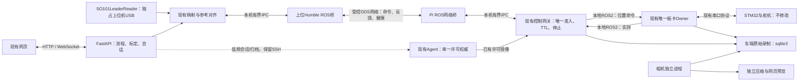

# LanderPi 更深入接入 ROS 2 的渐进改进方案

日期：2026-11-07（America/Los_Angeles）。这是设计交付，不代表已部署或通过实机验收。
本轮没有改运行配置、网络、控制代码或设备状态。

## 目标与边界

目标链路：主臂读数/映射由上位机服务处理，ROS 2 负责持续命令、实测反馈、健康和事件；
Pi 网关继续负责准入与本地停止。浏览器只操作流程和显示，HTTP 保留会话管理、配置、
归档与导出，不再作为逐周期反馈的必经链路。

- STM32 SDK、固件和舵机线缆协议保持原样，不构建、不烧录、不虚构事务 ID/MCU 回执。
- 保留 SO101LeaderReader、三层标定、TeleopMapper、双租约、急停、TTL 和唯一串口 owner。
- 复用 MentorPi Humble/Python 3.10；上位使用现有 Humble Docker，FastAPI 仍在既有 3.12 环境。
- 保持底盘锁定，只验收机械臂+夹爪 6D；observe/grasp、人工/unknown 结果语义不变。
- 原始录制继续 sqlite3，不强迁 MCAP；旧只读数据的不可训练身份不变。
- 保留 FrameLink 作为显式可回退传输，同一新会话只选一种执行传输，禁止静默双发/切换。
- 不以本方案为由全面改为 ros2_control、重写 LeRobot 或增加新的上层位置 PID。

## 当前依据

本地源码表明：

- `app_ros_mobile/lelab/hybrid_frame_link.py` 集中构造完整六维帧、身份、序号、TTL 和窗口。
- `hybrid_stream_hardware.py` 的 FrameStreamDriver 和 StreamHardwareObserver 是上位插入点。
- `ros2_ws/src/lelab_mobile_agent/lelab_mobile_agent/car_control_process.py` 中的 on_hello、
  on_frame、FrameAdmission、tick 和 driver 是应继续复用的车端唯一输出入口。
- 两侧 `teleop_frame_v1.py` 中已有 TransportSelector，但本次检索未找到运行时绑定调用；
  DDS 并入前必须补上，不能只把类存在当作互斥已实现。
- 当前本地 Docker 使用 domain 93、ROS_LOCALHOST_ONLY=1，属于离线装置；不能直接当成
  已配置跨主机 DDS 的生产桥。Pi 之前核查为 domain 0、CycloneDDS、本地通信。
- 历史故障快照已确认车端反馈先达到 505/859ms，见
  `docs/evidence/landerpi-follow-feedback-20261107/second-incident.md`。DDS 不会消除底层缺帧。

## 推荐拓扑

上位 Reader 保持在真实 USB 所属主机。上位 ROS 桥通过本机 IPC 接现有服务，不另开串口，
也不要求把 FastAPI/LeRobot 迁到 Python 3.10。ROS 桥可放进已有 Humble 镜像，无需映射 /dev。

Pi 内部仍留在原厂本地域；网络桥只转发白名单。初版可用两个进程分别连接本地域与网络域，
中间走有界 IPC，避免假定一个进程能靠全局 ROS_LOCALHOST_ONLY 同时表达两套网络策略。
也可在验证安装版本和每 context 网络行为后采用现成域桥，但不能未经验证直接套配置。

## 1. 先稳定采样和调度

应修改的是 ROS Python owner 周边调度与诊断，不是 STM32：

1. 将“每轮结束再睡 200ms”改成可配置的 deadline 周期调度；错过周期丢弃旧计划，不追赶补发。
2. 单串口事务调度统一仲裁位置命令、扫描和校准查询，均有等待预算；急停撤权不等待普通查询。
3. 保留迟到回包隔离要求，不能为了赶 500ms 而无依据缩短 quiet time。反馈超龄仍停止输出。
4. 每次读失败保留 ID、命令、超时/错帧/锁等待、耗时、恢复阶段和最后成功序号，而不是只返回 None。
5. owner 发布采集健康：成功扫描率、最大间隔、失败计数、扫描跨度、源实例和恢复状态。
   consumer 接收计数与 owner 失败计数分开；consumer failed_scans=0 不等于底层零失败。

读回先以 **10Hz 候选值**做只读总线负载测试，按实际结果取值，不宣称已支持 30/50Hz。
控制先稳定到既定 10Hz；实际反馈带宽不足时不靠增大发包频率或控制补偿伪造性能。
既有 500ms 门限保持，正常运行目标是明显远离边界，而非不断贴线续命。

相机编码、HTTP、录制哈希各自独立进程/工作队列；控制回调仅校验并写入最新值槽。
有限串口事务由唯一 owner 工作线程执行。只改 MultiThreadedExecutor 不够，默认 callback
group 仍可能串行；Python CPU 工作也不能靠线程自动消除 GIL 影响。
这些执行器行为依据 [Humble callback group 文档源码](https://raw.githubusercontent.com/ros2/ros2_documentation/humble/source/How-To-Guides/Using-callback-groups.rst)。

## 2. 定义少量明确的 ROS 接口

新增 `lelab_mobile_interfaces` 包，在 amd64/arm64 的 Humble 上构建同一份接口定义。
下面名称是拟议接口，不表示当前已经存在。

| 接口 | ROS 类型 | 用途及关键字段 |
| --- | --- | --- |
| MeasuredServoFrame | msg | 固定六轴 name/ID、raw、rad、逐轴 valid/error、源 instance/seq、采样起止、发布时年龄、clock epoch、标定 hash |
| TeleopFrame | msg | 复用现有完整帧：session/epoch/transport epoch、source、frame/channel seq、bundle hash、window ID、TTL、五轴+夹爪目标 |
| CommandReceipt | msg | 接收/拒绝原因、准入/发布时间、frame seq；明确 publisher_sent 与硬件接受/实际运动的区别 |
| DriverHealth | msg/diagnostics | owner 采样与恢复指标、consumer 接收延迟、队列/丢弃统计，来源与时间 |
| SessionControl | srv | 获取/释放/续租、状态转换的薄入口；内部仍只有现有 Agent 一个许可权威 |
| ClearEstop | srv | 校验原 owner/许可、stop generation、幂等 request ID；两层回执，清除不使能 |
| HomeArm | action | 包装已有可取消回中任务，返回轴、目标/实测、进度与原因；不复制一套状态机 |

原始 v2 数组话题在迁移期保留，typed 消息由明确的转换层产生。标准 JointState 可用于
显示，但只有真实读回可进入 measured position；未知 velocity/effort 保持缺失，禁止补零。
没有独立电机的 mimic 关节不增加控制维度。

长任务选 action 是为了表达进度、结果和取消；持续遥操作使用 topic，不把每帧变成 service。
依据 [ROS 2 接口说明](https://raw.githubusercontent.com/ros2/ros2_documentation/humble/source/Concepts/Basic/About-Interfaces.rst)。
回中目标引用当前已确认的安全姿态资产及版本，不重新写死 500/350，也不把 raw 500 当成
任意设备已标定区间的 50%。

## 3. 反馈先切 DDS，命令后切

第一步让上位桥订阅 MeasuredServoFrame/DriverHealth，与旧 HTTP 反馈并排对照，但不授权输出。
通过验证后，上位 observer 从本机 ROS 桥的最新值缓存取反馈；HTTP 保留管理与诊断用途。

反馈必须携带真实采样来源。跨机不能直接比较两台主机的 monotonic 值，也不能将收到
DDS 消息的时间当成新的测量时间。应建立带误差上界的时钟映射/握手，报告 conservative
source age、传输估计、接收后驻留分别是多少。映射/误差无法满足门限时不使能。

车端仍以自己的 monotonic 验证实际反馈年龄、命令窗口和 deadline；不依赖上位机时钟安全。
DDS QoS 的时间属性只作辅助，不替代这一门禁。

第二步加入 DDSCommandTransport，复用同一个 FrameAdmission/FreshnessWindow 和执行 tick。
上位 FrameLink 与 DDS 实现提供相同的发送、回执、窗口、stop 接口；不另建直接写 servo topic 的端口。

在实际会话创建、epoch 绑定和旧入口门禁处接入 TransportSelector：

- 新会话固定 `frame_stream_v1` 或 `dds_v1`；切换需撤权、丢队列、建立新 epoch 并重新显式接合。
- DDS 断连不自动启用 FrameLink；管理页可使用 HTTP 查状态，但不能借它静默继续运动。
- 旧 `/hybrid/apply`、arm/gripper、expert/reset 等执行入口与 DDS 同样互斥。
- 收包时与真正发出前都核对 session、源、代际、序号、窗口、标定和许可；重连不重放。

## 4. QoS 与网络

以下为起始设计值，必须对实际安装 RMW 和链路做兼容验证：

| 数据 | 建议起点 | 额外规则 |
| --- | --- | --- |
| 连续 TeleopFrame | BestEffort / KeepLast(1) / Volatile | 丢帧靠下一帧；无新帧按本机 deadline 停止，过期帧一律拒绝 |
| 实时实测反馈 | BestEffort / KeepLast(1) / Volatile | 保留源序号；发现缺帧/过期不能填充测量 |
| 准入回执、会话操作 | Reliable / 有界队列 / Volatile | 回执不作为 MCU 执行确认；不能堵住实时发送队列 |
| 回中 action | Reliable / Volatile | 校验会话和目标 ID；客户端失联不能由 action 无限自续租 |
| SafetyStatus、健康摘要 | Reliable / KeepLast(1)，状态可 TransientLocal | 带源实例/时间；历史状态不授予输出许可 |
| 急停/清除请求 | Reliable / Volatile | 明确请求与双层回执，清除命令不得用持久化 false 广播 |
| 视频预览 | SensorData/压缩、限帧 | 与控制反馈独立队列；车端原图照常录制 |

Deadline/liveliness 用来诊断停顿，不能证明机械已停止；节点其他 publisher 活跃也不能证明
六轴扫描线程健康。Reliable 不等于没有延迟，QoS 不兼容会导致消息无法交付。
依据 [Humble QoS 文档源码](https://raw.githubusercontent.com/ros2/ros2_documentation/humble/source/Concepts/Intermediate/About-Quality-of-Service-Settings.rst)。

网络采取白名单桥：Pi 本地域 0 保持 localhost；跨机域建议另选未占用 ID（例如95，部署前确认），
桥接双方统一 CycloneDDS、Humble 消息版本，显式绑定实际 LAN 网卡和对端 peer，不改全局 shell。
离线 92/93/94 环境继续隔离。domain ID、namespace 和 peer IP 都不是身份认证。

只在受控两机网络开放必要 DDS 通信，不把原厂 servo 写话题、全图服务和原图视频无差别暴露。
Cyclone 支持静态 peers；XML 字段要按实装版本检查，不直接复制 latest 示例。
参考 [Cyclone 0.9.1 配置](https://cyclonedds.io/docs/cyclonedds/0.9.1/config.html)。

跨机命令启用前核验 DDS-Security/SROS2 支持，限制 bridge 的发布/订阅权限；显式 enforce，
失败不降级成无认证控制。握手可继续使用受保护的现有 SSH 管理通道，将认证后的桥身份
绑定会话和 transport epoch；原始控制 token 不进入普通 ROS topic 或 rosbag。
参考 [Humble SROS2 说明](https://raw.githubusercontent.com/ros2/ros2_documentation/humble/source/Tutorials/Advanced/Security/Introducing-ros2-security.rst)。

## 5. 录制与网页

保留生产 SessionRecorder 与车端 sqlite3，补录真实测量、映射前/后目标、车端准入/拒绝、
发布回执、健康、离合、phase 和 owner/标定事件。保留源时间和 bag 接收时间，不重戳旧帧。
录制 QoS 与发布方兼容，通过 source seq/时间间隔检查遗漏，不将 Reliable 宣称为零丢帧。
磁盘/编码慢不能阻塞采样或急停；无法完整录制时将本集标为无效，不删除旧数据。

网页继续现有路径。服务端把 ROS 最新状态用现有 WebSocket 广播队列推送，降低状态轮询。
显示源扫描年龄、接收后年龄、采样率、最大间隔、恢复阶段与第一条故障，避免只给一个
笼统 stale。急停只读锁存状态与清除回执，清除成功仍要求新会话/对齐/接合。

## 实施里程碑与最少验收

| 阶段 | 交付 | 放行条件 |
| --- | --- | --- |
| R0 采集/恢复 | deadline 调度、事务诊断、原 owner 保留/校验、首次故障证据 | 离线注入读失败与重复急停；只读采样证明扫描间隔和恢复预算；不放宽500ms |
| R1 ROS 反馈 | interfaces 包、上位 Humble 桥、Pi 白名单桥、observer DDS provider | 双机只读比对 seq/raw/标定/年龄；断网/迟到/重启后 stale 不被重戳为 fresh |
| R2 DDS 命令 | 薄传输适配、运行时 selector、鉴权和统一 admission | 模拟完整帧/乱序/双通道/撤权/急停通过；Pi 原生导入；现场授权范围内小幅与组合跟随 |
| R3 流程接口 | HomeArm action、会话 service 薄入口、健康/网页推送、录制主题补充 | 实际点击取消/错误/恢复；两集 observe/grasp，真实 sqlite3→同步→6D SDK/网页读回 |

最快路径是 R0 与 R1 的离线部分先做，反馈 DDS 先上机只读；再接命令。每阶段只跑受影响
测试和一条真实集成路径，不重做全部历史验收。部署采用新候选+成对接口版本+哈希+回退；
不覆盖原厂树，不切 current，不提交/推送，不清理旧 sessions/invalid sessions。

实施时主智能体统一写入与集成，可用至多三个 default 只读子智能体核对接口、传输准入与
部署依赖；不能再次出现多个会话同时修改同一控制文件或操作同一真机服务。
