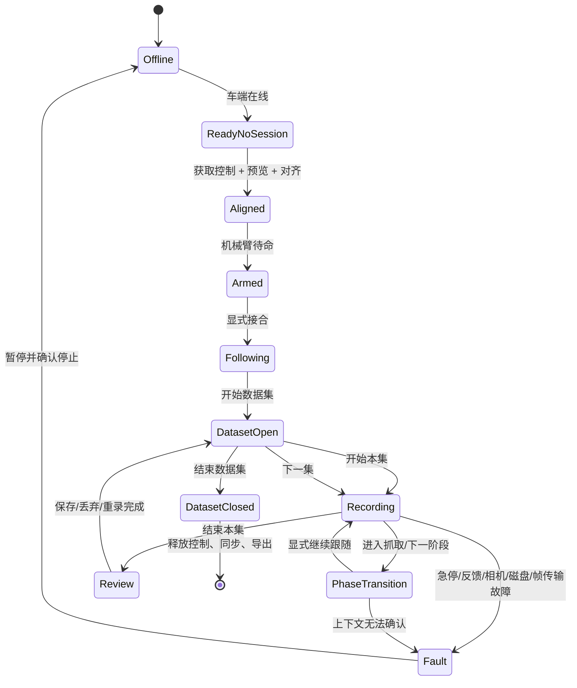

# LanderPi 采集前端整体规划

日期：2026-11-09
状态：设计稿；本轮未修改采集控制后端或执行新的机械臂动作。

## 1. 目标

把 LanderPi 前端从“多个调试面板叠加”改成一条可预测的采集流程：

1. 连接并检查机器人；
2. 建立一次数据集采集 session；
3. 按 episode 录制多项示范；
4. 每集保存、丢弃或重录；
5. 结束后同步原始数据并导出 LeRobot 数据集；
6. 标定、范围、映射和底层诊断只在独立设置页修改。

核心原则：主页面只显示当前阶段、下一步动作、阻塞原因和必要遥测。原始 JSON、哈希、ROS 话题和全部配置默认折叠。

## 2. 术语

| 术语 | 含义 |
| --- | --- |
| 控制会话 | 上位机与车端的双租约，允许预览、对齐、接合和停止 |
| 数据集 session | 一次采集任务；小车从开始到结束持续写原始 bag |
| episode / 本集 | 一次可独立保存的示范，有明确开始和结束时间 |
| 阶段 | episode 内的 `observe`、`grasp` 等人工边界 |
| 有效采集窗口 | 从“开始本集”到“结束本集”；只有这段时间会形成训练 episode |

“数据集 session 已开始”不等于“正在录本集”。页面必须明确区分：

- `数据集待机`：bag 已建立，但下一次开始 episode 之前的数据不属于任何示范；
- `REC`：当前有打开的 episode，操作员的动作会进入训练数据；
- `本集待审核`：episode 已暂停，等待保存、丢弃或重录；
- `复位中`：不录制，允许恢复物体和两臂姿态。

## 3. 信息架构

导航固定为四项：

| 页面 | 路由 | 职责 |
| --- | --- | --- |
| 采集 | `/landerpi` | 连接、预检、跟随、episode 录制和 episode 审核 |
| 数据 | `/landerpi/data` | 同步、导出、完整性报告、视频和曲线回看 |
| 设置与标定 | `/landerpi/calibration` | 三层标定、主从映射、反馈范围、目标软限位 |
| 诊断 | `/landerpi/diagnostics` | 原始状态、日志、ROS/DDS、串口和相机详情 |

兼容旧入口：`/landerpi/teleop` 重定向到 `/landerpi`；旧调试页面保留为隐藏入口，不进入主导航。

## 4. 主采集页布局

### 4.1 固定状态条

只显示五个操作员需要的事实：

1. 车端是否在线；
2. 相机是否新鲜；
3. 六路从臂反馈是否新鲜；
4. 当前输出是否开启；
5. 是否急停或存在阻止开始的故障。

状态值只能是“正常 / 等待 / 阻塞 / 未知”，不能混用旧状态文字。

### 4.2 首屏

```text
┌──────────────────────────────┬───────────────────────────┐
│ 相机画面                     │ 当前阶段                  │
│ 640×400，显示帧龄            │ 当前主按钮                │
│                              │ REC / 阶段 / 时长 / 集数  │
│                              │ 缺失条件与下一步          │
├──────────────────────────────┴───────────────────────────┤
│ 六轴：目标 / 实测 / 误差 / 反馈年龄（紧凑一行）          │
└──────────────────────────────────────────────────────────┘
```

主按钮只有一个，根据状态变化：

| 当前状态 | 主按钮 |
| --- | --- |
| 无控制会话 | 连接机器人 |
| 已连接但未对齐 | 预览并对齐 |
| 已对齐 | 机械臂待命 |
| 已待命 | 开始跟随 |
| 已跟随，未开始数据集 | 开始数据集 |
| 数据集待机 | **开始本集** |
| REC 中 | **结束本集** |
| 阶段切换等待确认 | **继续跟随** |
| 本集待审核 | 保存本集 |
| 数据集已结束 | 前往数据处理 |

“获取控制权”“释放控制权”“重建会话”等高风险操作不放在主按钮序列中。只有状态条旁提供“安全暂停”和“释放控制”。

## 5. 状态机



前端用单一派生状态 `operatorStage` 决定布局和按钮，不能继续让多个组件各自解释
`state=ready`、`outputs_enabled` 和 `recording.status`。

派生优先级：

1. 车端离线或身份不一致；
2. 急停；
3. recording invalid；
4. 录制错误；
5. 本集待审核；
6. REC；
7. 数据集待机；
8. 控制准备阶段；
9. 未连接。

## 6. LeRobot 式标准操作流程

### 步骤 0：创建数据集

点击“开始数据集”前填写或确认：

- 任务描述；
- 预期集数；
- 单集目标时长或最大时长；
- 相机；
- 六轴 schema；
- 磁盘可用空间；
- 标定版本和反馈范围版本。

预检不通过时按钮禁用，并直接显示缺失项。开始后，小车启动一次 `ros2 bag record`。

### 步骤 1：准备 episode

数据集保持打开，机械臂保持暂停或待命。操作员：

1. 摆放物体；
2. 调整主臂和从臂到安全起始姿态；
3. 确认相机和六路反馈新鲜；
4. 点击“开始本集”。

系统自动：

1. 写入 episode 起点；
2. 建立 `observe` 阶段上下文；
3. 用当前主从位置建立新参考；
4. 显式进入跟随；
5. 显示 3 秒倒计时后切换为红色 `REC`。

### 步骤 2：REC

只有红色 `REC` 可见时才是示范采集：

- 操作员移动 SO-101 主臂；
- 从臂按当前映射跟随；
- 相机、主臂、映射目标、最终发送目标和真实反馈持续写入；
- 页面显示 episode 时长、帧数、阶段和相机/反馈年龄。

主页面不显示 raw JSON，不显示映射编辑表单。

### 步骤 3：observe → grasp

“进入抓取阶段”只改 episode 内的阶段标签，不结束 episode。

推荐交互：

1. 操作员点击“进入抓取阶段”；
2. 车端在不超过一个控制周期内暂停输出；
3. 服务端原子更新 recording context；
4. 页面显示“抓取阶段已就绪”；
5. 操作员点击“继续跟随”；
6. 服务端自动建立新参考并恢复输出，不需要重新获取会话或重新走完整四步向导。

如果后端暂时无法做到原子阶段切换，页面必须明确显示“输出已暂停，等待继续抓取”，不能伪装成仍在录制跟随。

### 步骤 4：结束本集与审核

“结束本集”执行：

1. 立即暂停输出；
2. 确认车端停止；
3. 写入 episode 终点；
4. 显示本集摘要：长度、帧数、相机断流、反馈最大年龄、阶段覆盖；
5. 提供三个动作：
   - 保存本集；
   - 丢弃本集；
   - 重录本集。

默认结果仍为 `unknown`，不能自动宣称抓取成功。

### 步骤 5：复位

保存或丢弃后进入不录制的复位状态：

- 机械臂保持暂停；
- 操作员恢复物体和姿态；
- 不增加 episode 帧；
- 点击“准备下一集”后回到步骤 1。

### 步骤 6：结束数据集

点击“结束数据集”后：

1. 暂停并确认输出关闭；
2. 停止 ros2 bag；
3. 校验必需话题、episode 时间线、manifest 和 READY；
4. 释放控制会话；
5. 引导到“数据”页。

## 7. API 映射

第一阶段可以继续使用现有路由，但由前端封装成组合动作：

| UI 动作 | 现有后端调用 |
| --- | --- |
| 连接机器人 | `session acquire` → `control preview` → `control align` |
| 机械臂待命 | `control arm` |
| 开始跟随 | `control engage` |
| 开始数据集 | `recording start_session` |
| 开始本集 | `recording start_episode` → `recording set_phase observe` → 重新捕获参考并接合 |
| 进入抓取 | `control pause_all` → `recording set_phase grasp` → 显式继续 |
| 结束本集 | `control pause_all` → `recording end_episode` |
| 结束数据集 | `control pause_all` → `recording stop_session` |
| 释放控制 | `session release` |
| 同步 | `ros-mobile/sync` |
| 导出 | `ros-mobile/export` |

后续建议增加一个前端专用的组合层，而不是让页面直接拼接十几个请求：

- `POST /landerpi/capture/prepare`
- `POST /landerpi/capture/open-dataset`
- `POST /landerpi/capture/start-episode`
- `POST /landerpi/capture/continue-phase`
- `POST /landerpi/capture/end-episode`
- `POST /landerpi/capture/close-dataset`

组合层只做编排，所有运动仍走现有双租约、agent、DDS 和唯一串口 owner。

## 8. 阻塞与错误展示

阻塞原因按可操作性排序：

| 原因 | 页面动作 |
| --- | --- |
| 车端离线 | 等待连接，禁用所有硬件操作 |
| ESTOP | 显示清除按钮；清除后不自动恢复 |
| 相机过期 | 显示“重启相机”入口，禁止开始 episode |
| 六路反馈不可信 | 显示缺失轴和年龄，禁止输出 |
| 磁盘不足 | 显示当前/要求空间，禁止开始数据集 |
| 标定或范围版本不一致 | 跳转设置页并阻止开始 |
| phase 上下文未确认 | 保持暂停，只显示“重试阶段切换” |
| 控制 session 改变 | 自动标记旧录制 invalid，先审核/丢弃旧 session |

错误卡片结构：

1. 一句话中文原因；
2. 当前是否仍在运动；
3. 一个明确的下一步按钮；
4. “查看详情”折叠原始错误。

不再用“操作没有完成”作为主标题。

## 9. 数据页

session 卡片按流水线展示：

```text
已录制 → 本地归档 → 硬件 6D 导出 → 数据回看
```

每个阶段显示状态和可执行按钮：

- 未同步：显示“同步”；
- 已同步但未导出：显示“导出硬件 6D”；
- 已导出：显示集数、帧数、视频数量、schema、版本；
- 失败：显示具体原因，不自动使用模拟导出入口。

导出完成后直接展示：

- 视频首/中/末帧；
- 六轴 action/state 曲线；
- 每集阶段切片；
- 相机名、关节名和单位；
- 数据集路径和 READY/哈希。

## 10. 前端组件拆分

建议新增：

```text
components/landerpi/
  OperatorStatusStrip.tsx
  CaptureStepper.tsx
  CapturePrimaryAction.tsx
  BlockingIssueCard.tsx
  RecordingBanner.tsx
  EpisodeReviewDialog.tsx
  JointTelemetryCompact.tsx
  DatasetPipelineCard.tsx
lib/landerpi/
  captureState.ts
  captureErrors.ts
  captureActions.ts
```

`LanderpiWorkspace.tsx` 只负责布局和调用动作层，不直接实现状态推导。

## 11. 实施顺序

### P0：先解决当前操作混乱

1. 抽出统一 `operatorStage` 和单一主按钮；
2. 主页面删除范围配置、映射端点和诊断 JSON；
3. 把标定、映射、范围收口到 `/landerpi/calibration`；
4. 加入明确的 `数据集待机 / REC / 本集审核 / 复位中` 四态；
5. 显示磁盘、相机、反馈三类预检；
6. 禁止在录制 session 中重建控制会话；
7. 修复通用错误文案，直接显示 `disk_low`、`camera_frame_stale`、`control_session_changed` 等。

### P1：LeRobot 式 episode 管理

1. 一 session 多 episode；
2. 保存 / 丢弃 / 重录；
3. 未录制复位状态；
4. 自动生成下一集编号；
5. 阶段切换组合动作；
6. 本集结束后摘要与人工结果选择。

### P2：数据页闭环

1. 流水线状态卡片；
2. 导出进度和日志摘要；
3. 视频首/中/末帧；
4. 六轴曲线；
5. 阶段覆盖与完整性摘要。

## 12. 验收标准

纯前端/夹具：

- 任一后端状态只推导出一个 `operatorStage`；
- 每个 stage 只有一个主按钮；
- `REC` 只在本集窗口出现；
- 相机过期、磁盘不足、反馈不可信时主按钮禁用并给出具体原因；
- 结束本集后必须经过保存/丢弃/重录；
- 旧 session 的迟到响应不能改变新页面状态；
- 浏览器刷新后能从权威后端状态恢复。

实机：

- 一个数据集 session 内录制至少两集；
- 集间复位不进入训练 episode；
- 每集都有 observe/grasp 时间切片；
- 结束本集先暂停，再保存；
- 相机断流、磁盘不足和反馈超龄均能阻止继续；
- 同步、导出、SDK 和页面读回完整。

## 13. 当前硬件阻塞

本轮停车后的状态：

- 控制会话已释放；
- 上位与车端租约均未持有；
- 位置输出关闭；
- 当前无活动 `ros2 bag record`；
- 六路反馈仍正常；
- 相机图像仍发生过期，需要满足持续新鲜后才能开始下一集；
- 车端磁盘 `2,147,450,880` 字节，录制要求
  `2,147,483,648` 字节，仍差 `32,768` 字节；
- 旧的不完整录制已标记 `discarded` 并关闭，文件保留。

正式再次录制前应先通过安全清理释放足够空间。建议预留至少数 GB，而不是只越过 2 GiB 门限几 KB。
