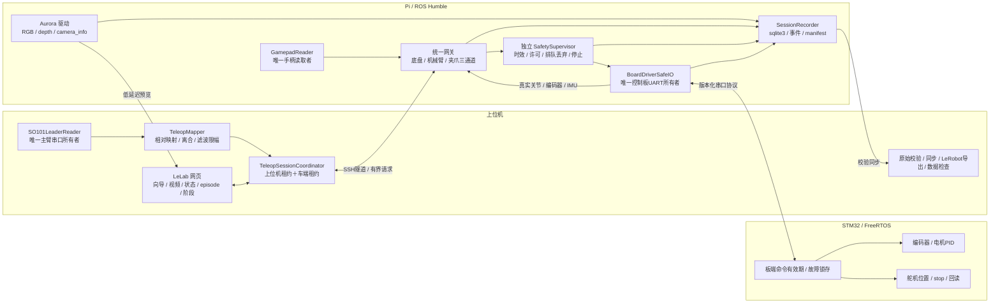

# LanderPi 手柄底盘＋SO101 主臂遥操作与全流程录制设计

日期：2026-11-04（America/Los_Angeles）。性质：基于当前源码的整体设计与实施分解，**不是已实现或实机验收报告**。

## 1. 本轮需求与设计结论

目标是一位操作员在网页观看车载视频，用手柄移动底盘，用上位机 USB 连接的 SO101 主臂控制小车五轴机械臂和夹爪；同一任务中手动改变相机视角进行**观察**，再进行**抓取**，两阶段均留有明确记录。录制在车端原始落盘，上位机校验同步、检查和导出 LeRobot 数据。本轮不包含策略训练、自动导航或自主抓取。

总体采用 **一个会话、两条输入、一个车端执行出口、一个原始录制器**：

- 上位机保留 LeLab/FastAPI/React、本地定制 LeRobot、SO101 主臂读取和相对映射。
- Pi 保留 ROS 2 Humble/Python 3.10、相机与 sqlite3 rosbag2；手柄默认接 Pi，只产生输入意图，不直接发布执行器命令。
- Pi 的统一控制网关组合手柄底盘和 SO101 机械臂命令，独立安全进程把经检查的命令交给唯一控制板驱动。
- STM32 保留轮电机闭环及舵机协议，补齐可验证的通信失联停止、编码器反馈与版本能力报告。
- LeRobot 用作主臂设备/标定及数据集工具；小车通过独立适配器接入，不冒充 SO101Follower，也不套写其 Feetech 标定。

“底盘移动与机械臂动作能共存”属于最终模式能力；实施仍先在底盘锁定时验收机械臂，然后开放底盘单独运动，最后验收联合操作。不会直接放开现有只读 profile 或锁底盘 profile。

## 2. 分析基线与证据等级

| 资产 | 当前依据 | 边界 |
| --- | --- | --- |
| ROS 参考源码 | `/home/liaozhengyan/Desktop/resource/lander_pi`，无独立 Git 根；按现有工作树读取 | 不是正在运行代码的完整性证明 |
| FreeRTOS 参考源码 | `/home/liaozhengyan/Desktop/resource/RosRobotControllerLite_ros_250811`，HEAD `a72a60d331c614b32ef438b6fb89ac86be52c512`，有大量本地差异 | 该 commit 和目录中的 hex 均不能证明车上烧录版本 |
| LeLab 开发副本 | `/home/liaozhengyan/Desktop/lelab/app_ros_mobile`、`ros2_ws/src/lelab_mobile_agent`、本地 `lerobot` | 分支 `codex/ros2-mobile-collection`，含未提交修改；本设计不覆盖这些改动 |
| 原始只读录制 | 2026-11-02 的相机、sqlite3、断隧道本地收尾、哈希同步历史证据 | 不能证明关节/底盘反馈或联合遥操作已验收 |
| 软件排练 | 历史合成反馈和部署版 agent 排练；本线程此前的工具测试和页面模拟网关检查 | 只能证明相应软件路径，不能证明实体反馈和停车 |
| 车端连接 | 本线程曾只读连到 `<private-ip>`，看到 MentorPi、vendor bringup/controller/init_pose，启动参数引用 source 下 servo YAML | 进程、力矩和设备状态会变；执行前重新探查，不把这个快照当实时事实 |

工作区另有 `so101-car-joint1-torque-release-20261104.json` 等新增记录：其内容记载过 1 轴卸力矩、控制板 ROS 节点退出及手动转动。它是已有操作记录，**本设计轮未复测**；文件中关于机械终点的解释也不能代替实体检查。恢复前应重新确认支撑、力矩、关节位置和 UART 所有者，禁止按“系统正常”直接重启 init_pose。

## 3. 两个参考库实际做了什么

### 3.1 ROS：命令、运动学、设备和应用

实际代码链可归纳为：

```text
vendor 手柄 / app / 导航 / 标定脚本
  → controller/cmd_vel 或 cmd_vel
  → odom_publisher_node + mecanum/ackermann
  → 四轮 MotorState(id, rps)
  → ros_robot_controller 单一串口驱动
  → STM32 电机闭环

servo_controller / 动作组 / init_pose
  → 总线舵机位置命令
  → 同一个 ros_robot_controller
  → STM32 转发到舵机

Aurora 相机 → RGB / depth / camera_info → 原始录制与视频预览
```

关键事实和影响：

| 代码事实 | 系统设计含义 |
| --- | --- |
| `bringup.launch.py` 包含 app、手柄、init_pose、controller 和传感器 [R1] | 不能作为无输出连接入口；采集/遥操作使用专用最小 launch |
| 机型由 ROS 的 `MACHINE_TYPE`、构建路径由 `need_compile`、相机由 `DEPTH_CAMERA_TYPE` 选择 | 会话固化生效值及解析后的模块路径，不仅记录配置文件名 |
| 手柄代码直接打开 `/dev/input/js0` 并发布 `controller/cmd_vel`；launch 还起 `joy_node` [R2] | 只保留一个手柄读取者，复用按钮/摇杆映射，移除直达电机的旁路 |
| 麦轮逆运动学在 ROS 把 m/s、rad/s 转成四轮 RPS [R3] | 保留这一个逆运动学入口，MCU 不再重复计算同一组命令 |
| `odom_raw` 用指令速度积分；位置积分未包含 `linear_y` [R4] | 不能拿它标定自身或作为实体底盘实测 state |
| EKF 融合指令积分 odom 与 IMU | 融合结果仍是有来源局限的估计，不能因为叫 filtered odom 就声称来自编码器 |
| 舵机 ID 为 1–5，真夹爪为 `r_joint`/ID 10 [R5] | 机械臂＋夹爪有六个独立控制量；仿真 mimic 关节仅用于模型显示 |
| ServoManager 的位置初始化为 500，在 `set_position` 时更新缓存；`joint_states` 由缓存生成 [R6] | 原厂话题必须标为 `command_cache`，不允许作为跟随对齐和训练 state 的证据 |
| 参考 `FollowJointTrajectory` 实现有 `self.self.joint_names`、未定义/不匹配的 Time/Duration/转换调用等路径 [R7] | 不能仅因 action 名字存在就默认支持可靠流控、取消与保持；实时跟随优先用短时位置设定适配器 |
| 原厂 SDK `bus_servo_read_and_unpack` 无超时且不匹配返回 ID/命令 [R8] | 要在唯一串口驱动内修复，外层 HTTP/ROS 超时不能解除已卡住的驱动回调 |
| 相机模型固定在 `link4` 的 camera_connect 链上 [R9] | 观察姿态由前面若干关节改变；不能假设 joint5 的腕转会转动相机。实物挂载仍须核对 |

ROS 的 `linear/angular` 标定脚本会发运动命令并观察 TF，不是只读向导；角度校准源码还混用 degrees 与按弧度归一化的函数，应先修单位与异常路径，再考虑复用。[R10]

### 3.2 FreeRTOS：设备执行与底层保护

| 代码事实 | 系统设计含义 |
| --- | --- |
| TIM7 约 10 ms 周期读取编码器、估计轮速、更新 PID/PWM [F1] | 可复用轮电机控制闭环，不要求重写电机驱动 |
| MOTOR 分支设置每个电机的 RPS 目标或置零 [F2] | ROS 保持机体速度语义；串口层明确轮序、符号、RPS、有效期 |
| 参考协议未见四轮实际计数/轮速上报 | 需新增反馈报文，不能把电机设定值当轮速 |
| MOTOR 接收路径未见命令断流超时清目标 | Pi/agent 崩溃时不能只靠“上位机停止发包”；必须在板端实现最后一道通信停车 |
| IWDG 被 app 循环刷新 [F3] | 程序 watchdog 不等于控制链失联保护，也不等于硬件急停 |
| 固件存在另套底盘运动学；初始化路径与 ROS 配置并非一个来源 [F3] | 先识别实际使用路径，不因静态 TANKBLACK 或库名就改当前机型/烧录 |
| 总线舵机支持位置写、stop、当前位置、限位与力矩等协议 [F4] | 可实现回读和受控停止，但成功转发不代表舵机到位；stop 是否保持须实机验证 |
| 舵机角度限位是寄存器范围，位置按约定 0–1000 转换 | 修改限位不能产生无限机械行程；SO101 Feetech 与该总线舵机协议不同 |

**1 轴连续旋转不是这版系统的前置条件。** 当前 ROS 模型是有限位 revolute 关节。连续旋转需确认舵机型号、机械止挡、线缆/滑环、编码器多圈能力和位置闭环接口；即使某舵机支持电机模式，速度模式也不等于原来的绝对位置模式。若真要改硬件，应建立新 rig/模型/标定和数据身份，单独验收，不能直接删除限位或把 URDF 改成 continuous。

## 4. 现有 LeLab/LeRobot 可复用点与必须先修的断点

可复用：

- `calibrate.py` 的网页分步、取消、后台线程和主臂 LeRobot 标定产物；保留 connect/configure、写标定、力矩的真实副作用提示。
- `mobile_leader_reader.py` 的独占主臂读取、单位和健康快照；当前只读 reader 不等于标定写入流程。
- `mobile_teleop.py` 的三层原子标定保存、版本/哈希、相对映射及夹爪独立转换；`desktop_follow.py` 的对齐/离合语义作为一致性参考。[L1]
- `hardware_lease.py`、coordinator、状态广播、双层租约回滚、故障与退出收尾。
- 双臂工作台的设备卡片、逐设备标定、绑定记录和多相机命名。复用模式和公共函数，不把“一辆车＋一支主臂”包装成两支 SO101Follower。
- 车端 `SessionRecorder` 的 sqlite3 bag、episode 事件、异常会话保留、READY/manifest，以及上位机暂存→哈希→原子发布和 LeRobot SDK/数据页读回。[L2]

当前不能直接迁到真车的部分：

| 优先级 | 断点与证据 | 要求 |
| --- | --- | --- |
| P0 | hardware teleop profile 接受 `/controller_manager/joint_states`；FeedbackStore 仅看完整和年龄，无法识别它是缓存 [L3] | 新增有真实总线来源证明的状态流及有效标志；来源不明拒绝跟随/训练导出 |
| P0 | `start_car_arm_stack.sh --status` 用收到消息就判 `feedback_is_measured`，且 get-state 使用空请求/假定 `res.id/res.pulse`，与参考服务 `cmd[]/state[]` 不符 [L4] | 修探测接口，空请求不算实测；只有逐 ID 回包证据才能通过 |
| P0 | agent/watchdog 夹爪固定为五个仿真关节，真车夹爪只有 `r_joint` [L5] | HardwareFollowerAdapter 独立控制 r_joint，mimic 仅渲染 |
| P0 | watchdog 底盘输出 `/lelab/base/cmd_vel`，厂商底盘接收 `/controller/cmd_vel` [L5/R3] | 显式硬件路由和单位/轮序适配；保留仿真专用路由 |
| P0 | watchdog `_hold()` 缺关节时用 0；applied 事件早于 action accepted [L5] | 缺状态不发猜测保持位姿，确认事件分级记录 |
| P0 | HTTP 校验的 envelope 在转成裸 JointTrajectory 后丢失 [L5] | session/epoch/seq/source/ttl/标定版本一路传到执行出口，排队目标二次验时 |
| P0 | 现有独占检查主要盯 `/lelab/...request` [L3] | 增加厂商 set_position/set_motor、servo_controller、action、app/init_pose 等真实输出面的仲裁 |
| P1 | 全局 `leader_arm` 模式与 chassis_locked 不允许手柄底盘并发 [L6] | 新建 hybrid manual profile 与按执行器分通道许可，不放松原 profile |
| P1 | 当前硬件导出是六维，九维 fallback 是仿真布局且有 exportability 门禁 [L7] | 新增显式硬件 schema；不复用仿真真值、mimic 或成功标签 |

这些发现不否定既有相机只读验收或合成排练，但意味着“软件排练全绿”不能替代真实硬件适配。此前文档若将这些 topic 直接称为实测反馈，应以本次源码证据修正理解。

## 5. 目标架构与所有权



默认手柄接 Pi：避免把基础输入循环放浏览器，并允许 Wi-Fi 失联时 Pi 独立执行停车。远端观察操作仍要求上位机会话和显示链路有效；Pi 本地手柄不因此获得失联后继续驾驶的例外。将来如要手柄接上位机，可换输入适配器，沿用同一命令与超时契约，不能同时运行两个读取者。

同一串口只由 BoardDriverSafeIO 持有。查询、命令、校准都经该所有者串行化；禁止在 vendor 驱动已占 `/dev/rrc` 时另起 readout/watch/torque 脚本。临时维护必须先停止本任务控制并显式移交所有权。

现有厂商 ROS 输出接口不能只凭 HTTP 租约就成为独占：专用 launch 禁止 app/init_pose/旧 joystick/导航写入；最终串口所有者也检查有效会话许可。拓扑探测用于发现冲突，不能当认证边界；ROS 侧按需要隔离域/命名空间，保留明确的维护 profile。

## 6. 标定资产：四类业务标定＋观察链

每份资产原子保存，带 `schema_version`、内容 SHA256、版本、设备绑定、实际测量来源/日期、单位、有效范围与生效软件/固件指纹。示例值不能通过就绪检查。会话引用**不可变快照**；运行中禁止悄悄换标定。

### 6.1 底盘与底座

“底座标定”同时覆盖两件事：底盘运动学，以及机械臂/相机相对于车体的安装关系。

1. 确认真实机型、四轮安装方向/滚子朝向、轮序与电机 ID，确认 RPS 和编码器符号。先架空进行授权小幅轮序检查，再地面低速验证。
2. 核对每圈计数、减速比、轮径、轴距/轮距与电机饱和范围。编码器 RPS 和机体速度是不同量。
3. 新增轮计数/轮速回报后，从独立距离、横移距离和角度参考测量前进/后退、左右横移、正反转；拟合有效尺度、偏航和交叉耦合，保留原始测量及残差。
4. 编码器＋已标定 IMU 构造 wheel odometry/fused estimate，明确 `base_link` 坐标 x 前、y 左、z 上；不得用原来的指令积分 TF 证明自身精度。
5. 保存底盘载荷、轮胎/地面条件、估计器版本和不确定度；轮速里程计仍受打滑影响，不称为直接测得车体真值。
6. 保存 `T_base_arm` 与 `T_arm_camera`/URDF 版本。纯关节空间遥操作不依赖精确手眼标定才能开始，但相机姿态、后续空间分析和外参导出必须有独立证据。

新资产 `base_calibration/v1`：`wheel_order`、`signs`、`counts_per_wheel_rev`、`wheel_geometry`、`kinematics_version`、`correction_model`、`imu_calibration_ref`、`estimator_source`、`residuals`、`test_conditions`。运动学只在 ROS 一处执行；不能把 m/s 与固件另一套 mm/s 混用，也不能重复应用校正系数。

### 6.2 小车从臂与夹爪

- 五个机械臂关节＋一个实际夹爪执行关节，绑定控制板/串口适配器/舵机 ID 与型号；适配器身份不能单独证明下游舵机未被换过。
- 校准原始位置→物理关节角的方向、参考零位、有效比例和安全软限位。原厂 `240°/1000` 只作待验证的初始模型，不能用作已测结果。
- 受支撑条件下小幅命令并回读、用参考姿态/量具验证，逐关节记录机械干涉与线缆范围；不要求整臂断力矩强行拖动。EEPROM offset/限位属于单独维护写入，普通校准优先保存上层转换。
- 夹爪单独测开/合安全脉冲、方向和可重复性；若需要 mm 宽度，测出函数/查表及误差。没有力传感器时不能声称夹持力已测得。
- `r_joint` 与仿真 `gripper_base_joint`/mimic 的几何对应作为模型适配，绝不增加独立控制维度。

资产扩展现有 `follower` 层，记录 `raw_position`、`q_rad`、反馈来源、soft/hard bounds、stop/hold 能力与验证证据。

### 6.3 上位机 SO101 主臂

复用已有 Web calibration 与本地 LeRobot。按 by-id 确认物理角色、六个电机和已存文件，分步完成中位、活动范围、夹爪 0–100% 标定；显示会写入的内容和力矩状态。标定工作与 reader 互斥，取消会释放串口。

reader 只在标定匹配后输出五关节角与夹爪百分比；缺路、NaN/Inf、超龄即失效。更换主臂、标定哈希改变、重连后重新建立对齐。保留旧双臂工作台和其设备绑定记录，移动系统采用更严格的显式绑定，不能因旧路径缺记录而静默通过。

### 6.4 主从映射与手柄输入标定

主从按关节语义逐项确认方向、比例、映射范围，而不是按 ID 相同来对应。相对跟随为：

```text
q_target = q_follower_measured_at_engage
           + direction × scale × delta(q_leader, q_leader_at_engage)
→ 位置软限位 → 连续滤波 → 速度/加速度限制 → 最终目标
```

主臂连续读数的回绕只对经验证关节使用；从臂始终遵守本身行程/线缆边界。夹爪用百分比→经实测的脉冲/角度关系，接合时同样保证目标连续；百分比不是角度。主从几何不同，不承诺末端轨迹相同。

手柄保存硬件 VID/PID/序列或人工确认身份、axes/buttons 语义、中心/死区/满量程、反向、速度档位、使能按钮和离线检测。对未知手柄拒绝默认套映射；接通时必须中位且使能按钮释放，之后新按下才允许驾驶。键盘作为未来替代输入，不与手柄混合叠加。

按住摇杆不变时仍周期发送带新序号的有效输入，不能只在值变化时发消息。输入超龄或设备断开时清零，不把缓存的按下状态当成新的使能；为控制流配置有限深度、禁止跨会话保留的队列/QoS。

### 6.5 观察链与相机

用户已确认观察是手动调整从臂带动相机。视频标定包括相机身份、内参/畸变、分辨率/fps、曝光配置、挂载链和版本。相机预览与原始录制共享驱动缓存，不另开设备。

视频门禁跟踪源 frame_seq/采样戳和客户端显示存活；反复拿到同一张缓存 JPEG 或 HTTP 200 不算新画面。显示延迟上限与停车阈值在现场验收前确定，不能仅检查浏览器连接是否还在。

观察/抓取使用同一套主从控制器；切换只改任务阶段，不自动切换姿态、不发送回零。需要预置观察姿态时，另设显式确认的低速动作，并纳入同一租约/限位；第一版可直接手动调整，无需新增动作规划。

## 7. 联合遥操作与安全契约

新增独立 profile `hardware_hybrid_manual_v1`，旧 `hardware_readonly_v1` 和锁底盘 `hardware_teleop_v1` 身份保持。

全局只有一个会话 owner，内部为三个通道：

| 通道 | 输入来源 | 独立状态 |
| --- | --- | --- |
| base | 已绑定手柄 | locked / ready / enabled / stopped / fault |
| arm | 已标定 SO101 相对目标 | disconnected → calibrated → preview → aligned → armed → following；paused/fault/estop |
| gripper | 主臂夹爪 | 与 arm 同一会话、独立映射和限幅；按压/负载风险停止策略单独定义 |

手柄底盘与主臂可以同时提供意图，但网关按各通道授权；不靠来回切换全局 `keyboard`/`leader_arm` 模式实现并发。标定、维护、桌面 SO101 遥操作、策略控制与该会话仍互斥。录制为会话子任务，不抢第二把硬件租约。

第一版操作策略：驾驶时机械臂在已验证的运输/观察包络；抓取阶段默认底盘锁定并确认估计速度接近零。后续只有在载荷、稳定性、制动距离和视野验收后才放开移动中调臂；软件允许并发不代表所有姿态下都安全。视频盲区和抓物状态不由 URDF 碰撞模型自动解决。

每条控制意图的概念契约：

```json
{
  "protocol_version": 1,
  "session_id": "opaque-session-id",
  "session_epoch": "new-on-reacquire-or-restart",
  "channel": "arm",
  "source": "so101_leader",
  "seq": 123,
  "sample_seq": 456,
  "ttl_ms": 150,
  "calibration_bundle_hash": "sha256:...",
  "clutch": "engaged",
  "target": {"joint_names": ["joint1", "joint2", "joint3", "joint4", "joint5"], "positions_rad": []}
}
```

以上只是字段示例，空 positions 不能下发。`seq` 必须按 `(session_epoch, channel, source)` 单调，避免底盘与机械臂的并发包因一条全局序号而互相误杀；另用全局事件序号排序审计。

TTL 在接收方单调时钟执行。入队时记录本地 deadline，出队和驱动实际下发前再次检查；各层转发不能重置整个 TTL。跨主机旧包需依靠有效期、同步不确定度上界和短期限发送许可/挑战来拒绝；仅“接收后再活 150 ms”不能识别在隧道内滞留数秒的包。新 MCU 协议使用板端 tick、boot_id 和会话 epoch，扩展需能力协商；旧包没有事务 ID，不能伪造这种匹配能力。

故障语义：

| 情况 | 必须发生 | 恢复 |
| --- | --- | --- |
| 松开驾驶使能/手柄掉线 | Pi 发底盘零目标，MCU 超时兜底；机械臂按通道策略暂停/保持 | 手柄中位＋新的按下 |
| 主臂拔线/读数无效 | arm/gripper 退出跟随、清目标；联合操作默认也停底盘 | 重连、反馈有效、重新对齐与接合 |
| 视频过期或上位机失联 | 人在远程观察的 manual 会话停止运动；本地手柄不能继续盲驾 | 页面/链路恢复后人工重新使能 |
| agent 或安全进程崩溃 | 独立监督与板端命令超时分别兜底 | 新会话 epoch，不恢复旧队列 |
| 整个 Pi 断电/串口断开 | MCU 依靠自己的最后有效命令时限停车；臂执行已验证 stop/hold | 板卡状态和反馈复核后重新获取 |
| 急停 | 先停车/停止臂动作并锁存，再尽力保存；不等编码/同步 | 清锁存不自动使能、不回零 |
| 反馈过期/某关节缺失 | 不生成零位保持目标；执行已验证的停止策略，报告状态未知 | 必须重新取得真实状态 |

机械臂“保持”分为停止轨迹、发送舵机 stop、维持力矩等不同能力，逐项实测选定。不可整臂卸力矩当通用停止，也不能以“最后命令没变”证明已经停住。硬件急停是否独立切断驱动、是否影响抓物和承重，需现场验证；软件停包和 MCU watchdog 不能替代独立回路。

## 8. 真实反馈与最小固件扩展

### 8.1 机械臂回读

在唯一控制板驱动中实现一个有界事务队列，优先级为停止/故障 > 实时命令 > 位置回读 > 低频诊断。按舵机 ID 串行读当前位置，校验长度、校验和、ID、子命令、成功状态；超时后的迟到同 ID/同命令回包尤其不能仅靠“新 generation”区分。须排空、隔离等待并验证最大迟到边界，或升级板协议增加事务标识。

新状态流建议 `/lelab/hardware/arm_state`：每关节有原始位置、转换角、sample_seq、source_kind=`servo_position_readback`、设备 ID、采样/接收时间、age、valid、错误和标定哈希；必要时另发布带正确语义的 JointState 供显示。缓存目标另外命名为 commanded state，绝不覆盖真实反馈。

六关节是一轮扫描而非天然同步。记录每个读取时间和扫描跨度，以最老关节年龄作门禁。主臂/从臂/控制频率独立配置；先测总线吞吐和最坏延迟再确定值，不因原厂 50 Hz 发布缓存就声称六路回读有 50 Hz。

实测值不能先夹到 0–1000 或软限位再对外宣称正常。超出标称范围的 raw 值保留原样并标记诊断/有效性，阻断未经解释的使能，避免把编码器异常、机械超程或转换错误藏在裁剪后数值中。

### 8.2 底盘与 MCU

最小固件增量：

- 新能力查询/构建 ID、boot_id；保存实际 hex 校验和及烧录证据。当前源码 HEAD 和已有 hex 不能互相代替。
- 周期四轮累计计数、实际 RPS、目标 RPS、板端采样 tick、故障标志。计数/周期快照要一致，处理溢出，不在高优先级电机中断里阻塞串口。
- 有效电机命令时间戳、有限 TTL、超时置零与锁存/重新使能语义；只允许合法 ID、数量、有限速度，校验帧长度再访问数组。
- 把 ROS/Pi 消失与 IWDG 区分；必要的舵机 stop/心跳保护按能力和负载验证后加入。
- 保留原有轮电机 PID；初期只补反馈和安全，不同时迁移整套运动学和调 PID，避免故障来源扩大。

没有可重复构建、烧录/回读和回退条件时，先完成无输出与原始录制；**不以 Pi watchdog 通过来宣布整机断电停车已完成**。

## 9. 录制、阶段标记和数据定义

### 9.1 会话与 episode

一个 session 对应固定 rig、profile、时钟、标定 bundle、版本与录制配置，可包含多段 episode。每个 episode 可有人工阶段：`drive`、`observe`、`grasp`、`transport`、`release`，至少支持已确认的 observe/grasp。阶段按车端时间轴写 `phase_started/phase_ended` 事件，切换无运动副作用，不自动保存新集。

默认流程：开始 session → 开始 episode → 手柄驶近 → 停车 → 标记 observe 并用主臂调视角 → 标记 grasp 并完成抓取 → 结束本集 → 停止 session → 校验同步 → 数据检查/导出。第二集必须重新显式使能；可以分别导出阶段窗口，也可保留跨阶段完整任务。跨切片保存 `parent_session/episode`、原时间区间和边界，不能悄悄拼接成新时间线。

结束本集先暂停全部运动，再收尾事件；结束 session 才收尾持续 bag。急停优先控制；原始录制器故障时停止本次示教并报告，坏 session 保留且不发布 READY。观察和抓取成功均由人工标注 `success/failure/unknown`，不使用 Gazebo 真值。

### 9.2 车端原始记录

保持已验证的 sqlite3，记录：

- 相机 RGB、可用 depth、camera_info、曝光和 frame_id；原始 bag 是采样依据，预览 JPEG 不是数据源。
- 主臂原始/标定读数、采样时间、映射前目标、所有限幅/滤波后的最终目标。
- 手柄原始 axes/buttons、映射速度意图、死区/使能状态与下发四轮命令。
- 网关接受/拒绝、排队/驱动下发、板端接收和控制器回执；没有对应 ACK 时保留 unavailable。
- 舵机真实回读、轮计数/轮速、IMU、估计的底盘速度/位姿和协方差、来源与年龄。
- 两端租约、离合、急停/故障/恢复、标定版本、episode/phase、人工结果。

确认分级至少包括 `requested → gateway_accepted → driver_sent → controller_acknowledged → execution_observed`。串口 write 成功或 action accepted 均不等于机械执行成功；到位/误差可由真实反馈观察，但不能推断没有传感器的接触力。

### 9.3 六维与九维 schema

| schema | action | observation.state | 条件 |
| --- | --- | --- | --- |
| 旧只读 session | 无控制 action | 原传感器 | 原身份保持，继续禁止训练导出 |
| `arm_gripper_6dof_phase1` | 五关节最终位置目标＋r_joint目标，rad | 六路真实关节角 | 底盘锁定；不补底盘列 |
| 新 `mobile_hybrid_manual_9d_v1` | `[base_vx_cmd, base_vy_cmd, base_wz_cmd, q1_target..q5_target, r_target]` | `[base_vx_est, base_vy_est, base_wz_est, q1_measured..q5_measured, r_measured]` | 底盘有已验证的编码器/融合估计，逐字段来源与有效性齐备 |

state 的底盘前三维是明确标注的估计；`base_pose(x,y,yaw)`、原始四轮速度、IMU 和主臂读数作为其他观测/诊断特征保存，不混入 action 冒充反馈。全向底盘若最终不是麦轮，维度/动作定义另立 schema，不能机械补零维持九维。

离合释放时 action 不能从主臂读数推得：若控制器仍保持一个已确认的有效位置目标，可记录该目标及 hold 标志；没有有效目标的时间段，raw 标无效，导出拒绝该窗口或按显式规则切片，不能补零或无限延续过期命令。底盘零速度只有实际发出了有效零目标才能记为零 action；有零 action 不意味着 measured state 已停止。

LeRobot 数值向量不能靠 NaN/零掩盖缺失。原始数据保留完整，导出只接受有有效来源与对齐证据的窗口，报告拒绝原因、缺失比例和裁剪区间；有效估计须独立声明 estimator 版本、误差与适用条件。保留观测与 action 时间对应关系：state/图像截止于决策参考时刻，action 为随后生效目标，报告端到端延迟，避免取未来状态作当前输入。

### 9.4 时间、带宽与文件保护

TTL 只使用所在设备单调时钟；跨主机时间对齐使用同步的系统时钟＋记录偏差/不确定度，单调时钟不能直接跨主机比较。相机驱动戳、Pi 收到帧、主臂采样、发送/接收/实际串口下发各保留；重启或 NTP 跳变可造成新的 clock epoch，不跨 epoch 偷做插值。

20 Hz 可作为首轮控制/导出评估候选，但不是已验证速率。按六路回读扫描、相机约 15 fps 和网络实测决定控制、采样和导出频率；不要为了统一 fps 静默重采样原始 bag。网格对齐策略和最大 age/skew 在 export report 明示，不跨 episode/phase 边界插值。

640×400 BGR8、约 15 fps 的未压缩 RGB 单流约 **11.5 MB/s、0.69 GB/min**，不含 depth；这是容量预算，不是本轮写盘实测。开录前检查实际 free space/带宽，限制最大录制长度和磁盘安全余量；不要在遥操作时通过隧道传整个 bag。

继续使用 staging、大小/SHA256 校验、原子发布、READY、重复同步核验及已导出目录写保护。相机/标定不同的会话合并需显式兼容检查。旧数据和 invalid session 均保留。

## 10. 网页流程

在 `/ros-mobile` 延伸现有面板，不新做独立遥控网站：

1. **设备与能力**：车/板/固件/舵机/手柄/主臂/相机、真实模块路径、UART owner、当前输出进程、反馈来源；默认无输出。
2. **标定中心**：底盘、从臂、SO101 主臂、主从映射/手柄、相机与安装关系；每步保存版本、显示缺项、可取消。
3. **预览与对齐**：主臂六路、映射目标、真实从臂、限幅、跟随误差、手柄意图、底盘估计；预览不发执行器命令。
4. **遥操作**：驾驶使能、机械臂离合、底盘锁定、观察/抓取阶段按钮、相机、反馈年龄、控制权、急停。主要按钮可映射手柄，但与网页调用同一 API。
5. **录制**：开始会话/本集、observe/grasp 切换、暂停全部运动、结束本集、人工标注、停止会话；急停在任何保存过程中可用。
6. **检查**：按 episode/phase 查看视频、动作/state、命令确认级别、反馈缺失/时钟/限幅；同步与导出独立，长任务可取消。

错误应保持到用户确认或明确恢复事件，不能被状态轮询清掉。显示“源无效/数据过期/控制板未知”，不用目标缓存画成“机械到位”。生产构建产物按现有发布方式重建，不能只更新 TSX 后声称已部署。

## 11. 实施顺序与验收门槛

| 阶段 | 工作 | 完成判据 |
| --- | --- | --- |
| P0：重新建立可信基线 | 精确运行版本、设备身份、UART单属主；修 SDK 查询、反馈来源及 probe 的误判；设计最小启动 | 缓存不能通过 measured 门禁；空/错帧/超时明确失败；无 init_pose 副作用 |
| P1：从臂真实状态＋主臂 | driver 内六路回读、独立从臂校准、SO101向导/绑定、映射/无输出预览 | 对齐使用从臂实测；预览输出计数不增长；单路缺失阻断 |
| P2：锁底盘机械臂操作与录制 | 低速小幅、夹爪、离合、observe/grasp阶段、两个短集 | 防跳变、结束先停、六维导出/SDK/网页按阶段读回；真故障恢复不接合 |
| P3：底盘反馈与板端安全 | 编码器报文、MCU失联停车、外部参考底盘标定、手柄独立测试 | 正/横移/旋转方向尺度可测；Pi/串口失效实际停车，编码器估计有残差证据 |
| P4：联合控制 | hybrid profile、两输入按通道许可、运输/观察包络、抓取默认锁底盘 | 手柄与主臂共存且只一个执行出口；所有旁路被拒绝；双输入故障停稳 |
| P5：全流程数据验收 | 驶近→观察→抓取两段短episode；九维导出、阶段切片、读回 | action/state来源明确、无假底盘0、两阶段时间和视频对应；旧只读导出仍拒绝 |

每阶段先测试纯函数/协议与无输出，再在明确现场条件下逐项实测。故障矩阵至少有：拔主臂、拔手柄、Wi-Fi断/半开、丢包/延迟、租约过期、agent/safety/driver被杀、Pi掉电、某舵机不答、相机过期、录制磁盘不足。记录检测/停止时间、最后有效指令、残余位移与恢复状态；仿真通过不能替代实体停车。

本设计不规定拍脑袋的验收误差。实施前按允许工作区、载荷、制动距离、测量精度确定各阈值；在 manifest/runbook 固化，不能测试后临时放宽使其通过。

## 12. 计划修改范围与回退

| 位置 | 计划工作 |
| --- | --- |
| `app_ros_mobile/lelab/mobile_*`、`hardware_lease.py` | 扩展协调器/标定能力，保持兼容；新增底盘与手柄资产，不复制两套会话 |
| `app_ros_mobile/frontend/src/...` | 扩展现有向导、驾驶使能、观察/抓取事件、诊断与数据检查 |
| `ros2_ws/src/lelab_mobile_agent` | 新硬件 adapter/安全契约/分通道许可、可靠反馈、硬件录制与导出身份 |
| vendor ROS overlay | 在唯一串口所有者中修查询并提供安全 command/feedback API；最小 launch 和命令缓存分离 |
| 独立固件工作副本 | 编码器上报、命令时效/能力版本/合法输入检查；保留原始 source/hex |
| `tools/ros2_collection` 与配置 | 修错误探针、部署运行版本校验，新增 hybrid profile、能力探测/回退工具 |
| `lerobot` | 优先复用当前版本，不先改原生机器人基类或替换本地定制；仅当正式需要 Robot adapter 时按真实身份扩展 |

参考 ROS 与固件库保留为来源。实现采用明确工作副本/overlay，不在含大量未提交差异的参考树上直接打补丁，更不把未知 hex 烧到车上。部署先 preview、精确记录本任务 PID/进程组/模块解析路径和 hash；回退只停止本任务并恢复兼容代码/配置，不清空所有 ROS 进程，不删除 sessions/校准/invalid 数据。

## 13. 还需要的现场探查

整体设计已能由源码得出；下列项目是实施前需要逐项补齐的证据，**本设计轮不自动启动或停止车端节点**：

1. 现有节点、实际 Python 导入路径/安装映射、参数、ROS_DOMAIN/RMW、串口占用、所有执行器 topic/action/service 的来源；确认最近节点退出和 1 轴力矩状态的恢复方式。
2. 真车型号、轮序/方向、实际 MCU/电机/舵机型号和固件能力；握手无法读固件版本时必须记录未知并用可回退的重建验证解决。
3. 六个舵机 ID、真实位置、限位寄存器/力矩/温度/供电与实际机械行程，尤其 1 轴的机械止挡和线缆范围；维护读取也必须经唯一串口所有者。
4. 手柄实际接在哪台主机、USB 身份和按钮/轴布局，急停/使能的实际接线及有效性。默认选择 Pi，若现有硬件接在上位机则按实际接入调整 reader。
5. 相机实物挂载、TF 与镜头视野、帧率/延迟/原始写盘负载；观察/抓取阶段录像是否确实能看清操作。
6. 电机命令停止、servo stop、保持/断电实际行为与最坏停止时间；先有现场支撑/急停/低速工作区，再执行有输出测试。

未来执行前只问与当步有关的现场条件，不把整份清单变成一次性的审批门槛。先前低速授权保留为会话背景，但新固件、1轴状态和系统重建后的安全能力要按实际变化重新验证。

## 14. 源码索引

以下行号对应本轮读取的工作树；实现前若源码变化应重新定位。

- [R1：整车 bringup](/home/liaozhengyan/Desktop/resource/lander_pi/src/bringup/launch/bringup.launch.py:10)
- [R2：手柄读取与直接发布](/home/liaozhengyan/Desktop/resource/lander_pi/src/peripherals/peripherals/joystick_control.py:39)
- [R3：ROS 麦轮运动学](/home/liaozhengyan/Desktop/resource/lander_pi/src/driver/controller/controller/mecanum.py:25)
- [R4：指令积分 odom](/home/liaozhengyan/Desktop/resource/lander_pi/src/driver/controller/controller/odom_publisher_node.py:292)
- [R5：真车舵机配置](/home/liaozhengyan/Desktop/resource/lander_pi/src/driver/servo_controller/config/servo_controller.yaml:3)
- [R6：指令缓存](/home/liaozhengyan/Desktop/resource/lander_pi/src/driver/servo_controller/servo_controller/servo_controller.py:10)，[缓存发布为 joint_states](/home/liaozhengyan/Desktop/resource/lander_pi/src/driver/servo_controller/servo_controller/controller_manager.py:98)
- [R7：参考轨迹 action](/home/liaozhengyan/Desktop/resource/lander_pi/src/driver/servo_controller/servo_controller/joint_trajectory_action_controller.py:47)
- [R8：无界 SDK 查询](/home/liaozhengyan/Desktop/resource/lander_pi/src/driver/ros_robot_controller/ros_robot_controller/ros_robot_controller_sdk.py:477)
- [R9：link4 相机挂载](/home/liaozhengyan/Desktop/resource/lander_pi/src/simulations/landerpi_description/urdf/arm.urdf.xacro:254)
- [R10：角度标定](/home/liaozhengyan/Desktop/resource/lander_pi/src/calibration/calibration/calibrate_angular.py:91)
- [F1：编码器/PID 周期](/home/liaozhengyan/Desktop/resource/RosRobotControllerLite_ros_250811/Core/Src/stm32f4xx_it.c:419)
- [F2：MCU 电机命令](/home/liaozhengyan/Desktop/resource/RosRobotControllerLite_ros_250811/Hiwonder/System/packet_handle.c:397)
- [F3：app 初始化/IWDG](/home/liaozhengyan/Desktop/resource/RosRobotControllerLite_ros_250811/Hiwonder/System/app.c:46)
- [F4：舵机转发/stop/位置回读](/home/liaozhengyan/Desktop/resource/RosRobotControllerLite_ros_250811/Hiwonder/System/packet_handle.c:192)
- [L1：三层标定与相对映射](/home/liaozhengyan/Desktop/lelab/app_ros_mobile/lelab/mobile_teleop.py:53)
- [L2：原始录制收尾](/home/liaozhengyan/Desktop/lelab/ros2_ws/src/lelab_mobile_agent/lelab_mobile_agent/recorder.py:331)
- [L3：FeedbackStore](/home/liaozhengyan/Desktop/lelab/ros2_ws/src/lelab_mobile_agent/lelab_mobile_agent/follower_feedback.py:29)，[agent 输入来源](/home/liaozhengyan/Desktop/lelab/ros2_ws/src/lelab_mobile_agent/lelab_mobile_agent/agent.py:504)
- [L4：当前反馈探针](/home/liaozhengyan/Desktop/lelab/tools/ros2_collection/start_car_arm_stack.sh:267)
- [L5：仿真 watchdog](/home/liaozhengyan/Desktop/lelab/ros2_ws/src/lelab_mobile_agent/lelab_mobile_agent/watchdog.py:18)，[消息转换](/home/liaozhengyan/Desktop/lelab/ros2_ws/src/lelab_mobile_agent/lelab_mobile_agent/agent.py:957)
- [L6：单模式协调器](/home/liaozhengyan/Desktop/lelab/app_ros_mobile/lelab/mobile_teleop_coordinator.py:114)
- [L7：导出 schema 与门禁](/home/liaozhengyan/Desktop/lelab/app_ros_mobile/lelab/ros_mobile.py:1105)

关键源码指纹（当前文件，不是实机运行/烧录证据）：

```text
ROS servo_controller.py  709e42977ea8c98b0e31a4f58f89f5fdf2e2e83a35589eef1e37a39e2e7c84a4
ROS odom_publisher_node.py  5c68f11aa7a4e629c004a598833a928d48ba84810279d87efaa717c768d9e761
ROS ros_robot_controller_sdk.py  f7c1584b5b1f393041bd86c16c68310d38969c15bf8dfd1f92df10373a6cc504
MCU packet_handle.c  a3bdf756ebf42f11110dc51e7cec4a2875fde4986e0060d9ec1b7bc6b84164b9
MCU encoder_motor.c  6b826659b2e351a3a7da3de6040ffb288b146bd14cdd551788fa482aba1aada1
MCU serial_servo.c  3269bcdbbd9d82371b0f8fdd7a8758c63bb6034c4e6295499846315ae0be195f
existing hex  31c31d48db766c2bcecf545de1776c76247864780b681aa7caa40e12c1127f7b
```
