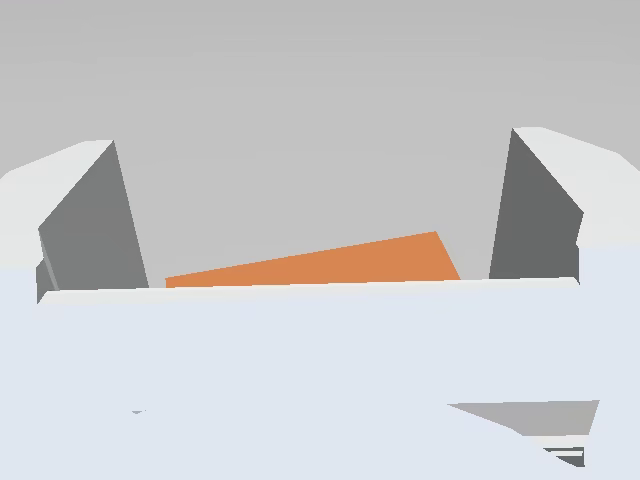
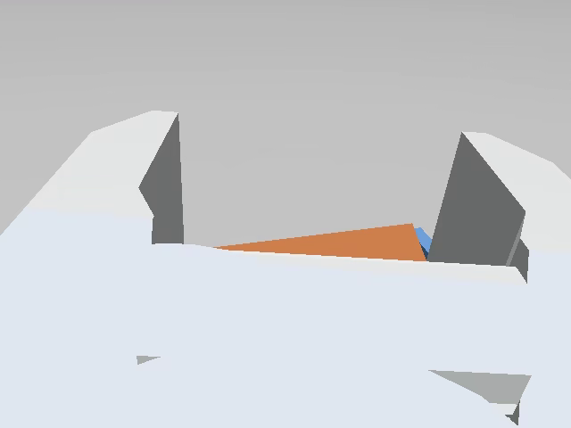
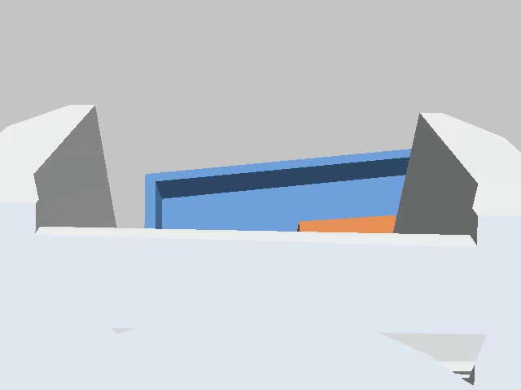

# 2026-10-31 ROS 移动操作仿真采集闭环验收报告

状态：**仿真闭环已跑通并有物理成功、原始 session、哈希同步、LeRobot 导出、SDK/网页读回和关键故障证据；尚未判定整个 Goal 完成。** 未完成项在第 8 节明确列出，主要包括底盘真实麦轮接触力学、时间 reset 分段、完整租约/控制连接 UI 流程和树莓派/真实硬件。

## 1. 本轮实际结果

> 网页/HTTP 控制 → ROS 控制网关 → Gazebo Harmonic 执行 → ROS 状态与腕部 RGB-D/激光/接触反馈 → 网页显示 → episode 原始 MCAP + 事件 → HTTP 暂存/哈希同步 → 10 Hz 对齐 → LeRobot v3.0 导出 → 本地 SDK 与网页视频/曲线读回。

一次完整成功尝试（`ros_20261031T140351Z_14a78c2b`，第二次专家运行）：

- 方块初始 `[0.2587, -0.0663, 0.0200]` m；最终 `[0.2729, 0.0630, 0.0230]` m，位于容器内；
- 最大抬升 0.0486 m，相对初始抬升 0.0286 m；
- 夹爪三路 contact sensor 记录 13,071 个事件；`success=true`；
- 该 session 同时保留第一次失败尝试（`saved, success=false`，原因 insufficient_lift/not_inside_container），原始审计没有删除失败。
- 该 session 的腕部相机在侧向抓取时能看到夹爪与方块（下图帧来自导出的 MP4）：
  - 
  - 
  - 
  - 

## 2. 环境与来源

| 项 | 实际值 |
| --- | --- |
| 主机 | Ubuntu 24.04.4 LTS，x86_64，AMD Radeon 集显，X11 :0 |
| ROS | ROS 2 Jazzy（conda/RoboStack，用户空间，无 sudo） |
| Gazebo | 8.10.0；`gz_ros2_control` 1.2.20；`ros_gz_bridge` 1.0.24 |
| Python | ROS 环境 3.12.16；LeLab 环境 CPU torch 2.11.0+cpu |
| LeRobot | 本地 `lerobot` 0.6.2（editable），非 PyPI |
| 版本锁 | `work/ros2_collection/envs/ros_jazzy/package-lock.txt` |
| 发布快照 | `releases/sanitized-20261024-01` 未被修改；开发在 `codex/ros2-mobile-collection` |

原始参考：`resource/uavociety` 的 `landerpi_description`/`robot_gazebo`（几何与惯性），`resource/lander_pi`（串口/控制接口），mobileCar 只读参考（link4 相机/专家格式）。模型资产来源和改动记录在 `ros2_ws/src/lelab_mobile_description/SOURCES.md`；参考源没有许可文件，按项目内部研究适配记录，未复制第三方代码。

新增源码：

- `ros2_ws/src/lelab_mobile_description`：四轮、五轴、夹爪、link4 RGB-D、激光、IMU、接触、ros2_control、RViz、四元数相机俯仰 child frame。
- `ros2_ws/src/lelab_mobile_sim`：世界/方块/浅口容器、bridge、spawn 后处理（轮摩擦方向、接触、关节显式驱动）、launch、RViz。
- `ros2_ws/src/lelab_mobile_agent`：contract/kinematics、agent HTTP、watchdog、recorder、scripted expert。
- `app_ros_mobile/lelab/ros_mobile.py`：租约接入、代理、JPEG/MJPEG、同步校验、MCAP 解码、对齐、LeRobot 导出。
- `app_ros_mobile/frontend/src/pages/RosMobile.tsx`：ROS 小车页面；`DatasetViewer` 直接读回。
- `configs/ros2_collection/runtime-profile-v1.json`：state/action 9 维、单位、主题、TTL、对齐规则。

## 3. 控制、数据与安全实现

- 唯一控制权：LeLab `recording` 租约 + agent control token；键盘、scripted expert、未来 leader arm 通过同一 HTTP 网关；agent 校验 session/seq/source/mode/限幅/TTL。
- 独立 watchdog：0.6 s 心跳、0.3 s 底盘 TTL、急停锁存、轨迹取消/保持、bridge 退出时 odom 过期检测并用 `gz topic` 直接零速；所有 TTL 使用墙上单调时钟。
- 手臂/夹爪：`gz_ros2_control` 位置控制器；五个夹爪关节显式按倍率驱动（绕开会被 Gazebo 固定的 URDF mimic 约束）；三个指爪/夹爪 contact sensor 作为接触证据。
- 相机：link4→camera_connect→depth_cam 原挂载；RGB 640×480/rgb8/约 14–15 Hz，深度 640×480/32FC1 米制/约 15 Hz，RGB camera_info；光学 frame `wrist_camera_optical_frame`；额外虚拟 0.55 rad 俯仰 child frame 用于观察工作区，不改变 link/joint 挂载。
- 录制：一个 session 一条 rosbag2/MCAP，episode 是逻辑边界 + `events.jsonl` + 每集 JSON；session 停止后写 manifest/READY；失败/弃用保留原件。
- 同步：上位机通过 HTTP 拉取 `.tar.gz`，按 manifest 的 size/sha256 逐文件校验，暂存后原子发布到 `upper/sessions`；哈希不符拒绝发布。
- 导出：只选 `saved && success` 的 episode（可显式 include_failed）；10 Hz，严格使用帧时刻之前最新图像/关节/odom，图像最大 0.20 s、state/odom 0.10 s；动作来自网关 applied target 的零阶保持；图像、state、action、task 一致；先 SDK 验证再发布。
- 网页：控制权/模式、键盘 W/S/A/D/Q/E、腕部 JPEG 预览、关节/底盘/任务状态、手动关节/夹爪、session/episode/弃用/停止、专家运行/中止、e-stop/清除、同步/导出、错误显示；DatasetViewer 视频 + 9 维 state/action 曲线。

## 4. Session 与数据集证据

| session | 尝试 | 结果 | 说明 |
| --- | --- | --- | --- |
| `ros_20261031T133217Z_7b7ae3fc` | 1 | success | 首条完整成功；导出 204 帧；侧向相机（未加俯仰） |
| `ros_20261031T134406Z_97f7e108` | 3 | discarded/discarded/saved failed | 连续尝试：手动弃用、专家中断、底盘未复位导致失败；用于边界审计 |
| `ros_20261031T135940Z_682218dc` | 1 | discarded | 完全通过网页开始 session→开始回合→弃用重录→停止 session |
| `ros_20261031T140351Z_14a78c2b` | 2 | saved failed + saved success | 最终演示；首次失败、第二次成功；2.8 GB MCAP；上机同步；导出 187 帧；相机俯视 |

- 规范导出（侧视）：`work/ros2_collection/lerobot/lelab/ros-mobile-20261031t133217z-7b7ae3fc`，204 帧，1 集，SDK 读回通过。
- 最终导出（俯视）：`work/ros2_collection/lerobot/lelab/ros-mobile-20261031t140351z-14a78c2b`，187 帧，1 集，SDK 读回通过；报告 `docs/evidence/ros2-new-camera-export-report.json`。
- `LeRobotDataset` 读回：episodes=1，frames=187，fps=10，`observation.images.wrist_rgb` `[3,480,640]`，`observation.state`/`action` `[9]`；视频 `videos/observation.images.wrist_rgb/chunk-000/file-000.mp4`。
- LeLab DatasetViewer 浏览器实测：下拉显示 `lelab/ros-mobile-20261031t140351z-14a78c2b · 1 集`；1 集/187 帧/10 fps；视频 `readyState=4`、duration=18.7 s、无 error；21 个曲线 SVG、state[0..8]/action[0..8]。
- 原始与上机 session 的 manifest、哈希和路径见 `docs/evidence/ros2-new-camera-session-manifest.json`；源 session 仍保留在车端目录。

## 5. 故障与安全实测

所有结果 JSON 位于 `docs/evidence/`：

| 测试 | 证据 | 结果 |
| --- | --- | --- |
| 急停 | `ros2-fault-estop-agentkill-20261031.json` | 运动中 e-stop 后位姿立即冻结；agent `mode=idle`、`estop_latched=true`、watchdog `estop=true` |
| 杀 agent | 同上 | 杀 agent 后 2.2 s 世界位移约 0.55 mm；watchdog 心跳丢失零速/保持 |
| 杀 ros_gz_bridge | `ros2-bridge-exit-20261031.json` | 断桥后 2.5 s 世界位移约 0.45 mm；watchdog 用 odom 过期兜底直接写 Gazebo 零速 |
| 暂停/恢复 | `ros2-pause-resume-20261031.json` | 暂停时位姿冻结；恢复后未重放旧速度（恢复前后位姿相同） |
| 同步篡改 | `ros2-sync-tamper-20261031.json` | 同尺寸改一字节后 expected/actual sha256 不同，校验器拒绝 |
| 回归 | `tools/ros2_collection` + `app_ros_mobile` | 预检 15/15 通过；LeLab 63 项通过（租约/API/路由） |

说明：篡改测试验证的是同步校验器对同尺寸内容篡改的拒绝（不是对网络传输注入的端到端测试）；e-stop/暂停/断桥/杀 agent 均是本机仿真进程级故障注入，不代表真实 Wi-Fi/树莓派/急停距离。

## 6. 已知限制（未完成 Goal 的原因）

1. **任务布局与底盘接近**：容器为 2 cm 壁高的浅口托盘（适配五轴/夹爪可达高度，不是高边框箱）；方块初始已位于臂展内，专家没有单独做“底盘前向靠近方块”的段，底盘主要在抓取后的 13 cm 横移搬运中体现移动操作。底盘前向接近和更高容器留给下一轮。
2. **底盘接触模型不是经证实的麦轮物理**：四球轮在 4 cm 轮径下轮地法向负载不稳定，纯接触麦轮出现固定对角漂移；当前用 Gazebo 平面 `VelocityControl` 执行三自由度，保留 `MecanumDrive` 的轮关节/里程计。世界位姿方向正确、专家闭环可完成，但不能声称已经完成真实麦轮打滑/滚子接触验证；`state` 底盘速度来自轮里程计，可能与世界速度不一致。
3. `/joint_states` 约 1 kHz，尚无录制前节流；2.8 GB 双集 session 的同步/导出耗时长（独立导出成功，但网页后端导出线程曾被 GIL/大任务拖住，通过重启后端恢复）。这是下一步最先修的工程项。
4. Gazebo 时间 reset 的 episode 自动分段未实现；暂停/恢复已测，但 reset 未测。
5. LeLab 租约到期/控制连接断开的完整 UI 流程未做端到端验证；agent 控制 token 有 30 s TTL，watchdog 有独立心跳/停车，已测 agent 进程死亡。
6. 导出任务不可取消，HTTP 篡改传输不是端到端测试；IMU 页面仍无数据；深度 camera_info 未单独发布；没有深度/激光进入训练特征。
7. 未连接树莓派、真实舵机/相机/串口/底盘，未烧录 FreeRTOS，未做 MoveIt、策略训练/自主推理、性能/延迟和无线测试。
8. 专家为 `scripted_expert`，使用方块/容器真值做规划/评估，不是真人示教；相机为观察工作区增加虚拟俯仰 frame，不是原厂实物朝向验证。
9. CPU-only LeLab 环境是当前 AMD 主机上的可运行方案；它不是 GPU 训练环境的替代，完整 CUDA lock/树莓派跨发行版未验证。

## 7. 重跑入口

```bash
cd /home/liaozhengyan/Desktop/lelab
source work/ros2_collection/envs/ros_jazzy/setup.bash
cd ros2_ws && source install/setup.bash
ros2 launch lelab_mobile_sim sim.launch.py gui:=false rviz:=false agent:=true
# 另一个终端：LeLab 后端
cd ../app_ros_mobile
HF_LEROBOT_HOME=../work/ros2_collection/lerobot \
LELAB_ROS_COLLECTION_ROOT=../work/ros2_collection \
LELAB_ROS_AGENT_URL=http://127.0.0.1:8110 .venv/bin/lelab
```

浏览器：`http://127.0.0.1:8000/ros-mobile` 和 `/dataset-viewer`。完整启动/停止/环境重建见[运行手册](../ros2-collection-runbook.md)。

## 8. 树莓派/硬件移植清单（下一阶段，不含本次结论）

- 把 `lelab_mobile_agent` 的控制网关、recorder 和 watchdog 作为车端服务独立运行；车端地址、ROS domain、topic、存储根、时钟、设备映射全部配置化；agent 只绑定回环，通过既有 SSH 隧道/鉴权访问。
- 真实关节/轮速/IMU 反馈必须来自设备；现有 LanderPi `servo_controller` 的 joint_states 是发送缓存，需要有限超时的实测轮询和响应 ID 匹配；底盘编码器速度上报与板端 watchdog 另行验证。
- 主臂输入适配器：确定型号、标定、零位、方向、夹爪宽度映射；在此前不得伪造主臂连接。
- 相机：确认真实 ASCAMERA/深度流、相机内参/外参、光学 frame、时间戳和 QoS；保留深度/激光原始数据。
- 车端本地存储与上位机同步沿用本次 manifest/哈希/READY 协议；真实 Wi-Fi 下测吞吐、延迟、丢包、时钟偏差和断连停车；不要用本机回环结果替代。
- FreeRTOS 电机命令 watchdog、急停、串口和编码器反馈按原实机设计单独联调。

## 9. 结论

本轮完成了可重复的仿真端到端链路和一次有物理证据的抓取放置，保留了成功、失败、弃用和中断原始材料，导出了可由本地 SDK 与 LeLab 网页读回的数据集，并取得了急停、杀 agent、断 bridge、暂停/恢复和哈希篡改的实测证据。由于第 6 节的底盘接触模型、时间 reset、完整租约流程、频率/体积和真实硬件等必需项尚未全部完成，**不把本报告当作整个 Goal 的完成声明**。
