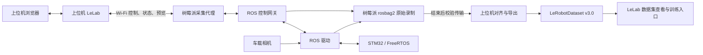

# LanderPi 无线实机采集与 LeRobot 接入方案

日期：2026-10-31。状态：源码分析与开发设计，尚未实现或实机验证。

当前实施顺序已按用户最新要求调整为：先在本机完成麦轮底盘＋五轴机械臂＋夹爪的 ROS/Gazebo/RViz 仿真采集闭环，再移植车端代理到树莓派并做硬件联调。具体需求、当前环境和阶段验收以[仿真实施计划](ros2-simulation-recording-implementation-plan.md)为准；本文保留后续实机部署与数据契约设计，不表示树莓派或硬件已经可用。

## 1. 目标与部署结论

用户已确认：底盘、机械臂和夹爪一起采集；ROS 在车载树莓派运行，上位机通过 Wi-Fi 局域网控制，并在浏览器查看相机和采集状态。

建议把“录制”拆成两个明确的工作：

| 工作 | 运行位置 | 作用 |
| --- | --- | --- |
| ROS 驱动、控制网关、真实反馈读取 | 树莓派 | 获取传感器和接收动作，执行限幅、控制权与失联保护 |
| 原始录制器 rosbag2 | 树莓派 | 本地保存图像、状态、命令、时间戳与 episode 事件 |
| 预览转发 | 树莓派 → 上位机 | 发送可限帧、降分辨率的预览，允许丢弃过期预览帧 |
| LeLab FastAPI、React 界面 | 上位机 | 控制、任务配置、开始/停止、状态显示和数据管理 |
| 同步、对齐、LeRobotDataset 导出 | 上位机 | 停止后校验传输原始数据，生成本地 LeRobot 数据集 |
| 电机闭环及底层命令超时保护 | STM32 / FreeRTOS | 脱离上位机及 ROS 进程后仍执行设备保护 |

录制器是树莓派上的后台服务，不依赖某个终端窗口保持打开。开发时可在终端启动，交付时由服务管理器管理进程。上位机上点击按钮只是发起远程请求；实际开始和结束以树莓派回执为准。

当前 LeLab 的录制后端运行在哪里，就在哪里连接设备和写入数据。浏览器只显示界面，不决定保存位置。现有实现还不能直接作为树莓派 ROS 远程录制器使用。



Wi-Fi 断开时应由车端立即触发本地停止策略，记录断连事件和短尾部反馈，随后关闭当前 episode。恢复后查询原 session 状态，不能自动恢复运动或重复开始。这个行为需要开发，当前源码尚不保证。

## 2. 本次核查基线与证据

LeLab 仓库 HEAD：`07216e0`；`current` 指向 `releases/sanitized-20261024-01`。本文以该快照及其同级本地 LeRobot 为基线，没有切换运行版本，也没有使用另外两个未跟踪的 training-monitor 发布目录替代它。

本地 LeRobot 包声明 `0.6.2`，数据格式常量为 `v3.0`。包版本和数据格式版本不能混用。保持 LeLab 对同级 `../lerobot` 的可编辑依赖；不需要为本方案换成 PyPI 包或另一个上游 checkout。

关键源码（路径相对于 LeLab 根目录或 `/home/liaozhengyan/Desktop/resource`）：

| 事实 | 位置 |
| --- | --- |
| LeLab 录制参数要求 leader/follower，构造 SO101 配置 | `app/lelab/record.py:73,245` |
| 现有摄像头配置仅接收 OpenCV 类型 | `app/lelab/record.py:202` |
| 现有录制中 MJPEG 接口 | `app/lelab/server.py:1694`、`app/frontend/src/pages/Recording.tsx:720` |
| 非录制时浏览器相机 hook 使用本机 getUserMedia | `app/frontend/src/hooks/useCameraStream.ts:60` |
| 本地 LeRobotDataset 创建入口 | `lerobot/src/lerobot/datasets/lerobot_dataset.py:773` |
| 每帧时间戳按 frame_index/fps 生成 | `lerobot/src/lerobot/datasets/dataset_writer.py:202` |
| LanderPi 底盘两路 Twist 订阅 | `lander_pi/src/driver/controller/controller/odom_publisher_node.py:143` |
| odom_raw 由命令速度积分 | 同文件 `:292` 起 |
| 常规机械臂 joint1–joint5，夹爪 r_joint，ID 1–5/10 | `lander_pi/src/driver/servo_controller/config/servo_controller.yaml:3` |
| joint_states 取 ServoManager 缓存 | `lander_pi/src/driver/servo_controller/servo_controller/controller_manager.py:98` |
| 该缓存记录发送的目标位置 | `lander_pi/src/driver/servo_controller/servo_controller/servo_controller.py:54` |
| 舵机实测位置服务 | `lander_pi/src/driver/ros_robot_controller/ros_robot_controller/ros_robot_controller_node.py:269` |
| SDK 反馈等待没有显式 timeout | 同目录 `ros_robot_controller_sdk.py:477` |
| ASCAMERA 配置 640×480、15 FPS | `lander_pi/src/peripherals/launch/include/ascamera.launch.py:21` |
| 固件真实编码器测速及 PID | `RosRobotControllerLite_ros_250811/Core/Src/stm32f4xx_it.c:419` |
| MOTOR 命令处理 | `RosRobotControllerLite_ros_250811/Hiwonder/System/packet_handle.c:397` |

ROS 主工作区是 `resource/lander_pi/src`；`resource/uavociety` 有部分重复驱动和仿真资源，不能混用其运行假设。ROS 发行版、树莓派型号、设备当前烧录固件、实际机型、相机及运行 topic 均未实测。

## 3. 现有接口的关键缺口

### 3.1 状态必须分清实测、目标与估算

当前 `odom_raw` 按缓存的下发速度积分；EKF 再融合它和 IMU，也不因此变成编码器实测。固件内部确实读取编码器，但现有 MOTOR 协议和 Python SDK 没有相应的实测轮速上报通路。

当前 `/controller_manager/joint_states` 来自发送位置缓存，不能直接写成真实关节状态。需要在既有串口所有者内增加受控的舵机轮询，读取 ID 1–5、10 的实际位置，再发布独立的 measured joint topic。不要另开串口连接与原驱动竞争。

现有 SDK 使用 `bus_servo_queue.get(block=True)` 无显式等待超时。要补充有限超时、响应 ID/命令匹配、迟到响应处理、有效标志及错误统计。串行读取六个舵机的频率需要测量；不能因原 joint_states 标称 50 Hz 就宣称实测反馈达到 50 Hz。每个关节保留采样或接收时刻与数据年龄，整组反馈并非天然同时采样。

### 3.2 控制入口不能直接认定可用

可优先适配现有 `servo_controller` 的 `servo_controller_msgs/ServosPosition`，其支持 `pulse/rad/deg` 和运动时长。经网关完成 ID、单位、关节限位、动作时效检查后进入原驱动。

`joint_controller` 路径当前把两个数值传给 `ServoManager.set_position(duration, position_list)`，与接口语义不匹配，需修复后验证。`FollowJointTrajectory` 路径还有 `self.self.joint_names` 和错误的参数数量等可见缺陷；不能将 MoveIt action 已存在当作它已经可用。

`cmd_vel` 与 `controller/cmd_vel` 的处理路径不同，不能假定它们共享限幅。要把键盘、手柄、网页、导航及后续策略的控制输入统一到同一网关，下游控制 topic 通过配置/重映射限制为该网关的输出路径。

### 3.3 失联保护需要落到车端和板端

本次核查的 ROS 桥接和固件中未见运行期间的电机命令过期停车逻辑；启动零速或 KeyboardInterrupt 时发零速覆盖不了 Wi-Fi 断开、进程崩溃等路径。

新增车端命令 watchdog 和板端电机命令 watchdog。超时阈值按控制周期、网络抖动和实际停车距离测定，不以 LeLab 默认 60 秒的任务租约替代运动命令时效。安全事件必须先处理停车、撤销控制和取消旧动作，再做数据收尾。

机械臂停止策略需按设备验证，不能把断连一律处理为卸力；夹爪也不能默认张开。具体策略需避免失去支撑或掉落物体。急停后须显式重新获取控制权，旧命令和旧轨迹不得恢复。

网络沿用项目默认的本地绑定和既有 SSH 隧道访问方式；车端代理和上位机接口不直接向公网暴露。若后续选择局域网直连服务，需显式配置监听地址与会话鉴权，不能仅凭接入同一 Wi-Fi 就授予运动控制权。

## 4. 采集数据契约

### 4.1 原始录制内容

配置 topic 白名单，不默认录制整个 ROS 图。候选内容包括：

- RGB `/ascamera/camera_publisher/rgb0/image`、相机内参、实际使用的外参/TF。
- 需要时采 depth `/ascamera/camera_publisher/depth0/image_raw`，保留原单位、无效值和精度。
- 新增 measured joint topic；原命令缓存另标为 commanded joint state。
- 新增真实轮速/编码器 topic、IMU、电池；`odom` 标注估算来源。
- 控制网关输出的完整动作，以及原始请求、下游实际发送目标、限幅原因和来源。
- session/episode/task 事件、开始/停止原因、急停/断连、设备和软件版本、标定与参数快照。
- 激光等暂不进入策略的传感器按任务选择保存，不要求第一版全部成为模型输入。

以上现有 topic 名必须在树莓派上核实命名空间、类型、编码、频率、时间戳及 QoS 后配置。QoS 不匹配可能导致订阅不到数据；不能仅凭 topic 出现在列表中判定可录制。

动作事件应带：`session_id, episode_id, command_seq, source, receive_time, dispatch_time, valid_until, base_target, joint_target, gripper_target, duration, controller_mode, safety_result`。底盘和机械臂异步输入由网关维护完整目标向量，保留各分量更新时间，不能将“未更新”自动补成零动作。

“上位机请求”“网关批准后发给驱动的目标”“设备已响应的反馈”是三种不同数据。没有硬件确认时，下游目标只能称已发送命令，不能称实际执行结果。

### 4.2 LeRobot 输出 schema

根据实际底盘机型固定 schema。以麦轮底盘为例：

| 特征 | 示例定义 |
| --- | --- |
| `observation.images.front` | RGB `uint8`，H×W×3，视频特征 |
| `observation.state` | 实测 joint1–joint5、夹爪关节，加已具备的实测底盘速度 |
| `action` | `[base_vx, base_vy, base_wz, joint1_target, ..., joint5_target, gripper_target]`，9 维 |
| `task` | 任务语言描述，例如“靠近目标并抓取物体放入箱中” |

建议统一底盘 m/s、rad/s，手臂 rad。夹爪先用标定后的关节 rad；只有完成宽度标定后才改用开口米数或归一化比例。保存 names、单位、frame、标定版本和顺序。注意本地 LeKiwi 的底盘 theta.vel 使用 deg/s，不能原样接 ROS rad/s。

控制器中的夹爪名称为 `r_joint`，URDF 中出现 `gripper_base_joint`；本次未找到明确的二者映射。数据集名称、反馈舵机和可视化关节须建立显式映射，不能仅按数组索引或名称相似关联。

Tank 或 Ackermann 不能照搬麦轮三自由度动作；按实际控制接口明确有效自由度、Ackermann 转向语义和不可执行指令处理，再固定数据契约。

若首版尚无真实底盘反馈，可以采用“RGB＋六个实测关节”的 state，同时保存底盘 action；观测和动作维数可以不同。不能用假零值或命令积分冒充缺失的实测底盘速度。之后改变输入定义时创建新 schema/数据集，做显式兼容处理。

## 5. 时间对齐与无线链路

以树莓派为主要时间域。原始记录保留传感器 header stamp、树莓派接收时刻、消息/动作序号，并记录使用的 clock。超时和间隔计算采用单调时钟；与 ROS/墙上时间的对应关系需记录和检测跳变。

当前 IMU 的 ROS stamp 来自主机发布侧；串口协议为 `AA 55 | function | length | payload | CRC8`，没有通用采样时间戳或序号。CRC 只能检测校验错误，不能还原采样时间或证明未丢帧。高质量底层反馈应在协议扩展中加入 MCU sample tick、sequence 和主机对时映射；短期必须如实标注接收时间近似。

上位机时间用于 UI、审计和延迟测量，不直接与树莓派时间相减，除非已测得时钟偏差。传感器若还有独立硬件时钟，也需确认驱动如何映射它。

导出时把不等频的 ROS 数据明确对齐到固定训练频率。建议第一轮评估 10 Hz；这是待实测的起点，不是当前性能结论。相机配置是 15 FPS，不应把同一图像重复复制到 30 Hz 后宣称 30 Hz 实采。

每个训练步使用对齐时刻之前的新鲜观测，动作按约定的已发送目标进行零阶保持；保留各传感器年龄、图像选取误差、动作更新时间和质量掩码。不要用未来反馈隐式补成“当时状态”。检测到长时间缺帧、状态过旧或时钟跳变时，标记片段无效或分段，不压缩时间轴掩盖缺失。

本地 `LeRobotDataset.add_frame` 自动生成 `timestamp=frame_index/fps`，不接受调用方覆盖这个默认 timestamp。真实 ROS 时间、图像序号和对齐映射保存到旁路审计文件，或使用明确声明且不混入训练 state 的附加特征。SDK 的 timestamp tolerance 不是 ROS 消息同步器。

预览和录制共用同一个相机来源，但使用独立队列。预览优先显示最新帧，可降分辨率/限帧；录制保留既定数据规格并统计丢失、写盘积压和缓冲溢出。预览慢不能反向堵塞录制与控制。

按未压缩 RGB8 640×480×15 计算，仅 RGB 约 13.8 MB/s；再加同尺寸 16 位 depth 约 20.7 MB/s、74.6 GB/小时，均未计消息和文件开销。这是容量估算，不是实测吞吐。JPEG、视频或无损压缩可改变带宽与 CPU 开销，需显式配置并评估精度。

因此首版优先本地落盘；Wi-Fi 承担控制、状态和压缩预览，采后传输大文件。开始前检查本地可用空间、持续写入速度和完整一集的空间预算，不能假设树莓派存储已够用。

## 6. 录制生命周期与交互

建议区分采集状态和导出状态：

`idle → checking → ready → recording → stopping → raw_ready → syncing → converting → validating → completed`

异常进入 `interrupted/error`，保留可审计的原始材料和错误原因。开始/停止请求按 session ID 幂等；连接恢复后查询原任务，不重新创建任务。

1. 连接机器人并预览：只读订阅，显示底盘机型、相机、反馈来源、反馈数据年龄与存储容量。
2. 开始 session：校验机型、关节映射、任务描述、标定、所有必需 topic；取得现有 LeLab 控制租约，并在车端确认唯一控制者。
3. 车端 recorder 完成订阅和准备、记录开始标记后回执。UI 收到确认才显示“正在采集”。
4. 每次任务尝试对应一个 episode；环境重置阶段不进入有效训练片段，可在原始日志中保留明确 reset 标记。
5. 结束 episode 时保留保存/弃用与成功标签，原始文件保留审计；重录不直接删除已发布数据集。
6. 结束 session：先停止本 session 的控制输出并取消旧轨迹，取得车端确认；再关闭原始录制并写清单。急停则优先停止运动，不等待写盘或上传。
7. 校验原始文件、按清单传输到暂存目录、校验后发布；再由上位机启动导出。断网时保留车端原件，UI 显示待同步，不假报完成。
8. 导出及验证完成后才显示“LeRobot 数据集已就绪”。停止 HTTP 请求成功不等于最终数据已可训练。

不要直接照搬现有 `/stop-recording` 中发出停止请求后立即释放租约的时序到新的远程控制路径；车端停止和实际控制权释放应有确认流程。编码和传输期间是否开放下一次采集，取决于独立资源预算及控制状态，不能凭 UI 阶段推断。

首版预览可复用现有 MJPEG 展示组件并增加 ROS 图像来源；驾驶体验需要更低延迟时再评估 WebRTC。无论预览协议如何，最终录制源都应来自 ROS 原始数据，而非浏览器截图或 MediaRecorder。

## 7. LeLab 与 LeRobot 的开发落点

优先增加边界明确的新模块，不全面重构现有 SO-101 功能。以下名称是建议，当前文件尚不存在：

| 位置 | 责任 |
| --- | --- |
| 车端 ROS 包 `lelab_ros_recorder` | 控制网关、状态反馈、采集会话、rosbag2 生命周期、预览和健康状态 |
| `app/lelab/ros_bridge.py` | 上位机与车端代理的连接、确认、事件和会话查询 |
| `app/lelab/ros_record.py` | ROS 采集请求模型和生命周期，接入现有互斥/租约/急停 |
| `app/lelab/ros_export.py` | 原始数据清单、对齐、schema、LeRobotDataset 写入与验证 |
| `app/frontend/src/pages/Recording.tsx` 等 | 新增 ROS 小车采集模式，展示相机和底盘/机械臂/夹爪状态 |
| `app/lelab/utils/config.py` | 复用共享路径与配置方式，配置车端地址及数据根目录 |
| `app/deploy/` | 车端/上位机启动、依赖与部署适配 |

保留已有 SO-101 请求契约；ROS 模式另设明确 schema 或独立路由。不要要求用户为小车填写无关的 leader/follower 串口。共享数据集封存、可写保护、查看器和同步协议；不要把面向训练服务器的同步配置不加区分地拿来控制树莓派。

车端只依赖其实际 ROS Python 环境和录制组件。LeLab 当前要求 Python 3.12+，不要假定可将其与未核实的树莓派 ROS Python 包直接装入同一环境。上位机通过独立进程/传输边界接收原始材料，在项目环境使用本地 LeRobot 导出；自定义 ROS 消息需要可用的定义和反序列化方案，不能假定上位机天然能读。

首版只做数据采集与格式导出，不强制实现完整 LeRobot Robot 插件。需要后续策略实机推理时，再实现自己的 `LanderPiRobotConfig/Robot`，包含 `observation_features/action_features/connect/get_observation/send_action/disconnect`，共享同一控制网关与数据契约。可借鉴本地 LeKiwi 的移动操作机器人接口，但其三轮底盘、舵机映射、角速度单位与 LanderPi 不同，不能直接复用为该机器人的驱动。

数据浏览先使用相机和数值曲线，标明各维名称。SO-101 的 3D 回放和机械臂动作回放不自动适用于小车；离线数据检查应直接读取 bag/Parquet，不在连接实机的 ROS 图上回放带动作的 bag。

## 8. 导出格式和可靠性

上位机完成对齐后按本地 SDK 生命周期写入：

```python
dataset = LeRobotDataset.create(
    repo_id=repo_id,
    root=staging_dataset_path,
    fps=recording_fps,
    features=features,
    robot_type=verified_robot_type,
    use_videos=True,
)
try:
    for episode in accepted_episodes:
        for frame in aligned_frames(episode):
            # 所有声明的特征和 task 都须提供，dtype/shape 与 schema 一致。
            dataset.add_frame(frame)
        dataset.save_episode()
finally:
    dataset.finalize()
```

这是接口示意，`aligned_frames`、验证与失败收尾逻辑均待实现。`finalize()` 不会代替 `save_episode()` 保存未提交的帧；`save_episode()` 也没有跨 Parquet/视频/元数据的通用事务回滚保证。转换失败时保留原始 bag 和失败暂存目录，从原件重新导出到新暂存目录；不能把清空帧 buffer 当作已写文件的事务回滚。

最终数据为 v3.0 的 `data/` Parquet、`videos/` MP4 和 `meta/` 信息/任务/episode 索引/统计。多个 episode 可以共享一个数据或视频文件，episode 边界由元数据索引确定，不能手工按照“一集一个 MP4”拼接元数据。

发布前在本地离线打开数据集，核对每集首尾与随机帧、视频解码、动作与反馈曲线、索引和统计；成功后才从暂存目录原子发布，并生成就绪标记和来源清单。后续需要训练时另做模型特征/动作处理器兼容验证，格式可读取不等于策略已经适配。

原始 session 清单包含源码版本、设备/固件标识、机型、topics/types/QoS、schema、相机与标定、任务与 episode 事件、时间域、源文件哈希、导出配置、导出器版本和验证报告。原始材料与派生数据分开存放，不写入源码发布快照或 Git；同步只对明确管理的数据范围操作。

## 9. 分阶段实施与验收

| 阶段 | 工作 | 达成标准 |
| --- | --- | --- |
| A：只读接入 | 核实树莓派环境/机型/topics；ROS 摄像头预览；反馈来源和吞吐检查 | 浏览器显示车载摄像头；证明预览与原始帧同源，记录延迟和丢帧；不发送动作 |
| B：反馈与控制基础 | 修复选定控制入口；舵机读取超时/响应匹配；车端及板端 watchdog；必要的编码器上报 | 假硬件验证超时、重放、限位与租约；授权后逐设备、小幅度验证命令、反馈及失联停止 |
| C：本地原始采集 | rosbag2 白名单录制；session/episode/重录标记；存储和队列监测 | 连续录多集并正确关闭；预览拥塞不堵控制/录制；磁盘不足、中断有明确结果 |
| D：LeRobot 导出 | 采后校验同步、固定频率对齐、v3.0 写入、数据集查看器 | 本地 SDK 离线读取全部 episodes；图像与动作/反馈对齐；中断导出可从原件重跑 |
| E：完整无线验收 | 底盘、手臂、夹爪一起操作；主动断 Wi-Fi、关页面、停止代理等故障注入 | 车端按已验证时间界限停止；原始数据可检查；不会重复 session 或自动恢复旧动作 |

已有测试可参考 `app/tests/test_record.py`、`test_hardware_lease.py`、`test_hardware_lease_api.py`、`test_dataset_storage.py`，但这些测试并不证明 ROS 实机路径可用。新增检查应覆盖时序、真实 schema、错误恢复及控制保护，不扩建无关测试体系。

本次仅完成本地源码阅读及官方文档核对。未修改应用/固件源码、安装依赖、运行测试、登录树莓派、启动服务或移动设备。尚需确认的实际信息：树莓派型号与系统/ROS 版本，底盘 `MACHINE_TYPE`，摄像头实际输出，舵机 ID/方向/可读性，以及本地存储容量和持续写入性能。

## 10. 官方参考

2026-10-31 核对，在线 main 文档只用于理解接口设计，具体签名以本地 0.6.2 源码为准：

- [LeRobotDataset v3.0](https://huggingface.co/docs/lerobot/main/en/lerobot-dataset-v3)：Parquet/视频/元数据组织与 finalize 要求。
- [Bring Your Own Hardware](https://huggingface.co/docs/lerobot/main/en/integrate_hardware)：Robot 适配接口。
- [rosbag2 官方仓库](https://github.com/ros2/rosbag2)：topic 录制、存储插件及关闭/回放能力。
- [rosbag2 Humble 分支说明](https://github.com/ros2/rosbag2/blob/humble/README.md)：发行版分支对应与录制/分卷说明。
- [ROS 官方 QoS 录制说明源码](https://github.com/ros2/ros2_documentation/blob/humble/source/How-To-Guides/Overriding-QoS-Policies-For-Recording-And-Playback.rst)：订阅兼容与 QoS overrides；官网页面本次被访问保护拦截，改核对官方仓库源码。

可优先评估 rosbag2 的 MCAP 插件，但须确认目标 ROS 发行版实际具备的插件和选项。若只具备 sqlite3，可明确记录并使用该存储后端；不要把上游 Rolling 的默认值、服务接口或性能当作树莓派现状。
