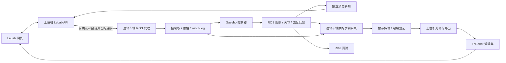

# 麦轮移动操作机器人：仿真采集需求与实施计划

日期：2026-10-31。状态：仿真闭环已跑通并有成功/失败/故障证据；完整结果与未完成项见[验收报告](milestones/2026-10-31-ros2-mobile-collection.md)与[运行手册](ros2-collection-runbook.md)。

最新明确需求：键盘控制麦轮底盘，主臂示教先预留硬件接口。用户确认本地目前没有专家轨迹，后续在 Gazebo 模型与控制链路就绪后再生成 scripted expert 测试数据；现有专家数据导入不作为当前开发前置条件。首个任务是靠近方块、抓取并放入容器；必需视角改为随 link4 运动的腕部 RGB，同时核查和记录可用 depth/laser。参考项目选择与已实现工具见[多智能体参考核查](ros2-collection-reference-review.md)。专家数据不能标记为真人数据；不同模拟器的关节零位与夹爪 m/rad 映射必须显式处理。

## 1. 本轮确定的目标

用户已确认：麦轮底盘、五轴机械臂和夹爪一起采集。先在当前 Ubuntu 主机上完成 ROS 上层软件的仿真联调；Gazebo 提供机器人运动、物理与相机，RViz 显示 ROS 模型、TF 和反馈，LeLab 提供网页控制、预览、采集和数据管理。后续将逻辑上的车端代理移植到树莓派，通过 Wi-Fi 与上位机通信，再接真实硬件。

第一版闭环定义为：

> 网页下发统一动作 → Gazebo 中底盘/手臂/夹爪运动 → ROS 返回仿真状态和相机 → 网页显示 → 按任务尝试录制 episode → 原始数据校验同步 → LeRobot v3.0 导出 → 本地 SDK 与网页读回。

这一阶段包含真实的 Gazebo 执行与反馈，不用 MoveIt 的 FakeSystem 代替物理仿真。用户已选靠近方块并抓放的任务验收，先用专家输入测试，需核实夹爪接触与物体转移；训练策略自主执行仍为后续阶段。不能仅凭夹爪闭合或 RViz 动画判定抓取成功。

本次用户授权允许本机安装 ROS/Gazebo 和相关开发。当前这份交付先明确需求、源代码缺口和实施顺序，不将待执行事项写成已完成。

## 2. 本机检查结果

以下为本次实际只读探测结果：

| 项目 | 结果 | 对实施的影响 |
| --- | --- | --- |
| 系统/架构 | Ubuntu 24.04.4 LTS，x86_64 | 采用 ROS 2 Jazzy＋Gazebo Harmonic 的官方配套组合 |
| Python | 系统 Python 3.12.3 | 与本地 LeLab 的 Python 3.12+ 要求一致，但仍隔离 ROS 与 ML 依赖 |
| CPU/显示 | Ryzen 7 5800H，16 逻辑 CPU；AMD Radeon 集成显示；X11 `:0` | 可以评估 Gazebo/RViz 图形显示，渲染能力和性能尚未实测 |
| 内存 | 约 22 GiB 总量，探测时约 8 GiB available | 从小世界、单相机开始；不停止其他人的进程 |
| Swap | 约 8 GiB，总量中约 7.1 GiB 已用 | 不并行启动大场景、训练或重负载构建；实际性能再测 |
| 磁盘 | 当前工作盘约 689 GiB 可用 | 具备初始开发空间，安装下载量与录制容量仍需单独预算 |
| ROS/Gazebo/RViz | `/opt/ros` 不存在，PATH 未找到 `ros2/gz/gazebo/rviz2`，包查询未返回相关已安装包 | 未建立运行环境；不称为已安装成功 |
| 安装权限 | 用户在 sudo 组；`sudo -n true` 返回需要密码 | 原生 apt 安装需要用户在本机完成管理员交互，不在聊天中收集密码 |
| 容器工具 | PATH 未找到 Docker/Podman | 不假定已有可用容器或容器权限 |
| LeLab 源码 | HEAD `07216e0`，`current → releases/sanitized-20261024-01` | 不覆盖快照或切换 current；开发使用独立工作副本 |

内存、CPU 占用和磁盘是探测时快照，不代表未来始终可用。当前 LeLab 实际运行解释器与完整依赖环境尚未重新核实；不能仅凭源码版本认定运行版本。

## 3. 环境版本和安装范围

选择 Ubuntu 24.04＋ROS 2 Jazzy＋Gazebo Harmonic＋RViz 2；`gz_ros2_control` 驱动仿真手臂与夹爪。该配套关系已通过[Gazebo 官方兼容表](https://gazebosim.org/docs/harmonic/ros_installation/)和[gz_ros2_control Jazzy 文档](https://control.ros.org/jazzy/doc/gz_ros2_control/doc/index.html)核对。

拟使用官方 ROS 软件源的 Desktop、`ros_gz`、`gz_ros2_control`、ros2_control/controllers、Xacro、图像传输、rosbag2 与 MCAP 插件、colcon/rosdep。MoveIt 2 在基本控制闭环完成后接入；Nav2、SLAM 和策略训练不作为第一版依赖。具体包版本和安装大小在安装前以目标软件源解析结果记录，避免混入 Humble/Fortress 或 Gazebo Classic 的插件。

安装流程应先做系统与软件源探测、检查将安装/移除的包，再执行已授权的必要安装并保存日志；不全量升级操作系统，不移除其他项目依赖。ROS 环境通过项目启动入口加载，不修改所有终端的默认 Python 或全局 shell 启动配置。LeLab/LeRobot 使用项目专用环境，并保持 `app` 与本地定制 `../lerobot` 的关系。

目前没有执行安装。所需管理员交互是工具执行能力限制，不是需要重新确认用户是否同意开发；准备好具体安装入口后，由用户在本机完成该交互即可。

## 4. 原仿真资源的可复用范围与阻断

参考源：`/home/liaozhengyan/Desktop/resource/uavociety`。该目录不是 Git 仓库，本次未修改。使用解压源码，不重复解压 ZIP，不把历史远程配置或记录当成本机环境证据。

| 来源 | 可复用内容 | 必要处理 |
| --- | --- | --- |
| `landerpi_description` | 机器人网格、四轮外形/结构、五轴手臂、夹爪、RViz 配置 | 检查动力学参数、碰撞体、关节限位、mimic 与命名映射 |
| `robot_gazebo` | 世界、场景物体、传感器、启动流程结构 | 迁移插件、包名、bridge、时钟、底盘执行模型 |
| `hiwonder_moveit_config` | 规划组、关节限位、运动学及轨迹 action 配置 | 指向同一个 Gazebo controller manager，禁用 FakeSystem 路径 |
| `driver` | 实机消息及未来适配的接口参考 | 仿真阶段不启动串口驱动、不访问真实设备 |

已经确认的具体问题：

1. `robot_gazebo/launch/worlds.launch.py:26` 无条件查找当前资源中缺失的 `holonomic_sim`；`urdf/robot.gazebo.xacro:51` 加载缺失的 `libHolonomicPlugin.so`。
2. 原模型既包含麦轮外形的四轮结构，又叠加 `wheel_base.urdf.xacro` 的辅助中心驱动/支撑机构，原自定义插件控制的是辅助机构。不能仅把库名换为 MecanumDrive 而保留不匹配的物理接线。
3. `ros_ign_gazebo`、`ignition.msgs`、`ign_ros2_control` 和 `ros_gz_bridge` 混用；`worlds/empty.sdf` 也仍含旧 Ignition 系统标识。
4. `ros_ign_bridge.launch.py:31` 注释了 `/clock`，但 launch 默认使用 `use_sim_time=true`，会影响控制、TF、录制与 RViz。
5. 当前有多条 joint_states 来源，组合时需避免同名关节竞争和 TF 重复发布；每个受控关节仅由一个控制器负责。
6. `spawn_model.launch.py:34` 有未使用的错误文件名 `robot_cofig.yaml`；`world_name/world` 参数传递不一致也要统一。
7. 仿真夹爪驱动名是 `gripper_base_joint`；实机控制器参考中是 `r_joint`/ID 10，需要显式映射。mimic 关节不能重复配置独立命令接口。
8. 当前相机是普通 `type="camera"`，配置 640×400、30 Hz，图像名为 `/depth_cam/depth_cam`。名字里有 depth 不能证明存在深度图。
9. MoveIt demo 默认包含 mock 硬件路径；不能把 mock 执行成功当成 Gazebo 成功。Gazebo 模式须复用插件内的 manager，不另启冲突的 `ros2_control_node`。

### 麦轮底盘迁移决策

保留 LanderPi 本体与四轮结构，移除旧辅助中心驱动依赖，评估并接入 Harmonic 官方 MecanumDrive。需要正确设置四个轮关节、轮径/轮距/轴距、旋向和横向接触摩擦，处理现有零 effort/velocity 等不适合执行的限制，验证模型稳定性。

官方[MecanumDrive 接口](https://gazebosim.org/api/sim/8/classgz_1_1sim_1_1systems_1_1MecanumDrive.html)与[同版本示例](https://github.com/gazebosim/gz-sim/blob/gz-sim8/examples/worlds/mecanum_drive.sdf)可作迁移参考；该系统存在不等于当前机器人模型已兼容。以 Gazebo 世界位姿变化分别验证前进、后退、左右横移、原地旋转及组合动作，不能只看轮子转动或插件里程计。

若模型动力学仍不匹配，继续修复模型和配置，并记录阻碍；不静默降级为发布假 odom 或直接改位姿来宣称完成物理闭环。第一版用于上层集成，不声称达到实机打滑、抓取力学或传感器噪声的精确复现。

## 5. 功能需求与验收

以下全部为待开发/待验证要求。

| 编号 | 必需能力 | 验收证据 |
| --- | --- | --- |
| R01 | 本机启动 Gazebo、模型、ROS bridge 和 RViz | 一套可重复启动/停止入口、版本记录、日志；模型不持续散架/坠落 |
| R02 | 底盘、五轴手臂、夹爪各自和联合控制 | 命令后 Gazebo 中运动，反馈来自仿真状态；方向、单位与关节顺序正确 |
| R03 | 网页只读相机预览 | 图像来自 Gazebo ROS topic；开始录制前后可见，能检测过期/断流 |
| R04 | 网页控制与状态展示 | 速度/关节/夹爪控制、任务与录制状态；UI/API/ROS 错误能显示 |
| R05 | 单一控制入口与控制权 | 网页、键盘、后续 MoveIt/策略均经过同一网关；只读访问不取得控制 |
| R06 | 限位、时效、急停和失联 | 界限外命令明确拒绝/裁剪；失联撤销命令、取消旧轨迹，恢复后不执行旧动作 |
| R07 | session 与 episode 原始录制 | 明确开始/结束/重录/弃用/成功标记；reset 阶段与有效任务片段分开 |
| R08 | 逻辑车端到上位机同步 | 独立目录/进程间分阶段复制、哈希校验、可重试和就绪标记，不覆盖主副本 |
| R09 | 时间对齐与 LeRobot 导出 | 从原始数据重新生成 v3.0；图像、state、action、task 与 episode 边界对应 |
| R10 | 数据集读回 | 本地 SDK 离线读取全部 episodes；网页视频和带名称/单位的曲线可查看 |
| R11 | 故障恢复 | 关闭控制连接、杀本任务代理、bridge 退出、录制/导出中断等有明确结果 |
| R12 | 为树莓派移植保留边界 | ROS topic、地址、路径、时钟、设备映射可配置，上层不硬编码本机目录 |

底盘主输入采用键盘，手臂/夹爪预留主臂输入适配器，当前以 scripted expert 测试；网页提供状态、腕部相机、采集与停止/急停，以及必要的调试操作。所有输入进入同一控制网关；完整 scripted expert 独占控制与键盘驾驶模式显式切换。RViz 用于 ROS 状态与规划调试。

第一版不要求导航建图、自动任务规划、强化学习、VLA 训练、真实电机运动、FreeRTOS 烧录、公网发布或全平台重构。

## 6. 本机部署的逻辑边界

同一主机上仍保留未来两台机器的进程与存储边界，避免移植时重写整条链路：

本机阶段服务使用回环地址和独立开发端口；检查占用后选择端口，不停止其他服务。ROS 使用项目启动入口配置独立 domain/namespace，避免命令或 bag 回放流入不相关 ROS 图。故障注入仅针对本任务的连接和进程，不关闭整机 Wi-Fi 或修改全局网络规则。

未来把 Agent、原始录制目录和硬件适配器迁到树莓派。若树莓派已有 Humble 等环境，上位机与车端通过稳定的代理协议通信，不假定跨 ROS 发行版 DDS 直接互通，也不为此次本机安装改动树莓派系统。

## 7. 统一数据与控制契约

### 数据集基本定义

麦轮 action 固定为九维：`[base_vx, base_vy, base_wz, joint1_target, joint2_target, joint3_target, joint4_target, joint5_target, gripper_target]`。底盘采用机体坐标系 m/s、rad/s；关节和夹爪使用明确标定映射后的 rad。

state 首版采用相同六个关节实测位置，加仿真底盘机体速度；名字/顺序/来源写入 schema。`action` 与 `state` 的语义不同：前者是经控制网关处理的已发送目标，后者来自仿真执行反馈。仿真世界真值另行标注，不能把仅在仿真可得的绝对位姿隐式加入未来实机策略输入。

建议对外提供规范化图像、相机参数、joint state、base state、applied command 和采集事件接口，内部映射已有 `/controller/cmd_vel`、`arm_controller`、`gripper_controller` 等接口。具体 ROS topic 与自定义消息名在实现中集中配置，不要求改动所有原始驱动。

图像首版必需 link4 腕部 RGB；已有专家数据的额外前置 RGB 在导入时保留。depth/laser 作为可用的原始辅助数据保存，是否成为策略输入另行定义。Gazebo 当前入口只有 RGB/laser 声明，depth 需要新增 RGB-D sensor，IMU 需要补入口装配。新 ROS profile 的分辨率/FPS 参数化，可评估 640×480/15 FPS、训练数据 10 Hz；导入 mobileCar 专家时保留其源 5 Hz、16 维 state、9 维 action 与夹爪米制宽度，不隐式变成当前建议的九维 state 或夹爪 rad。上述 ROS 规格仍为待测计划值。

### 时间、动作和失联规则

- 图像、ROS 反馈和原始 bag 使用同一 `/clock` 仿真时间；数据集时间轴按显式对齐规则建立。
- 控制租约、网络失联和动作 TTL 使用单调墙上时钟，不随 Gazebo 暂停而停止计时。
- Gazebo 暂停时停止生成训练帧并显示暂停；恢复时清理过期命令。世界 reset 导致时间回跳时结束当前片段并创建新时间段，不能把时间倒退的数据直接接在原 episode 后面。
- 每条命令包含 session、序号、来源、接收/发送时间、到期时间、模式与处理结果；迟到、重复、旧 session 命令不得重新执行。
- 任务停止或断连时：底盘发零速并按限制减速；手臂取消轨迹并执行已验证的保持策略；夹爪保持策略单独配置。急停优先于数据保存。
- 第一轮可设置 300 ms 动作过期阈值，并以不超过 500 ms 撤销旧控制/开始停止输出作为软件测试目标；实际运动停止时间另测。该阈值为待验证配置，不作为实机安全结论。
- 反馈缺失或过期时不把目标命令填作测量值；停止相关控制并标记数据质量。

录制器保存原始流与事件，预览器使用独立有界队列并优先显示最新帧；预览拥塞不得阻塞控制与原始录制。需要记录实际频率、图像年龄、预览延迟、队列溢出和丢失计数。

## 8. 采集、同步和导出流程

`idle → checking → ready → recording → stopping → raw_ready → syncing → converting → validating → completed`；错误进入 `interrupted/error`。

开始必须等待车端 recorder 准备确认；停止 API 只表示收到请求，UI 等到原始关闭及导出验证后再分别显示状态。所有变更操作使用 session/request ID 做幂等保护，重连后查询已有任务。

每个任务尝试是一个 episode。支持结束保存、弃用当前片段、重新录制、结束 session；原始事件保留审计，避免为重录直接删除已发布数据。reset 时间不混入有效训练帧。

原始材料采用 rosbag2，优先评估目标系统实际可用的 MCAP 插件。原始 bag、事件、schema、标定/配置、软件版本和哈希清单一起封闭为 source session。然后传到上位机暂存目录，校验完成后发布 raw_ready。即使同机，也要真正经过这条存储协议，不能把同步步骤跳过后宣称已验证双机链路。

导出器根据固定频率对齐图像、反馈和动作，记录真实源时间与数据年龄，拒绝或分段处理长时间缺失，禁止无说明复制图像或压缩时间轴。使用本地 LeRobot 的 `create → add_frame → save_episode → finalize`，写入独立暂存目录；全部验证后原子发布。`add_frame` 自动生成 `frame_index/fps` 时间戳，源时间关联须另外保留。

转换中断可从原始材料重新执行，不依赖修补半成品作为正常路径；断点与异常报告保留。源 session、接受的 episode、导出配置及导出器版本应能确定派生数据身份，避免重试重复追加。

LeLab 已有封存和可写保护必须沿用。同步、重录、导出、删除都区分原始副本、暂存产物与正式数据集；默认本地保存，`push_to_hub=false`。

## 9. 代码与工作副本安排

不直接编辑已发布 `releases/sanitized-20261024-01`，不通过切换 `current` 改变正在运行的程序。实施前建立适当的独立开发工作副本和 `codex/` 分支，核对来源与未提交修改；`app` 与定制本地 `lerobot` 保持同级关系。

`resource/uavociety` 保留为原始参考。仅把需要的包、模型、场景和许可资料纳入开发来源，保存来源/哈希；排除 ZIP 副本、缓存、凭据及历史机器私有配置。构建、环境、日志和数据与源码分开管理，不能仅把实现留在被忽略的 work 目录而没有可审阅补丁或版本化来源。

建议新增或扩展的责任边界：

| 模块 | 工作 |
| --- | --- |
| ROS 描述/仿真包 | Harmonic 模型、world、bridge、controller、RViz 和启动配置 |
| ROS 接口/代理包 | 规范化观测、控制网关、watchdog、事件、录制与预览 |
| LeLab `ros_bridge`/`ros_record` | 代理连接、请求模型、任务状态、租约及急停联动 |
| LeLab `ros_export` | 源清单、校验同步、对齐、SDK 导出与数据验证 |
| ROS 小车控制/录制页 | 网页控制、只读预览、状态与 episode 操作 |
| 现有 DatasetViewer | 复用视频与 `observation.state/action` 曲线，补维度名称与单位 |
| 部署与集成验证入口 | 本机环境、启动/停止、证据收集和未来树莓派 profile |

复用 `app/lelab/hardware_lease.py`、`server.py` 的任务互斥、续租与急停分发；新增模式须接入活动探测与 stop hook，不能另开无保护的控制 API。当前录制表单和 OpenCV 摄像头入口绑定 SO-101，本次需新 ROS 模式，不要求小车填写 leader/follower 串口。

前端 UI 直接使用“ROS 小车”“仿真”“腕部相机”“当前回合”等用户概念；软件包版本、topic 名和调试信息放在诊断界面。交付网页时执行实际构建并验证生产产物，不手改 dist 文件。

## 10. 实施顺序与阶段退出标准

| 阶段 | 工作内容 | 退出标准 |
| --- | --- | --- |
| M0：环境与来源 | 准备安装入口、系统权限交互、依赖安装、独立工作副本与来源记录 | ROS/Gazebo/RViz 基础示例实际运行；记录安装版本和日志 |
| M1：仿真执行底座 | 迁移 Harmonic、四麦轮执行模型、时钟、相机、手臂/夹爪 controller 与 RViz | 底盘三自由度、五关节和夹爪实际运动；反馈、TF、图像正确 |
| M2：网页观测 | 代理只读状态和 ROS image → MJPEG 预览；LeLab 页面接入 | 网页看到车载视角，移动模型/目标时画面正确变化，断流可识别 |
| M3：统一控制与保护 | 网页控制、键盘适配、租约、限幅、TTL、急停和恢复 | 失联与抢占能触达 ROS 执行端，恢复不执行旧动作 |
| M4：原始采集 | 原始 recorder、session/episode/reset/重录/错误事件和监测 | 可连续录制多集，边界正确，图像/动作/反馈都有来源时间 |
| M5：同步与 LeRobot | 同机双目录同步、校验、对齐、v3.0 导出、DatasetViewer | SDK 和网页均可读取，转换重跑不重复追加或覆盖源数据 |
| M6：仿真联合验收 | 联合操作、暂停/reset、连接和进程故障、录制/同步/导出中断 | 满足下方验收场景，留下日志/报告/代表样本和重跑入口 |
| 后续：树莓派与硬件 | 移植车端 profile、测量真实反馈/串口/无线、固件 watchdog 和小幅动作测试 | 另行取得实机证据，逐项替换仿真未覆盖项 |

M1 是第一个关键阻断点：现成模型是否能在新环境真实执行，必须先证实。M2 可以先只读联通；M3 完成后再使用网页执行联合动作。专家轨迹安排在 M1–M3 的模型/观测/控制链路完成后生成，用于 M4–M6 的录制、导出和回放验证；生成时保存脚本版本、随机种子、仿真配置、特权输入与来源标记。当前不下载替代数据，不把合成 fixture 当作真实任务轨迹。MoveIt 接入复用同一控制权和下游控制器，安排在基本轨迹执行稳定之后，不绕过网关。

## 11. 仿真联调验收场景

1. 冷启动并关闭整套本任务服务，重复执行，确认端口和进程不残留；保留其他用户程序。
2. 独立验证前后、左右横移、旋转，再验证组合速度；世界位姿、反馈方向和视频内容一致。
3. 五轴逐关节小幅动作、夹爪开合，再执行底盘/手臂/夹爪联合操作；验证限位及指令有效期。
4. 网页查看相机并录制至少三次任务尝试，分别保存、弃用重录及提前停止；核对最终有效 episode 数与帧边界。
5. 网页断开控制连接、停止本任务代理、退出 bridge、急停、租约过期；验证旧控制被撤销，并确认恢复需重新取得控制权。
6. 暂停 Gazebo，再恢复；reset 仿真时间；相机断流/反馈过期。验证 watchdog 不冻结、训练数据不伪造连续时间。
7. 使用受限测试目录模拟磁盘写入失败；中断 recorder、同步和导出。验证错误清楚、原件保留、可重新导出。
8. 在独立测试副本篡改一个传输文件，验证哈希检查拒绝发布，不能进入训练就绪状态。
9. 最终离线加载全部有效 episodes，解码视频，核对首尾与随机帧、state/action 数量、单位、时间对齐报告和来源标记。
10. 所有数据标记 `source=simulation`、模拟器/模型版本及导出 profile；报告不把仿真反馈或 mock 测试写成实机测量。

本机故障注入可以验证应用面对断连的行为，但不能替代真实 Wi-Fi 丢包/延迟、树莓派磁盘性能、跨机时钟、串口可靠性或设备停止距离测试。FreeRTOS 安全与真实关节/编码器反馈仍按原[实机接入设计](ros2-mobile-manipulator-recording-design.md)单独联调。

## 12. 交付物及当前状态

实施阶段应交付：版本化源码/补丁、依赖与来源记录、环境安装和启动/停止入口、配置样例、集成验证入口、至少一个完整仿真采集 session 与派生 LeRobot 数据集、故障注入报告、树莓派移植清单。运行数据不提交到源码 Git。

当前已完成：本机只读环境核查、仿真源码及 LeLab 接入点分析、官方配套版本核对、需求计划、多智能体 GitHub 参考核查，以及传感器静态检查/专家数据预检实现和 15 项合成 fixture 测试。当前未完成：ROS 依赖安装、模型迁移、运行时采集/预览/控制/导出服务、构建、Gazebo/RViz 运行、真实专家 episode 检查、网页联调和任何实机测试。

后续第一项具体工作是 M0 的原生环境安装与 M1 的最小世界执行验证；本次发现的系统安装交互限制需要在执行安装时由用户在本机处理。

## 官方依据

2026-10-31 查询：

- [ROS Jazzy 官方 Ubuntu 安装文档源码](https://github.com/ros2/ros2_documentation/blob/jazzy/source/Installation/Ubuntu-Install-Debs.rst)：Ubuntu Noble 与 desktop/development 安装入口。
- [Gazebo 官方 ROS 版本配套表](https://gazebosim.org/docs/harmonic/ros_installation/)：Jazzy 与 Harmonic 的配套关系。
- [gz_ros2_control Jazzy](https://control.ros.org/jazzy/doc/gz_ros2_control/doc/index.html)：仿真硬件插件、内置 controller manager 和 mimic 配置。
- [Gazebo Sim 8 MecanumDrive](https://gazebosim.org/api/sim/8/classgz_1_1sim_1_1systems_1_1MecanumDrive.html)：四轮关节与底盘参数接口。
- [Gazebo Sim 8 官方麦轮示例](https://github.com/gazebosim/gz-sim/blob/gz-sim8/examples/worlds/mecanum_drive.sdf)：轮接触与驱动组合的参考；实际采用时记录所取提交版本。

在线文档分支会变化，执行安装和迁移时记录具体软件包版本、源码提交与实际运行配置。
