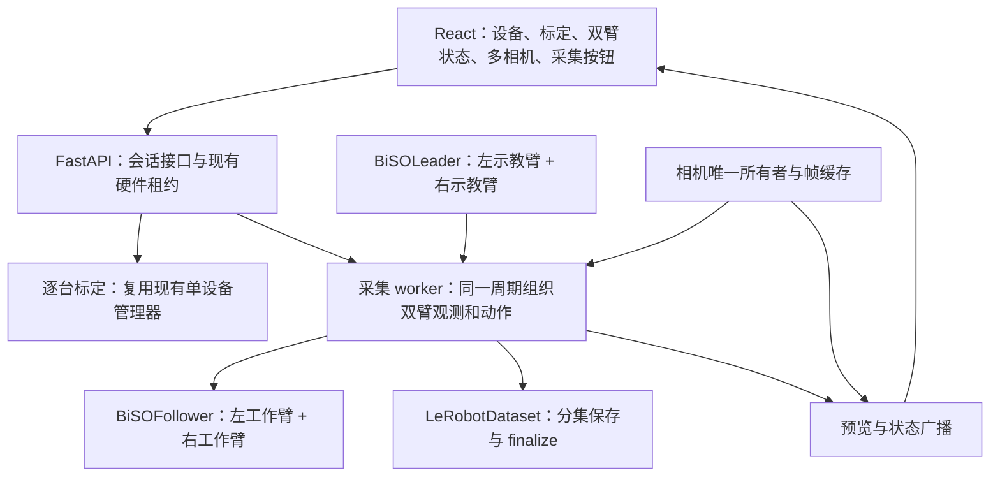

# SO101 双臂实机采集开发方案

核查日期：2026-10-31。状态：设计与静态源码核查，尚未实施双臂改造或实机验证。

用户已确认硬件为 **2 个 follower 工作臂 + 2 个 leader 示教臂**，且已有单臂实机采集与 ACT 训练成功的流程。2026-10-31 的补充要求确定：**四臂逐台标定并保存本地文件；双臂采集继续复用当前 LeRobot；暂时与其他采集系统隔离。** 本方案在已有单臂流程上扩展双臂配置、状态与多相机预览、按 episode 采集，以及停止后的完整 LeRobot 数据集交付。

## 1. 开发基线与结论

本次核验的活动源码为 `releases/sanitized-20261024-01/{app,lerobot}`；根目录的 `current`、`app`、`lerobot` 指向该版本。仓库 HEAD 为 `07216e0`，本地 LeRobot 声明版本为 `0.6.2`，应用声明 Python >= 3.12，并通过 `../lerobot` 使用本地可编辑依赖。版本声明不等于当前机器已安装或正在导入该版本。

建议延续 **FastAPI + React/Vite + 本地 LeRobot**，把两个 follower 组装成一个 `BiSOFollower`、两个 leader 组装成一个 `BiSOLeader`，由一个采集会话管理。采集时直接使用 `LeRobotDataset`，结束时保存当前 episode、收尾编码、`finalize()` 并重新加载核验。无需另做一套通用视频格式，再在结束后猜测如何与关节数据对齐。

本次不更换本地 LeRobot、不切换 `current`、不安装依赖、不启动服务、不连接相机或串口、不操作机械臂。已有未跟踪的其他版本目录和 ROS2 方案文档不属于本次修改范围。

### 1.1 采集现在在哪里运行

代码事实：`app/lelab/server.py:1651,1671` 在 API 进程内启动录制，`app/lelab/record.py:478` 创建本进程的后台线程；没有把采集任务通过 SSH 调到另一台机器的录制入口。因此 **后端在哪里运行，串口/相机采集和数据写入就在哪里执行**，浏览器所在机器不决定采集位置。

已有部署约定是 Jetson 作为边缘主控：`app/deploy/README.md:38` 指定 SO101 和相机通过本地 USB 接入 Jetson，数据主副本和标定保存在其 shared 目录；工作站查看网页，GPU 服务器训练与提供远程推理。`app/proj_state.md`、`app/run_note.md` 也记载该分工和单臂 ACT 排障历史。这些属于配置/历史证据；用户已确认单臂采集和 ACT 训练成功，本次不重新将历史流程表述为尚未实现。

2026-10-31 本次只读检查的会话主机为 x86_64，未暴露 Jetson 型号或 L4T 文件，未发现当前工作区的 Jetson 私有配置与可用连接别名。不能据此实时确认 Jetson 的 API 进程、USB 接线或正在采集的任务。文档中的 192.0.2.x 是脱敏示例，不尝试把它当真实地址连接。

### 1.2 推荐保持 Jetson 采集、工作站操作

| 职责 | 推荐位置 | 原因与条件 |
| --- | --- | --- |
| 四臂串口、相机读取、遥操作、本地保护 | Jetson Orin NX Super 16GB | 沿用已有硬件主机，USB 读取和运动闭环不依赖远程网络 |
| episode 写入、编码与 finalize | Jetson 本地已配置的数据盘 | 采集不依赖网络落盘；检查磁盘写入和实际编码能力 |
| 网页操作、多相机显示、3D 渲染 | 工作站浏览器 | 通过既有隧道访问 Jetson API，浏览器只显示与发送操作事件 |
| ACT / π 系列训练 | 已配置的 GPU 服务器 | 复用已成功的训练流程，数据先校验、同步后使用 |
| ACT / π 系列模型计算 | 第一版默认远程 GPU | Jetson 保持观测上传、动作队列、本地时效检查、限幅和急停 |

双臂示教采集的主要负载是 USB/串口、图像拷贝、JPEG/视频编码和磁盘；并不要求运行 ACT 或 π 模型。现有采集与推理互斥，因此人工采集时本来就不应启动模型推理。是否启用硬件编码要核对实际 codec/驱动，不能从 Jetson 具有 GPU 推导现有 writer 已用上硬编。

第一版继续在 Jetson 完成双臂加实际相机组合的压力测试，测周期超期、CPU/内存、温度、相机帧年龄和写盘速度。若在目标配置下持续达不到要求，再选择优化编码/预览或将硬件完整迁到工作站采集；不因工作站算力看起来更大就拆开硬件采样。若选择工作站接管，需物理转接 USB、复核身份及环境，不能只移动网页或转发 URL。

### 1.3 云端模型推理与本地控制的边界

“云端推理”在本项目指已有远程 GPU 服务器运行 policy：Jetson 发送观测，服务器返回带会话/时间关联的动作块，Jetson 按本地周期执行。安全检查、动作过期处理和故障停车留在硬件主机，不向网络交出无条件执行权。

建议 π0/π0.5 第一版使用远程 GPU，ACT 为保持部署一致也默认远程；ACT 较轻，后续可对现有 checkpoint 实测本地延迟、控制周期与资源占用后保留本地选项。本地 ACT 不必然影响操作性能；远程则增加观测上传、排队、推理及下行延迟，需要按端到端动作年龄和队列饥饿衡量，而非只看 GPU 前向耗时。有条件时优先使用延迟稳定的网络和空闲资源，避免与训练作业无约束争抢同卡。

本地快照的 `lerobot/async_inference/constants.py:25` 名单包含 ACT、pi0、pi05；`app/lelab/remote_inference.py:388` 已启动 PolicyServer、SSH 隧道和 robot_client。但其命令仍固定为单 `so101_follower`，需扩展左右配置、安全参数和 12 维特征。名单支持不代表具体 π checkpoint 已加载成功；相对动作、归一化、处理器、相机和任务文本都需核对。现有 async 动作块传输不能直接等同于 rollout RTC。

已训练的单臂 ACT checkpoint 对应六维动作，不能直接当作双臂十二维策略；保留原来的单臂数据和模型，双臂按匹配的 schema 重新训练或显式适配后验证。

2026-10-31 官方 main 的远程部署文档已经采用新的入口与传输架构；本地快照仍使用 gRPC `lerobot.async_inference`。本次不混用新版命令、不顺带升级 LeRobot。未来迁移需要单独核对本地定制和控制契约。

### 1.4 复用范围与系统隔离

保存/重录/结束直接复用 LeRobot 的 `record_loop()`、`LeRobotDataset.add_frame()`、`save_episode()`、`clear_episode_buffer()`、`finalize()`。原生 `record()` 自行创建键盘监听；网页用事件适配层取代键盘输入，外围只保留设备非交互连接、状态广播和 Web 会话所需内容。现有 LeLab 已采用这一方向，但外层会话循环存在与原生行为不同的超时/Stop 分支，需以本地原生循环为基准修正，并复用其 `VideoEncodingManager` 等异常收尾机制。无需增加第三套独立录制实现。

暂时仅扩展当前 SO101/LeLab 系统，不与其他采集系统或 ROS2 方案合并。实施使用独立工作副本和对应本地 LeRobot、独立环境/配置与数据根、未占用端口；不复用其他系统的设备锁或会话标志。软件隔离不能让两套程序同时拥有同一个物理串口/相机，切换前必须明确移交设备所有权。当前阶段只修改本方案，不改变已有单臂服务、发布链接或其他采集系统。

## 2. 已有能力与确定缺口

以下路径以活动快照为基准；行号为本次核查时的位置。

| 项目 | 源码事实 | 开发含义 |
| --- | --- | --- |
| 双臂驱动 | `lerobot/src/lerobot/robots/bi_so_follower/bi_so_follower.py:90` 产生左右前缀特征；`teleoperators/bi_so_leader/bi_so_leader.py:62` 产生对应动作 | 复用原生 `bi_so_follower` / `bi_so_leader`，不启动两套独立录制进程 |
| 应用配置 | `app/lelab/record.py:73,259` 和 `teleoperate.py:46` 只有单组 leader/follower | 录制、遥操作、配置选择都需识别整套四设备配置 |
| 标定 | `app/lelab/calibrate.py:94,103` 的请求和单例管理一个设备；`lerobot/src/lerobot/utils/bimanual.py:52` 依次标定左右臂 | 按用户最新要求复用单设备标定，四台依次完成并绑定各自文件 |
| 相机 | `app/lelab/server.py:2820,2924` 是后端 OpenCV 预览；`app/lelab/record.py:647` 录制时共享已连接相机缓冲 | 浏览器显示机械臂所在主机采集的画面；当前录制链路不依赖浏览器摄像头 |
| 前端布局 | `app/frontend/src/pages/Recording.tsx:137,616,718` 按相机数布局并显示 MJPEG | 相机网格可复用；左右臂关节和 3D 视图需扩展 |
| 安全配置遗漏 | `bi_so_follower.py:55,69` 重建子臂配置时未转发 `max_position_deviation`、`calibration_range_margin` | 必须补齐本地定制参数转发；不能仅将配置类型换成双臂就上机 |
| 相机键覆盖 | `bi_so_follower.py:86` 直接合并两臂相机字典；但观测特征会添加左右前缀 | 两侧都叫 `wrist` 会覆盖预览字典对象；需统一相机命名与注册表 |
| 停止与保存 | `app/lelab/record.py:494,1020,1037,1096` 的 Stop 标志与“提前保存”标志不同 | 静态路径显示 Stop 可能进入重录清缓冲，丢弃当前未保存集；先补流程测试并修正语义 |
| 动作语义 | `lerobot/src/lerobot/scripts/lerobot_record.py:373,381` 接收 `_sent_action`，实际写入 `action_values` | 安全裁剪后，下发目标可能不同于录入的示教目标；新数据契约要明确两者 |
| 时间戳 | `datasets/dataset_writer.py:223` 将标准 timestamp 生成为 `frame_index / fps` | 标准时间戳不是每次真实采样时刻，不能用它证明多设备同步 |
| 连接流程 | `app/lelab/record.py:939` 直接操作单个 `robot.bus` / `teleop.bus`；双臂对象由两个子臂组成 | 将已成功的非交互连接/写标定流程逐台用于子臂，保留力矩与清理顺序；不能只替换配置类型 |

以上为静态代码事实及调用路径推导，不是实机测试结果。

## 3. 会话架构与设备所有权



第一版保留现有进程与后台线程模式，不引入消息中间件或额外服务。API 接收命令，worker 执行设备操作；HTTP 请求线程不直接跑采集循环。关节广播继续使用现有同步广播队列，耗时探测不进入异步事件循环。

整套四臂由同一个现有硬件租约保护：标定、遥操作、录制、推理互斥。标定时仍一次只连接待标定的一台设备；完成后释放再处理下一台。同一物理串口只允许一个所有者；前端状态查询读取缓存，不另外发总线读请求。

运动停止与文件收尾分别处理：普通结束停止旧控制输入、完成数据收尾；急停或失联先执行设备适用的安全停止并撤销控制权，再尽力保存/收尾。急停后的动作不得排队等待编码结束，也不得重新获取租约后自动恢复旧动作。任务租约 TTL 不代替运动命令的时效和设备主机的控制 watchdog。断连时保持还是卸力须结合实机支撑和抓取情况验证，不能默认卸力等于安全。

## 4. 整套设备配置

在共享配置入口保存一个 rig，而不是继续保存唯一的 `leader_port` / `follower_port`。建议至少包含：

- `rig_id`、配置版本、模式 `bimanual`。
- `leader.id`、`leader.left.port`、`leader.right.port`；follower 同结构。
- 四台设备的物理身份、预期角色、标定文件与指纹。
- 三项 follower 安全参数及单位；启动时生成生效配置快照。
- 相机的稳定名称、设备路径、分辨率、fps、颜色格式。
- 左右基座在前端 3D 场景中的显示变换；该变换不等于用于控制的已验证外参。

Linux 优先使用可核实的 `/dev/serial/by-id/...` 和 `/dev/v4l/by-id/...`；不存在稳定身份时明确提示并保留人工绑定，不把 `ttyACM0` 或摄像头编号当永久身份。拒绝重复端口、重复相机设备、缺失标定和角色错配。

本地双臂包装器实际派生子臂 ID 为 `<pair_id>_left` / `<pair_id>_right`，不会沿用任意嵌套子配置 ID。标定与运行必须采用相同派生规则。例如 leader 对使用 `demo_leader_left/right`，follower 对使用 `demo_follower_left/right`。当前源码的目录类型名为 `so_leader` / `so_follower`，不能照搬旧说明中的 `so101_*` 路径。

相机第一版建议全部放入双臂机器人的**顶层** `cameras`，名称固定为 `front`、`left_wrist`、`right_wrist`，左右子臂的 `cameras` 留空。这样原始相机字典、观测特征和前端 feed 使用相同键，也避免当前同名臂级相机合并问题。相机数量按实际安装决定，不要求三路齐备。

组装左右子配置时复用 `app/lelab/safety.py:follower_safety_kwargs()`，并先修复双臂包装器对三项安全参数的完整转发。两臂保护独立生效；这些单臂限位不提供双臂互相避碰保证。第一版在验证后的作业空间内运行，不宣称已具备自动避碰。

## 5. 四台机械臂逐台标定

沿用当前单设备标定入口。依次选择左 leader、右 leader、左 follower、右 follower，各自连接、完成标定并保存本地 JSON；顺序可以调整，但运行前四份结果必须匹配对应硬件。四份标定数据不能共享、覆盖或用一侧复制到另一侧。前端配置页显示每台的已标定状态和当前绑定文件即可，无需增加并行标定调度器。

每台设备的流程为：确认身份和安全支撑 → 人工放到规定中位 → 明确确认后记录零位 → 人工移动关节记录范围 → 检查跳变、有效范围和覆盖程度 → 写入设备并保存对应 JSON → 复核结果。保留现有范围校验、串口锁和异常清理。

本地文件放在设备主机的持久标定目录，由 rig 记录四份绑定。若沿用双臂包装器，单独标定时就使用与其一致的 `<pair_id>_left/right` ID；已有标定文件如采用其他 ID，实施时通过显式映射/经校验副本兼容，保留原文件，不强制重标定或覆盖。工作站可保留备份，运行时以当前设备主机所加载的文件与指纹为准。

Web 标定继续使用现有非交互流程，避免服务器调用会 `input()` 的 CLI 路径。连接也并非纯只读：当前 follower 的 `connect()` 会执行电机 configure；`calibrate=False` 只跳过自动标定，不能当作“无硬件写入”开关。采集现有手动连接 bus、写标定、连接相机、configure 的顺序有历史兼容原因，双臂改造应逐子设备保留其行为，并在部分连接失败时清理所有已打开设备。

### 5.1 标定归属记录（2026-11-03 实现）

四台臂的电机 id 都是 1–6、关节名也相同（2026-11-03 逐一读取 `work/ros2_collection/lerobot/calibration/**/{left,right}_rig.json` 核实），而 lerobot 的 `FeetechMotorsBus.write_calibration` 按**关节名**遍历标定并经总线自己的 name→id 映射下发，从不比对条目里的 `id`。因此 id 和关节名都区分不出臂：右 leader 的标定写进左 leader 不会报错，只会得到平滑、合理但属于另一台臂的角度。可用的身份只有 USB——`/dev/serial/by-id` 路径。

标定流程完成保存后，把该端口绑定到刚写入的标定（`app_ros_mobile/lelab/arm_bindings.py`，默认落在 `<HF_LEROBOT_HOME>/lelab/arm_bindings.json`，可用 `LELAB_ARM_BINDINGS` 指定）：`role`（leader/follower）、`config` 文件名、内容 `canonical_sha256`、逐关节 `id` 与测量时间。桌面遥操作启动前用这份记录核查，规则按"证据矛盾才阻断"：

- 拒绝：同一端口同时被指派为主臂和从臂；端口上次量成另一侧；该端口量的是别的标定文件；标定条目里的 id 与将要轮询的总线 id 不一致。拒绝发生在两台设备构造完、串口仍未打开时，因此既不 `connect()` 也不写舵机。
- 只提示不阻断：该端口没有测量记录（本改造之前标定的臂）；文件内容哈希与记录不同（量完后手工改过限位——本工作台的常规操作）。
- 绑定表损坏或不可读时按"无记录"处理，不把记账失败变成对已标好台架的封锁。

`/so101/devices` 与 `/so101/identity` 复用同一份记录供页面显示；两者都不开串口，所以硬件侧的 id 比对只在真正启动的路径上做。

## 6. 采集循环与同步定义

一个采集周期按 LeRobot 的观测→动作语义组织：

1. 记录周期编号和单调时钟，取得左右 follower 实测状态与所选相机帧。
2. 取得左右 leader 目标，经现有处理管线和本地保护后向两个 follower 发送。
3. 保存本周期的观测、下发目标与任务描述；同时缓存原始示教目标和安全裁剪信息。
4. 将同一份左右关节快照推送前端；按固定周期推进，不补发过期动作追赶时间。

原生包装器先读左再读右、先写左再写右。因此第一版提供**同周期、可测量误差的软件同步**。不要通过开两套录制进程、同时按按钮，声称得到统一时间轴。

每周期至少测量总耗时、左右状态读取区间、左右发送区间、相机帧年龄、相机间时间偏差、重复帧和超期计数。串口读取的开始/结束或中点只是主机观测时间估计；OpenCV 当前 `latest_timestamp` 在读帧与后处理之后赋值，也不是相机曝光时间。读取图像、帧序号、时间戳应提供同锁快照，不能分别读取造成不一致。

标准 LeRobot `timestamp` 保持 `frame_index / fps`。真实单调时钟、设备时间与质量指标单独声明为附加特征或保存在带 `session_id/episode_index/frame_index` 的旁路记录中。不能强行覆写标准 timestamp，也不能把无法达到的实际采样率标成稳定 30 Hz。

初始性能目标可以选 30 Hz 采集、640×480 RGB、10–15 Hz 网页预览；这只是候选配置。先测四串口与实际相机组合，在预先设定的误差和超期阈值下验收。若周期持续超期、关键相机过期或设备掉线，停止当前集并报告原因，保留诊断；不要静默补零、重复旧动作或重采样。若实测表明需要更紧同步，再考虑每总线独立工作线程、带时间戳帧缓冲或支持触发的相机，并另行验证。软件读写不能承诺硬件级同时采样/发送。

## 7. 前端画面

前端使用现有设备、标定、录制页面扩展：

- 四设备配置与连接/标定状态；左右角色醒目标注。
- 多相机网格；每路显示名称、在线状态、帧年龄和掉帧信息。
- 左右 follower 各自的关节状态与 3D 视图；需要时显示 leader 姿态作对照。
- 当前 task、episode、已保存集数、帧数、录制时长、实际周期与剩余磁盘。
- 开始本集、保存本集、丢弃重录、结束并保存、急停。

双臂关节通过一个带 `seq`、时间和左右字段的数据包广播；前端同次更新左右视图，不把同名 URDF 关节直接合并。缺失状态显示异常，不用全零姿态伪装成真实数据。显示单位转换只在视图层完成。

录制预览复用相机缓存，禁止 `` 每开一路就重新打开相机，也不让预览调用会消耗采集事件的读帧方法。JPEG 编码与慢浏览器不应阻塞设备循环，预览允许只保留最新帧。若要求预览展示“本次真正入库的帧”，应从选帧后的采集快照派发；直接读相机最新帧只能保证同源，不能保证与当前入库帧完全相同。

第一版可沿用现有 MJPEG，以及录制前释放独立预览、由采集 worker 接管相机的流程；接管失败明确报错。录制中所有预览共享同一所有者。多路 MJPEG 的浏览器呈现时间本身不同步；精确对齐依赖采集记录和回放，而非肉眼同时看到画面。只有实测带宽/延迟成为瓶颈时再评估 WebRTC。

### 7.1 已实现：`/so101` 桌面双臂工作台（2026-11-03）

现有页面把角色选择、标定、跟随和数据检查分散在 Landing / Calibration / Teleoperation / Recording 四处，且串口是手打字符串。新增 `frontend/src/pages/So101Workbench.tsx`（路由 `/so101`，Landing 臂卡片上的滑杆图标进入；服务端不托管 SPA 子路径，直接输入 URL 会 404）：

- **设备识别**：从 `/so101/devices` 列出的 by-id 路径里用单选按钮指派主/从臂，每行显示序列号、tty 设备、当前是否在线与"上次标定成哪一侧 + 标定文件 + 内容哈希前 8 位"。没有 `/dev/serial/by-id` 时，`find_available_ports()` 会退回列出主板全部 `/dev/ttyS*`（节点恒存在，2026-11-03 在本机实测到 32 条），工作台过滤掉这些内建 UART，避免把不存在的外接臂"选上"；Windows 的 `COM*` 不受影响。
- **标定**：列出两侧标定文件的关节数、id 集与哈希，并标出该文件实际量自哪些端口；进入原有 `/calibration` 流程完成测量，绑定在保存后自动写入（见 §5.1）。没有重做标定采集 UI，避免与现有非交互流程分叉。
- **遥操作**：走现有 `/move-arm`、`/stop-teleoperation` 与 `/ws/joint-data`。启动按钮在 `/so101/identity` 判为矛盾时置灰并写明原因（后端仍会独立复查并拒绝）。同页并排显示逐关节"主臂目标 vs 从臂实测"曲线（`components/control/JointTrackPanel.tsx`，实线实测、虚线目标、逐关节跟随误差）与从臂 3D 姿态、相机面板。
- **数据检查**：本机数据集的集数/帧数/fps 摘要，加通往 Landing 采集流程与 `/dataset-viewer` 的入口；采集与遥操作互斥的约束沿用模块级互斥，页面不绕过。

关节流原先只带从臂实测（`get_joint_positions_from_robot(robot)`），无法在同一张图上看主从，故 `teleoperate.py` 的 `joint_update` 增加 `leader` 字段：值取自本轮已经用于下发的 `teleop_device.get_action()` 读数，不再向主臂总线追加第二次 `sync_read`，遥操作环路本身与总线负载不变。UrdfViewer 等旧消费者继续读 `joints`，不受影响。

本页此刻能验证的只有"没有硬件时的行为"（清单为空、曲线等待、启动被连不上串口挡下）。带真实读数的曲线绘制、`leader` 字段的实机数值与主从一致性，仍待主臂接回后由用户首验。

## 8. LeRobot 数据契约

使用原生特征聚合和 `build_dataset_frame()` 按 names 构造向量，不凭字典偶然顺序拼接。

| 特征 | 约定 |
| --- | --- |
| `observation.state` | float32，12 维，左右 follower 实测位置 |
| `action` | float32，12 维，经过保护后实际下发的目标；仍是命令，不是电机已执行证明 |
| `observation.images.front` | 实际配置相机的 RGB 视频特征 |
| `observation.images.left_wrist` / `right_wrist` | 有对应相机时建立的 RGB 视频特征 |
| `task` | 传给 writer 的任务文字，由 LeRobot 维护任务索引及元数据 |
| 标准索引 | episode_index、frame_index、index、timestamp 等由 LeRobot 管理 |

每侧顺序固定为 `shoulder_pan.pos, shoulder_lift.pos, elbow_flex.pos, wrist_flex.pos, wrist_roll.pos, gripper.pos`，整体先 `left_` 六项、再 `right_` 六项，并写入特征 names。使用当前默认 `use_degrees=True` 时五个关节是度数，夹爪是其归一化开合范围；不能把 12 项统称为弧度，也不能把前端显示弧度写回训练数据。

现有录制循环把经过 teleop 管线的 `action_values` 写入 action，却未采用 `send_action()` 返回的裁剪后目标。新数据集建议 action 明确使用下发目标，原始示教目标另存附加字段/审计记录。若处理管线变换了动作坐标，须明确逆变换或特征空间，使保存目标与声明的 action schema 一致。记录语义版本，不静默改变旧数据集或把两种动作语义混合追加。

数据集创建后固定 fps、camera keys、分辨率、state/action names、单位和动作语义。切换这些配置应创建新数据集；resume 必须核对兼容性、封存状态与设备配置。软件版本、标定指纹、安全设置与任务信息保存为可追溯快照，不包含凭据。

## 9. 按集保存与结束语义

状态流程建议为 `准备 → 就绪 → 录制本集 → 保存本集 → 复位/就绪`，结束进入 `停止控制 → 收尾 → 校验 → 完成/失败`。标定是独立互斥会话。

| 操作 | 明确行为 |
| --- | --- |
| 保存本集 | 停止增加本集帧，`save_episode()`，集数仅在保存成功后增加 |
| 丢弃重录 | 明确丢弃当前未保存缓冲，保留先前集，回到同一集的就绪状态 |
| 结束并保存 | 停止新动作/新帧；当前集非空且有效则保存，然后完成 writer 收尾与校验 |
| 到达单集时长 | 选择并固定产品规则；建议保存有效本集，不继承当前“超时自动清空重录”行为 |
| 急停/掉线 | 优先停止控制；保存故障原因，当前集是否保留为异常集按明确规则处理，不能标作成功示范 |

正常写入流程为：

```text
LeRobotDataset.create / resume
  → 每个有效周期 add_frame
  → 保存本集 save_episode
  → 后续 episodes
  → 结束时按指令保存最后非空集
  → 等待 writer/视频编码收尾，finalize
  → 重新加载、检查索引和抽样解码
  → 标记 completed，提供本地路径/回放入口
```

一次完整任务示范作为一个 episode，多次示范属于同一个 dataset；及时逐集保存，避免把数小时连续采集都留在一个未提交的 episode 中。

`add_frame()` 的数值内容仍在 episode 缓冲中；图片可能已写入临时目录。`finalize()` 负责冲刷视频、关闭 parquet writer 和元数据，它不会替用户调用 `save_episode()` 保存当前未提交集。异常修复也不能恢复仅存在内存的数据。第一版必须如实说明崩溃时可能损失当前集，不能承诺进程强杀后零丢失。

停止接口先返回“已受理/正在收尾”，不是“保存成功”。只有 finalize、必要完整性检查成功后才返回完成；失败保留错误和已有产物。租约直到硬件所有者确实停止并释放后再归还；文件编码可在硬件安全释放后继续，但数据集在收尾期间仍受写入保护。重复 Stop/Save 请求须幂等，不能双重保存。上传是显式可选后续操作，不应阻断本地完成。

实际目录由本地 v3 writer 的 path template 生成，包含 `meta/`、分片 Parquet、各 camera key 的视频；v3 可在同一分片容纳多集。前端回放应通过元数据索引定位，不假定一集一个 MP4 文件。

## 10. 最小修改范围和开发顺序

| 阶段 | 主要改动位置 | 可验收结果 |
| --- | --- | --- |
| 1：配置与保护 | `app/lelab/utils/config.py`，小型 rig 组装辅助模块，LeRobot `bi_so_follower.py` | 四设备身份/ID 一致，三项保护完整下传；旧单组模式可继续使用 |
| 2：逐臂标定绑定 | 复用 `app/lelab/calibrate.py` 和前端 `Calibration.tsx`，扩展 rig 配置组件 | 四台逐台完成，各自文件互不覆盖，已有标定可显式兼容 |
| 3：双臂只观测与遥操作 | `app/lelab/teleoperate.py`、关节广播及双 URDF 视图 | 先验证身份、方向、单位和保护，再执行授权范围内的小幅低速双臂遥操作 |
| 4：原生采集 | `app/lelab/record.py`、录制请求/弹窗/`Recording.tsx`、相机注册表 | 左右 12 维状态/动作 + 实际相机进入同一 episode，前端可预览 |
| 5：收尾与质量验收 | 录制生命周期、现有存储/质量/回放模块、相关测试 | 停止后本地 LeRobot 可重新加载并逐帧抽查，不遗失应保存的最后一集 |

共享组装入口供遥操作、录制与后续回放使用，避免各模块分别复制四套配置构造。保持现有单臂 API 可用，用明确的模式字段或版本化请求扩展；现有 start/status/stop 路由可兼容委托同一管理器，不需要为此次工作全面迁移接口。

采集会话的命令建议明确区分 `start_episode`、`save_episode`、`discard_episode`、`finish_session(save_current=true)`；请求含 session_id、命令序号，状态含当前阶段、已保存/缓冲帧数、逐设备健康状态和最后错误。旧的通用 `exit_early` 键盘事件可以在适配层映射，内部不再用同一个布尔值隐式表达多种保存意图。

开发应在适合版本管理的工作副本完成，再按发布流程构建前端和验证；不直接改写不可变发布快照，也不借设计工作切换运行版本。

## 11. 验收与证据

先做不接硬件的现有相关测试与必要新增流程测试：配置映射、三项保护转发、相机唯一键、左右特征顺序、四份标定绑定、逐子设备连接与部分失败清理、Stop 保存当前集、Discard 不增加集数、重复命令、finalize 失败和封存/续录兼容检查。测试应验证行为，不只镜像实现。

再用合成设备/相机写短数据集，覆盖数集、最后半集保存、丢弃重录、正常收尾和故障收尾；重新用本地 `LeRobotDataset` 读取，检查每集长度、12 维 names、图像颜色和形状、视频索引与随机帧解码。合成验证与实机结果分别标记。

最后在具备对应硬件授权、身份已核验的主机进行实际测试：四设备逐台确认；标定范围与方向确认；安全连接下仅观测；急停与断连路径验证；授权的小幅低速遥操作；实际相机组合的持续采集、结束并保存、浏览器离线回放。画面回放核验不调用会驱动机器人运动的 replay 路径。

实机报告记录设备身份、代码版本、环境实际导入路径、rig/标定指纹、fps/分辨率/相机数、连续运行时长、总周期与超期分布、左右读写偏差、相机年龄/偏差、保存集数/帧数、退出状态、产物路径及重开结果。候选 30 Hz 只有达到实测验收条件才能写为已验证。

本次仅完成方案及静态核查，未运行应用测试、构建或任何实机流程。

## 12. 官方对照来源

于 2026-10-31 在线核验，下列主线文档用于概念与 API 对照；实施仍以本地 0.6.2 快照为准，不自动升级：

- [官方 Robots API：BiSOFollower](https://huggingface.co/docs/lerobot/main/api/robots#bisofollower)
- [官方真实机器人示教与录制教程](https://huggingface.co/docs/lerobot/il_robots)
- [官方 LeRobotDataset v3：格式与 finalize](https://huggingface.co/docs/lerobot/lerobot-dataset-v3)
- [官方录制实现主线](https://github.com/huggingface/lerobot/blob/main/src/lerobot/scripts/lerobot_record.py)
- [官方 ACT：轻量策略说明](https://huggingface.co/docs/lerobot/act)
- [官方 main 远程部署：与本地旧异步接口分开核对](https://huggingface.co/docs/lerobot/main/remote_inference)
