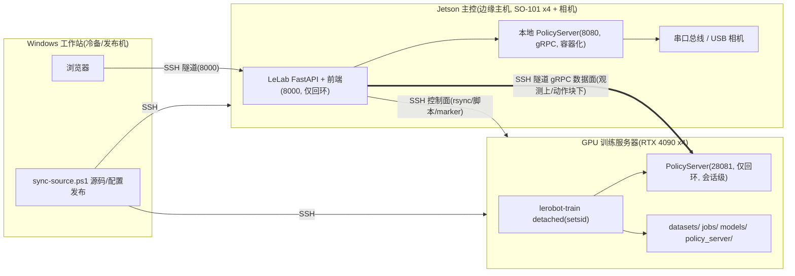

# LeLab 项目说明（代码工程描述）

> 本文基于当前仓库代码整理（后端 41 个 Python 源文件、前端 14 个页面、后端 127 条 HTTP/WS 路由均已逐一核对），按逻辑分层描述工程定位、总体架构、各层模块职责、部署拓扑、持久化位置与开发注意事项。代码实现是本文的事实来源；`README.md`、`INSTALL.md`、`CLAUDE.md`、`proj_state.md`、`remote_server.md`、`deploy/*.md` 仅作补充。凭据类信息一律见 `remote_server.md`（不入库），本文只描述角色与端口。

## 1. 项目定位与核心价值

### 1.1 项目定位

LeLab 是 Hugging Face [LeRobot](https://github.com/huggingface/lerobot) 的**分布式 Web 实验台**：把"标定 → 遥操作 → 数据采集 → 数据治理 → 训练 → 推理"的完整机器人学习闭环，从 CLI + 键盘交互改造为浏览器操作，并从早期"单机 Web 操作台"演进为**三机分布式系统**——Jetson 边缘主机控制机械臂、GPU 训练服务器负责训练与云端推理、Windows 工作站作冷备与发布机。

项目本身**不是机器人算法框架**：设备抽象、数据集格式、训练器与 rollout 主循环均来自 `lerobot`（以本地 editable 依赖锁定 0.6.2，见 1.2/13）；LeLab 负责 Web UI、接口适配、长任务生命周期、硬件资源互斥与安全限幅、数据资产治理、跨机编排与状态展示。硬件目标为 SO-101 leader/follower 双臂结构（Jetson 上现配置 4 支臂 + 3 路 USB 相机）。

### 1.2 核心价值

| 能力 | 说明 |
| --- | --- |
| **全流程 Web 化** | 标定、遥操作、录制、封存、组合、训练、推理全部浏览器操作，零 CLI；单进程同源托管前端与 API |
| **三机分布式架构** | Jetson 主控（硬件+数据主副本）/ GPU 训练服务器 / Windows 冷备；**SSH 控制面 + gRPC 数据面**分离（见 2.2） |
| **硬件安全治理** | 串口总线**单持有者租约**（TTL 心跳、崩溃自动释放、观察会话不可夺权）+ 一键急停抢占 + 三级运动限幅（相对限速 / 绝对工作区 / 标定行程限位） |
| **数据资产治理** | SHA-256 清单**封存**（不可变）、2–8 源**确定性组合数据集**、断点续传 rsync 同步、回收站（软删除/恢复）、完整性校验 |
| **任务全生命周期** | 训练目标三选一：本地子进程 / SSH 远程 detached / HF Jobs 云端；显存与磁盘门禁、孤儿作业接管、checkpoint 清理、模型自动回传 |
| **锁定版 LeRobot fork** | `lerobot` 永不从 PyPI/GitHub 安装，`[tool.uv.sources]` 指向本地 `../lerobot`；fork 内增强 SO-101 安全限幅、`EpisodeAwareSampler(episode_weights)` 加权采样、非阻塞 `observation_sender`（升级 LeRobot 时必须重放，见 13） |

### 1.3 技术栈

| 层次 | 主要技术 | 职责 |
| --- | --- | --- |
| 前端 | React 18、TypeScript、Vite、React Router、TanStack Query 5、Tailwind、Radix/shadcn、Three.js + urdf-loader、Recharts | 页面、设备配置、状态轮询 + WS 推流、3D 机械臂、训练/loss 图表 |
| 后端 | Python 3.12、FastAPI、Uvicorn、Pydantic、psutil、websockets | HTTP/WebSocket API、业务状态机、硬件/数据集/训练任务编排 |
| 机器人能力 | LeRobot 0.6.2（本地 editable fork）、Feetech 总线、OpenCV 相机、gRPC PolicyServer/robot_client | SO-101 控制、标定、录制、训练、本地/云端推理 |
| 跨机通道 | OpenSSH（rsync / `sh -s` 脚本 / 端口转发）、marker 文件授权 | 控制面：查询/启停/清理/回传；数据面：gRPC 仅回环 + 隧道 |
| 外部服务 | Hugging Face Hub / Jobs（可走 hf-mirror 代理）、可选 Weights & Biases | 鉴权、数据集与模型托管、云训练、实验追踪 |
| 持久化 | `~/.cache/huggingface/lerobot/`、`LELAB_OUTPUT_ROOT`、远端 `datasets/ jobs/ models/` 目录、浏览器 localStorage | 标定、端口、机器人档案、数据集、任务元数据、UI 偏好 |

## 2. 总体架构与部署拓扑

### 2.1 三机拓扑



### 2.2 控制面与数据面分离（核心设计约束）

| 通道 | 用途 | 说明 |
| --- | --- | --- |
| **gRPC 数据面**（训练机 28081，仅 loopback） | 只做推理：观测上行 / 动作块下行 | 会话级进程，结束即杀、释放显存；不做查询（`Ready()` 会 reset 会话状态）；经 SSH 隧道访问，严禁公网暴露 |
| **SSH 控制面** | 查询 GPU/端口/作业/会话/磁盘/权重；启动、停止、清理、删除、回传 | 一条 `ssh` 跑脚本返回分区文本，Jetson 侧解析成 JSON；2s TTL 缓存多轮询方共享；不占端口，重启后仍可查 |

远端**唯一授权依据是 marker 文件**：`jobs/<job_id>/.lelab-job.json` 与 `policy_server/<stamp>/.lelab-session.json`，含 `instance_id`（= `LELAB_INSTANCE_ID`，默认 `<LELAB_ROLE>-local`）。没有 marker 或标记为他人实例的目录只展示、不操作（403），绝不全局 `pkill`。

### 2.3 服务与端口

| 设备 | 服务 | 端口 | 暴露范围 |
| --- | --- | ---: | --- |
| Jetson | LeLab 前端/API（uvicorn，同进程托管 `frontend/dist`） | 8000 | 正式仅 127.0.0.1 + SSH 隧道；调试期可 `LELAB_BIND_HOST=0.0.0.0`（无鉴权，仅限可信网络） |
| Jetson | 本地 PolicyServer（gRPC，容器 `lelab-inference:local`） | 8080 | 仅 127.0.0.1 |
| Jetson | 训练机推理隧道的本地端 | 28081 | 仅 127.0.0.1 |
| 训练机 | 回退 PolicyServer（云端推理） | 28081 | 仅 127.0.0.1（SSH 隧道使用） |
| 各机 | SSH | 22 / 以 `deploy/config/servers.example.toml` 为准 | 凭据永不入库 |

### 2.4 运行入口

- `lelab`：生产模式，`127.0.0.1:8000` 启动 Uvicorn（`lelab.server:app`），同源托管已构建前端并打开浏览器；`--no-open` 不自动开页。
- `lelab --dev`：分别启动 Vite `:8080`（热重载）+ Uvicorn `:8000`（reload）。
- `lelab --rebuild`：生产启动前先安装前端依赖并构建。
- `lelab --stop`：按端口定位并终止 LeLab 相关进程树（不要用 `pkill -f lelab`，会误杀 SSH 会话）。
- `lelab/scripts/build_composite.py`：无 LeLab 依赖的组合数据集构建脚本，由 `composites.py` 经 SSH 以 `python3 -` 流式送训练机执行（见 4.3）。

## 3. 整体代码架构（逻辑分层）

```text
┌────────────────────────────────────────────────────────────────────────────┐
│ Web 前端交互层（frontend/src —— React 18 + TS + Vite）                       │
│ Landing | Calibration | Teleoperation | Recording | Upload | Training      │
│ Inference | SystemStorage(系统/存储) | Models(模型仓) | DatasetViewer       │
└───────────────┬────────────────────────────────────────────────────────────┘
                │ HTTP JSON / WebSocket 推流 / MJPEG
┌───────────────▼────────────────────────────────────────────────────────────┐
│ HTTP / WebSocket API 协议层（lelab/server.py + scripts/lelab.py）           │
│ 127 条路由 · 3 条 WS（关节 / 系统遥测 / 存储遥测） · Pydantic 请求模型      │
│ SPA 同源托管 · ConnectionManager 广播 · 硬件租约看门狗挂载                  │
└───────────────┬────────────────────────────────────────────────────────────┘
┌───────────────▼────────────────────────────────────────────────────────────┐
│ 业务编排层                                                                  │
│ calibrate(标定) | teleoperate(遥操作) | record(录制) | rollout(本地推理)    │
│ jobs(任务注册表/看门狗) | train(CLI 参数构造) | update(自更新)              │
│ dataset_repair(中断数据集修复)                                              │
├────────────────────────────────────────────────────────────────────────────┤
│ 远程分布式服务层（SSH 控制面 + gRPC 数据面）                                │
│ ssh_ops(SSH 底座/marker 授权) | runners: local · hf_cloud · ssh_remote      │
│ train_server(训练机只读状态视图) | remote_sync(数据集同步)                  │
│ remote_inference(云端推理五阶段) | model_store(模型回传/仓)                 │
│ composites + scripts/build_composite(组合数据集远端构建)                    │
├────────────────────────────────────────────────────────────────────────────┤
│ 数据资产层                                                                  │
│ datasets(本地+Hub 清单) | dataset_storage(存储/回收站/完整性)               │
│ dataset_viewer(分集检视/时序) | sealing(SHA-256 封存)                       │
│ composites(派生组合数据集) | model_store(模型资产)                          │
├────────────────────────────────────────────────────────────────────────────┤
│ 硬件治理层                                                                  │
│ hardware_lease(串口总线租约/急停/看门狗) | safety(运动限幅)                  │
│ utils/devices(断连失败后强制释放串口与相机)                                 │
├────────────────────────────────────────────────────────────────────────────┤
│ 基础设施层                                                                  │
│ utils/{config, servers, hf_auth, system, policy_refs,                       │
│         dataset_quality, inference_diag} | system_monitor(本机遥测)         │
└───────────────┬────────────────────────────────────────────────────────────┘
                │ 以本地 editable 依赖引用（版本锁定 0.6.2）
┌───────────────▼────────────────────────────────────────────────────────────┐
│ LeRobot fork（../lerobot，不在本仓库内）                                    │
│ 设备抽象(SO-101/Feetech) | LeRobotDataset | lerobot-train/rollout CLI       │
│ gRPC PolicyServer / robot_client | fork 增强：安全限幅 · 加权采样 ·         │
│ 非阻塞 observation_sender（升级时需重放，见 13）                            │
└────────────────────────────────────────────────────────────────────────────┘
```

### 3.1 核心数据流（数据治理主线）

```text
录制(record) ──进程中断──▶ 修复(dataset_repair 重建分集索引)
   │
   ▼
封存(sealing：全量 SHA-256 → meta/.lelab-sealed.json，源数据此后只读)
   │
   ▼
同步(remote_sync：分段 rsync → .incoming/<hash> → 校验 → 原子改名 + .ready)
   │
   ▼
兼容性预检(composites：fps / 相机命名 / 维度·dtype·关节顺序 / 版本 / 存储格式，
            严格拒绝不一致，不做重采样或字段重命名)
   │
   ▼
组合构建(训练机 local/composite_<hash16>，幂等、按 hash 缓存；源数据集零修改)
   │
   ▼
训练(jobs：local | ssh_remote | hf_cloud；GPU 门禁 + weights.json 加权采样)
   │
   ▼
模型回传(model_store：rsync + SHA-256 校验 + 原子发布；本机保留 N 个，余入 .trash)
   │
   ▼
推理(rollout 本地子进程 | remote_inference 云端 PolicyServer + 隧道 + robot_client)
```

## 4. 后端分层详解（lelab/ 包）

### 4.1 API 协议层

| 文件 | 职责 |
| --- | --- |
| [server.py](lelab/server.py) | FastAPI 单体应用（约 2900 行、127 条路由）：全部 HTTP/WS 路由、CORS、`ConnectionManager` 广播（后台线程排空队列，业务线程用同步方法投递）、相机枚举、startup 挂载租约看门狗与任务恢复、`SPAStaticFiles` 托管 `frontend/dist`（仅对接受 `text/html` 的未知路径回退 `index.html`，API 错路径仍返回 JSON 404）。只做协议转换，不持有业务状态 |
| [scripts/lelab.py](lelab/scripts/lelab.py) | `lelab` 命令实现：端口检查、前端安装/构建、生产/开发启动、打开浏览器、按端口终止进程树 |
| [train.py](lelab/train.py) | `TrainingRequest` 等 Pydantic 模式 + `lerobot-train` CLI argv 构造（视频后端探测、optimizer、W&B、GR00T 专属参数、多数据集/权重解析为 `local/composite_<hash>`） |

三条 WebSocket：`/ws/joint-data`（复用通道，消息带 `type`：`joint_update` / `jobs_changed` / `job_progress`，消费者必须先判 type）、`/ws/system-status`（1Hz 本机快照）、`/ws/storage-status`（2s 容量与数据集摘要）；后两者用 `asyncio.to_thread` 阻隔 psutil/磁盘 IO，不拖慢关节数据流。

### 4.2 业务编排层

每个模块自持全局状态（active flag、线程/子进程），对外暴露 `handle_*` 函数与请求模型，由 server.py 调用；四类硬件操作（标定/遥操作/录制/推理）启动前**必须先取硬件租约**（见 4.5）。

| 文件 | 职责 | 关键类/函数 |
| --- | --- | --- |
| [calibrate.py](lelab/calibrate.py) | Web 分步标定：连接设备→homing→活动范围采集；过滤编码器坏值与 0/4095 边界跳变；完成后写电机并保存 JSON、回写机器人档案；任何退出路径安全断连 | `CalibrationManager`（单例 + `_step_complete` Event） |
| [teleoperate.py](lelab/teleoperate.py) | leader→follower 实时控制；约 20Hz 读 follower 关节转 URDF 弧度并经 WS 广播；互斥检查、标定文件准备、退出安全停止 | `handle_start/stop_teleoperation` |
| [record.py](lelab/record.py) | 录制状态机：数据集名清理、非 resume 追加时间戳、构造 LeRobot `RecordConfig`、平台固定相机后端（Windows DirectShow / macOS AVFoundation / Linux V4L2）、episode 与 reset 阶段（reset 不写数据）、重录清空 buffer、MJPEG 预览、teardown 必先 `dataset.finalize()` 再释放硬件；失败时调用修复 | `record_with_web_events`、`handle_start_recording` |
| [rollout.py](lelab/rollout.py) | 本地推理：checkpoint 解析/下载、CUDA→MPS→CPU 自动选择、构造 `lerobot_rollout` 子进程、相对动作/GR00T 自动启用 RTC、日志尾部异常转用户可执行提示 | `handle_start/stop_inference` |
| [jobs.py](lelab/jobs.py) | 训练任务生命周期（约 1600 行）：`JobRegistry` 单例 + 磁盘持久化（`job.json`/`log.jsonl`）+ 1s 看门狗；本地任务同一时间最多一个，SSH/HF 云任务可并行；reload 后按 PID/日志重新附着；孤儿查询/接管；GPU 预检（`select_training_gpu`）与磁盘水位拒绝新建 | `JobRegistry`、`JobRunner` 协议、`LocalJobRunner`、`TailingJobRunner` |
| [update.py](lelab/update.py) | 仅对 Git VCS 安装（有 `direct_url.json` commit）检查 GitHub 更新并选 uv/pip 自更新；editable/本地安装不提示 | `check_for_update`、`handle_run_update` |
| [dataset_repair.py](lelab/dataset_repair.py) | 修复未 finalize 的录制：重建 `meta/episodes/`、裁剪不可恢复数据、重算统计。不修复则 LeRobot 会把本地集当"未下载"转而拉 Hub（对从未推送的数据集 404） | `repair_local_dataset` |

### 4.3 远程分布式服务层

| 文件 | 职责 |
| --- | --- |
| [runners/ssh_ops.py](lelab/runners/ssh_ops.py) | SSH 操作底座：argv 数组不经 shell、stdin 统一 LF；远端 python/代理/HF 镜像注入；`stage_policy_on_server`（Hub 引用用 `local_dir` 落盘，避免镜像 blob 卡 0 字节）；`list_remote_checkpoints`；marker 授权的 `stop_remote_pid`（按进程组 pgid 归属显存）与软删除 |
| [runners/ssh_remote.py](lelab/runners/ssh_remote.py) | `SshRemoteJobRunner`：训练机 `setsid` detached 启动 `lerobot-train`，`run.log` 轮询喂同一套指标解析器；checkpoint 留远端；重启后 re-attach；无并发上限（受显存门禁约束） |
| [runners/hf_cloud.py](lelab/runners/hf_cloud.py) | `HfCloudJobRunner`：经 LeRobot 原生 HF Jobs 参数提交云训练，解析远端任务 id/仓库，重连日志流，取消任务 |
| [train_server.py](lelab/train_server.py) | 训练机**只读状态视图**（不是独立进程、不监听端口）：一次 SSH 执行只读脚本（nvidia-smi / ss / jobs 目录 / 28081 端口探测），解析成 JSON；`TrainServerStatusCache` 2s TTL 供多轮询方共享；checkpoint prune 计划（真删中间权重、保留最近 N 个、最新永不删）；marker 摘要与授权校验 |
| [remote_sync.py](lelab/remote_sync.py) | 数据集异步同步：`rsync --append-verify` 分段断点续传 → `.incoming/<hash>` 暂存 → SHA-256 清单校验 → 原子改名 + `.ready`；`.previous` 回滚；训练运行中禁止重复同步同一数据集；区分"连接失败"与"被拒绝（无 .ready）"。`TrainServerConfig` 读 `deploy/config/servers.example.toml` 画像，环境变量优先 |
| [remote_inference.py](lelab/remote_inference.py) | 云端推理编排：`preparing_policy → starting_server → opening_tunnel → starting_client → running` 五阶段；启动前三态检查（端口占用/遗留会话）；会话级 PolicyServer 结束即杀释放显存；robot_client 后台"只保留最新一帧"观测上传线程（fork `observation_sender.py`）保住控制环频率 |
| [model_store.py](lelab/model_store.py) | Jetson 侧模型仓：训练成功自动回传最终 checkpoint（rsync + SHA-256 校验 + 原子 `active` 切换）；远程模型库单 step 按需下载（单队列）；本机保留策略（`LELAB_LOCAL_MODEL_KEEP`，默认 10）与 `.trash` 回收站 |
| [composites.py](lelab/composites.py) | 组合数据集：2–8 个**已封存**源 → 确定性 `local/composite_<hash16>`（hash = 有序成员 + 每成员 meta 指纹 + 封存 manifest 摘要，成员一变 hash 即变）；兼容性预检（fps/相机命名/dtype·shape·关节顺序/codebase_version/storage_format，严格拒绝）；经 SSH 在训练机构建（幂等、按 hash 缓存），`meta/lelab-composite.json` + `.ready` 原子发布；远端列表/回收站 |
| [scripts/build_composite.py](lelab/scripts/build_composite.py) | 组合构建执行体：无 LeLab 依赖，`python3 -` 流式送训练机；校验成员指纹后调 LeRobot 自带 `lerobot_edit_dataset --operation.type merge`，`LELAB_PROGRESS` 行回报进度 |

### 4.4 数据资产层

| 文件 | 职责 |
| --- | --- |
| [datasets.py](lelab/datasets.py) | 合并本地缓存与当前 HF 用户/组织名下带 LeRobot 标签的数据集，标注 `source=local|hub|both` |
| [dataset_storage.py](lelab/dataset_storage.py) | 存储层（不得 import FastAPI）：路径穿越安全的 repo_id 解析、summary（分集数/体积/相机/finalize 状态）、Parquet schema、文件树、完整性校验、存储摘要、`<root>/.trash` 回收站（忙时禁止删除）；被 server/composites/remote_sync/sealing 复用 |
| [dataset_viewer.py](lelab/dataset_viewer.py) | 数据集只读检视：episode 列表、关节时序降采样曲线、v3 分块视频区间读取（支撑前端 DatasetViewer 回放） |
| [sealing.py](lelab/sealing.py) | 封存：后台全量 SHA-256 → `meta/.lelab-sealed.json`；seal/unseal/verify API；**所有写路径（trash、delete、resume、repair）都过封存守卫**，未解封一律拒绝修改 |
| [composites.py](lelab/composites.py) | （见 4.3）派生只读数据集的编排端 |
| [model_store.py](lelab/model_store.py) | （见 4.3）模型资产三视图：训练机权重 / 远程模型库 / 本机模型仓 |

### 4.5 硬件治理层

| 文件 | 职责 |
| --- | --- |
| [hardware_lease.py](lelab/hardware_lease.py) | 串口总线**单持有者租约**：acquire/renew/release + TTL 心跳；观察会话（observer）只读不夺权；`/emergency-stop` 抢占任何持有者并安全停机；startup 看门狗在持有任务结束或 TTL 超时后自动释放（关掉的浏览器标签不能锁死机械臂）；`LELAB_HARDWARE_LEASE_REQUIRED` 控制强制 |
| [safety.py](lelab/safety.py) | 本机运动安全限幅，注入遥操作/录制/推理的设备构造与 CLI 参数（标量或逐电机 map）： |
| [utils/devices.py](lelab/utils/devices.py) | 可靠断连：常规 disconnect 失败时强制关闭底层串口与相机句柄 |

互斥矩阵（租约统一仲裁，业务层再自查一次）：

```text
calibration_active ─┐
teleoperation_active ─┼─ 任一为 true 时，其余硬件操作拒绝启动
recording_active     ─┤  （观察类查询不受限）
inference_active     ─┘
```

安全限幅参数（`jetson.env`，改后重启 API 生效；前三项由 `safety.py` 读取并注入，支持标量或逐电机 map）：

| 环境变量 | 含义 | 当前值 |
| --- | --- | --- |
| `LELAB_MAX_RELATIVE_TARGET` | 每周期相对上一实际位置的最大步长（限速） | 5 |
| `LELAB_MAX_POSITION_DEVIATION` | 相对"首次动作锁存姿态"的绝对工作区（限位）；`off` = 不注入 | off（实测与任务行程冲突，已关闭） |
| `LELAB_CALIBRATION_RANGE_MARGIN` | 按标定行程的绝对限位（正=收缩，负=外扩，off=关闭），与任务行程无关 | -4 |
| `LELAB_ACTION_TTL_MS`、`LELAB_START_OBSERVE_ONLY` | 部署模板（`deploy/env/*.example`）声明的运行时安全参数：动作超期丢弃、上电只观察；由机器人客户端运行时消费，`lelab` 包内不读取 | 250 / 1 |

### 4.6 基础设施层

| 文件 | 职责 |
| --- | --- |
| [utils/config.py](lelab/utils/config.py) | 共享路径与持久化：标定 JSON、端口、机器人档案 CRUD、端口发现、文件名校验、LeLab Hub tag。**业务模块不得另行硬编码缓存路径** |
| [utils/servers.py](lelab/utils/servers.py) | 部署坐标：`servers.toml` 或环境变量（环境变量优先）；`train_policy_endpoint` 默认 `127.0.0.1:28081` |
| [utils/hf_auth.py](lelab/utils/hf_auth.py) | HF token 状态/登录/登出；共享 `HfApi` 与 whoami 缓存降低限流；token 持久化到 `<HF_HOME>/token` 并随作业传训练机 |
| [utils/system.py](lelab/utils/system.py) | 可选依赖 InstallManager（训练/W&B/策略 extra 后台安装 + 日志队列，装完需重启进程）、CUDA/PyTorch 不匹配检测 |
| [utils/policy_refs.py](lelab/utils/policy_refs.py) | 策略引用解析：本地路径 / `repo@checkpoints/<step>` / `repo@root`（三源 checkpoint 的统一语言） |
| [utils/dataset_quality.py](lelab/utils/dataset_quality.py) | CLI 数据集质量体检，exit 1 作门禁 |
| [utils/inference_diag.py](lelab/utils/inference_diag.py) | CLI 推理日志诊断：解析 `[PERF]`/RTT/clamp 事件生成 JSON 报告 |
| [system_monitor.py](lelab/system_monitor.py) | 本机系统快照：nvidia-smi / tegrastats / 温度 / 负载 / 磁盘，容错超时；喂 `/system/status` 与 `/ws/system-status` |

## 5. 前端架构（frontend/src）

### 5.1 前端路由（14 页）

| 路由 | 页面 | 用途 |
| --- | --- | --- |
| `/` | `Landing.tsx` | 机器人档案、HF 登录、数据集选择、录制入口、训练入口、作业面板 |
| `/calibration` | `Calibration.tsx` | 串口/相机配置、端口拔线检测、200ms 轮询标定、范围可视化、档案回写 |
| `/teleoperation` | `Teleoperation.tsx` | URDF 3D 实时遥操作 + 相机预览；所有退出路径保证 stop |
| `/recording` | `Recording.tsx` | episode/reset 状态机、音效、键盘快捷键、MJPEG 相机格 |
| `/upload` | `Upload.tsx` | 数据集元数据、上传 Hub、跳过、删除 |
| `/training`、`/training/:jobId` | `Training.tsx` | 训练表单与任务详情：本地/HF 云/SSH 远程目标、GPU 手选 + 显存门禁、组合数据集多选、日志/指标/checkpoint/推理 |
| `/inference` | `Inference.tsx` | 推理 setup/rollout 进度、错误提示、停止确认 |
| `/system-storage` | `SystemStorage.tsx` | 系统 + 存储双视图核心页（封存/回收站/同步/完整性/清理） |
| `/system`、`/storage` | `System.tsx`、`Storage.tsx` | 双视图的两个入口路由 |
| `/models` | `Models.tsx` | 训练机权重（真删 + loss 曲线）/ 远程模型库（单 step 下载）/ 本机模型（回收站） |
| `/dataset-viewer` | `DatasetViewer.tsx` | episode 列表、关节时序曲线、v3 分块视频回放 |
| `/edit-dataset` | `EditDataset.tsx` | 占位"建设中" |
| `*` | `NotFound.tsx` | 前端 404 |

### 5.2 组件分组

| 目录 | 要点 |
| --- | --- |
| `components/`（根） | `UrdfViewer`（URDF custom element + mesh 映射 + 实时关节）、`SingleTabGuard`（BroadcastChannel 单标签页选举）、`HardwareLeaseBanner`（全局租约横幅：持有者/心跳/急停）、`TeleopStopNotice`、`UpdateNotice`、`Footer/Logo` |
| `components/system/` | `TrainServerCard`：训练服务器实时卡片（GPU/磁盘/28081 会话三态/清理遗留进程） |
| `components/jobs/` | `JobsSection`、`JobCard`、`HubJobCard`、`HubModelCard`、`ImportModelModal`（远程/Hub 模型导入）、`CheckpointDropdown`（本地/Hub/远程三源）、`OrphanJobsCard`（远端孤儿作业接管） |
| `components/training/` | `TargetCard`（local/hf_cloud/ssh_remote + GPU 选择）、`EssentialsCard`、`DatasetMultiSelect`（保序 ≤8 多选）、`CompositePanel`（兼容预检 + 帧数/等权/自定义权重）、`GrootCard`（GR00T N1.7 默认值）、`AdvancedCard`、`TrainingExtraGate`/`PolicyExtraDialog`/`WandbInstallDialog`/`InstallProgress`（可选依赖一键安装）、`monitoring/`（指标 + loss 曲线 + 日志窗） |
| `components/landing/` | 顶栏、HF 登录四件套（Banner/Chip/Dialog/TokenForm）、机器人三件套（Tile/Selector/ConfigManager）、`DatasetPicker`、`RecordingModal`、`InferenceModal`（checkpoint + 相机绑定 + 本地/远程目标）、`UsageInstructionsModal` |
| `components/control/`、`recording/`、`replay/` | 遥操作可视化面板、相机面板/流、命令栏；相机配置（FOURCC/后端/分辨率）；回放数据集下拉 |
| `components/ui/` | shadcn/Radix 薄封装 ×20 + `PortDetectionButton/Modal`（拔线两阶段串口确认） |

### 5.3 hooks / lib / contexts

| 类别 | 要点 |
| --- | --- |
| `hooks/` | `useStatusStream`（通用 WS 订阅 + 指数退避，喂 React Query 缓存、轮询兜底）、`useJobsChangedSignal`（WS 任务变化/进度）、`useRealTimeJoints`（WS 关节 → URDF）、`useRobots`、`useDatasets`、`useAvailableCameras`、`useCameraStream`（getUserMedia 重试/热插拔）、`useInstallExtra`、`useUpdateCheck`、`useUrdf`、`use-toast` |
| `lib/` | `apiClient`（统一请求 + ApiError）；`systemStorageApi`（系统/存储/封存 seal-unseal-verify/回收站/同步/租约/急停）、`compositesApi`、`jobsApi`（含孤儿接管）、`modelsApi`、`inferenceApi`（local/remote 会话）、`datasetViewerApi`、`checkpointsApi`（三源 + policy-config）、`replayApi`（含 sealed 状态）；URDF 渲染辅助（`meshLoaders`/`urdfViewerHelpers`/`UrdfDragAndDrop`）；`calibrationTargets`、`recordingAudio`、`isHostedSpace` |
| `contexts/` | `ApiContext`（baseUrl/WS/clientId——租约 owner 标识）、`HfAuthContext`（三态）、`Theme`、`Urdf`、`DragAndDrop` |

生产约束：`frontend/dist` 是提交进 Python 包的构建产物（wheel 运行它，不启动 Vite）；业务改动应改 `frontend/src`/`public` 后重新构建。`frontend/` 同时被 `sync_space.yml` 推到 LeLab HF Space（Space 自行 Docker 构建，是另一运行时）。

## 6. 部署体系（deploy/）

| 目录/文件 | 职责 |
| --- | --- |
| `README.md` / `IMPLEMENTATION-STATUS.md` | 三机部署 runbook（架构/安全门/审计/引导/传输/验收/回滚）与架构↔代码映射、M0–M7 运维里程碑 |
| `source-excludes.txt` | 源码发布排除清单（数据/密钥/env 不发布） |
| `config/servers.example.toml` | 无凭据机器画像（train + jetson 角色；`LELAB_SERVERS_CONFIG` 指向实际文件） |
| `env/{jetson,train,windows}.env.example` | 三角色环境变量模板：Jetson（回环 8000、设备白名单 `LELAB_SERIAL_DEVICES/VIDEO_DEVICES`、限幅、训练机 python/代理/HF 镜像）、训练机（回环 28081）、Windows 冷备（角色坐标、COM 口） |
| `systemd/` | `lelab-api.service`（Jetson API 容器）、`lerobot-local-policy-server.service`（Jetson 本地推理）、`lerobot-policy-server.service`（训练机回退 PolicyServer） |
| `windows/` | `sync-source.ps1`（校验和 + 原子 symlink 不可变源码发布）、`open-jetson-ui-tunnel.ps1`（UI 隧道）、`open-train-proxy-tunnel.ps1`（训练机反向代理隧道）、`link-lerobot.ps1`（开发布局 lerobot junction）、`sync-to-jetson.sh`（一次性 rsync 开发部署） |
| `jetson/` | `audit.sh`（只读审计）/`bootstrap.sh`（显式 `--apply` 引导）/`Containerfile`（API 镜像，保 NVIDIA torch）/`run-api.sh`；本地推理容器栈：`Dockerfile.inference`（pytorch igpu, sm_87）+ `docker-compose.inference.yml`（host 网络、无设备）+ `setup-container-runtime.sh` + `run-container-inference-setup.sh` + `entrypoint-inference.sh`（CUDA 自检 + 回环 PolicyServer）+ `container-healthcheck.sh`；`open-train-inference-tunnel.sh`（28081 隧道） |
| `train/` | 审计/引导；`fetch-pretrained-model.sh`（hf-mirror 拉预训练）；冒烟与验收脚本族：`smoke-act-finetune.sh`（SSH 远程微调）、`e2e-cloud-training.sh`（UI 同路径端到端）、`smoke-composite-training.sh`（封存→同步→构建→并行训练→复检全链路）、`probe-cloud-policy{,-session}.py`（无硬件 gRPC 探针/彩排）、`fake-robot-inference-smoke.py`（假臂 + 真 client）、`list-ready-datasets.sh`、`acceptance-check.sh`（M0–M7 验收）、`generate_fake_act_dataset.py`（合成数据集） |
| `data/` | `upload-dataset-to-train.sh`（分级 rsync + SHA-256 + `.ready` 原子上传）、`pull-model-from-train.sh`（分级拉模型 + 原子 `active` 切换） |

安全设计贯穿：**所有脚本默认 dry-run，需 `--apply` 才执行**；凭据永不入库（`remote_server.md` 被 gitignore）；gRPC 只绑 loopback 经隧道；破坏性操作一律要求远端 marker `instance_id` 匹配。Windows 冷备当前只保证代码不阻塞（`LELAB_ROLE=windows-standby` 区分作业归属），数据同步暂不启用。

## 7. 领域对象与术语

| 术语 | 含义 |
| --- | --- |
| Leader / `teleop` | 人手操作的主臂；标定 API 称 `teleop`，档案字段称 `leader` |
| Follower / `robot` | 执行动作的从臂；标定 API 称 `robot`，档案字段称 `follower`（两套词汇不要混淆） |
| Robot record | 以名字保存的设备元数据：两侧端口、标定文件、相机配置；`is_clean` = 必需字段齐全且标定文件存在 |
| Sealed dataset | 有 `meta/.lelab-sealed.json` 清单的数据集，写路径全部被守卫拒绝 |
| Composite | 2–8 个已封存源在训练机构建的派生只读数据集 `local/composite_<hash16>`；只在训练机存在 |
| Lease | 串口总线单持有者租约；观察会话可读不可夺权 |
| Marker | 远端 `.lelab-job.json` / `.lelab-session.json`，`instance_id` 匹配才可操作 |
| Orphan job | 远端有 marker 而本地 registry 无记录的作业，可查询并接管（running 自动 re-attach） |
| Checkpoint ref | 本地目录 / `repo@checkpoints/<step>` / `repo@root`（`utils/policy_refs.py` 统一解析） |

## 8. 状态与持久化

### 8.1 Jetson 本机磁盘（默认 `~/.cache/huggingface/lerobot/`，根可由 `HF_LEROBOT_HOME` 覆盖）

| 路径 | 内容 |
| --- | --- |
| `calibration/teleoperators/so_leader/*.json`、`calibration/robots/so_follower/*.json` | 两侧标定 |
| `ports/*.txt`、`saved_configs/*.txt` | 旧式全局默认端口/配置名 |
| `robots/<name>.json` | 命名机器人档案（当前 UI 主要设备配置来源） |
| `<dataset repo_id>/` | 本地 LeRobotDataset（数据主副本） |
| `outputs/train/<job_id>/{job.json,log.jsonl}` | 任务元数据与持久化日志（根可由 `LELAB_OUTPUT_ROOT` 覆盖） |
| `<LELAB_MODEL_ROOT>/`（默认 `~/Desktop/lelab/models`） | 回传模型仓 + `.trash` |
| `inference_logs/*.log` | 推理子进程日志 |

### 8.2 训练机目录布局（`~/Desktop/lelab_server`）

| 路径 | 内容 |
| --- | --- |
| `datasets/` | 数据集训练副本（`.incoming` 暂存、`.ready` 就绪标记、`local/composite_<hash16>` 组合体） |
| `jobs/<job_id>/` | `run.log`、`run.pid`、`run.exit`、`.lelab-job.json` marker、`weights.json` |
| `jobs/.trash/<id>-<ts>` | 软删除的作业 |
| `models/{pretrained,policies}/` | 预训练权重与 Hub 引用落盘 |
| `policy_server/<stamp>/` | 会话级 PolicyServer（`run.pid`、`run.log`、`.lelab-session.json`） |

### 8.3 内存与浏览器状态

- 后端单例：`CalibrationManager`、`HardwareLeaseManager`、`JobRegistry` + watchdog、`ConnectionManager`、`TrainServerStatusCache`、`DatasetSyncManager`、`CompositeBuildManager`、`ModelPullState`。
- 硬件会话（遥操作/录制/推理）重启进程后不恢复；训练任务从磁盘恢复；远端任务靠 SSH 重查。
- 浏览器：`lelab.apiBaseUrl`（后端地址）、`lelab.selectedRobot`、`vite-ui-theme`、`lelab.recording.muted`、`lelab:update-dismissed-sha`、`lelab:teleop-stopped`。

## 9. 接口总览（127 条路由，按分组）

| 分组 | 代表接口 |
| --- | --- |
| 健康/配置 | `GET /health`、`GET /get-configs` |
| 硬件租约/急停 | `GET /hardware/lease`、`POST /hardware/lease/{acquire,renew,release}`、`POST /emergency-stop` |
| 遥操作 | `POST /move-arm`、`POST /stop-teleoperation`、`GET /teleoperation-status`、`GET /joint-positions` |
| 推理（本地+远程） | `POST /start-inference`、`POST /stop-inference`、`GET /inference-status`、`GET /inference/remote/server-status`、`POST /inference/remote/server/stop` |
| 标定 | `/start-calibration`、`/stop-calibration`、`/calibration-status`、`/complete-calibration-step`、`/calibration-configs/{device_type}` |
| 录制 | `/start-recording`、`/stop-recording`、`/recording-status`、`/recording-exit-early`、`/recording-rerecord-episode`、`/camera-feed/{cam_key}`、`/camera-preview/{camera_index}` |
| 端口/相机/机器人档案 | `/available-ports`、`/available-cameras`、`/start-port-detection`、`/detect-port-after-disconnect`、`/robot-port/*`、`/robot-config/*`、`/robots*` |
| 数据集清单/上传 | `GET /datasets`、`POST /dataset-info`、`/upload-dataset`、`/delete-dataset` |
| 数据集存储/检视 | `/datasets/local`、`/datasets/local/trash`、`/datasets/local/{id}/{storage,summary,schema,files,integrity,episodes,episodes/{e}/video/{cam},episodes/{e}/timeseries}`、`/storage/summary` |
| 数据集同步 | `POST /datasets/local/{id}/sync-train`、`GET /datasets/local/{id}/sync-status`、`GET /datasets/sync-status`、`POST /datasets/sync-cancel` |
| 封存/回收站 | `POST /datasets/local/{id}/{seal,seal/cancel,unseal,seal/verify,trash,restore}`、`GET /datasets/local/{id}/seal` |
| 组合数据集 | `POST /datasets/compatibility`、`POST /datasets/composite`、`GET /datasets/composite/status`、`POST /datasets/composite/cancel`、`GET /datasets/composites`、`/datasets/composites/{trash,restore}` |
| 训练任务 | `POST /jobs/training`、`POST /jobs/import`、`GET /jobs`、`GET /jobs/orphans`、`POST /jobs/orphans/{id}/adopt`、`GET /jobs/{id}`、`/jobs/{id}/{logs,log-file,metrics-history,checkpoints,checkpoints/{step}/policy-config}`、`POST /jobs/{id}/stop`、`DELETE /jobs/{id}?purge_remote=`、`GET /jobs/hub`、`GET /jobs/runners/hardware` |
| 模型仓 | `GET /models/local`、`POST /models/pull`、`GET /models/pull-status`、`POST /models/local/{job}/trash`、`/models/local/trash/{name}/{restore}`、`DELETE /models/local/trash/{name}` |
| 训练机控制面 | `GET /system/train-server`、`GET /system/train-server/{status,checkpoints,models}`、`POST /system/train-server/checkpoints/prune`、`DELETE /system/train-server/checkpoints`、`POST /system/train-server/probe` |
| 系统与环境 | `GET /system/status`、`GET /system/cuda-status`、`/system/{training,wandb}-extra*`、`/system/policy-extra/{policy}/*`、`/system/update-check`、`POST /system/update` |
| 鉴权 | `GET /hf-auth-status`、`POST /hf-auth/{login,logout}` |
| WebSocket | `/ws/joint-data`（关节 + 任务事件复用通道）、`/ws/system-status`（1Hz）、`/ws/storage-status`（2s）、`GET /ws-test` |

## 10. 测试与质量

`tests/` 共 39 个测试文件 + `conftest.py`（TestClient、临时 LeRobot home、子进程 fixture）+ `mocks.py`（FakeRobot/FakeTeleoperator/SO-101 config patch），与后端模块一一对应：租约与互斥（`test_hardware_lease*`、`test_safety`）、录制/标定/遥操作、数据集存储/修复/质量/管理、封存（`test_sealing`）、组合（`test_composites`、`test_composite_api`）、同步与远程推理（`test_remote_sync`、`test_remote_inference`）、SSH 栈（`test_ssh_ops`、`test_ssh_remote_runner`）、训练机视图（`test_train_server`）、GPU 门禁（`test_gpu_gate`）、模型仓（`test_model_store`）、策略引用（`test_policy_refs`）、推理诊断（`test_inference_diag`）、WS 推流（`test_status_websockets`）、fork 侧 `observation_sender`（按文件路径加载，跳过无 fork 布局）。子进程 happy path 与 HF Jobs 集成不在单测范围，由 `deploy/train/` 冒烟与验收脚本覆盖。真机验收走 `deploy/train/smoke-composite-training.sh`（封存→同步→构建→并行训练→复检，支持 `--dry-run`）与 `acceptance-check.sh`（M0–M7）。

## 11. 辅助目录

| 目录/文件 | 作用 |
| --- | --- |
| `refer/lerobot-main/`（+ zip） | LeRobot 0.6.2 参考源码（开发布局中经 `deploy/windows/link-lerobot.ps1` 链接为 `../lerobot` 供 pyproject editable 引用） |
| `refer/plan_train_server_ops.md` | 训练机运维/监控实施计划与里程碑（M0–M8） |
| `refer/debug_log.md` | 现场问题案例（限幅与任务行程冲突等） |
| `.smoke/` | 2026-09-19 云端推理冒烟工件：`jetson_robot_client.py`（lerobot `async_inference/robot_client.py` 副本）、`diag-20260919/` 三方日志与 `inference_diag.py` 生成的 report.json |
| `proj_state.md` / `remote_server.md` / `run_note.md` / `使用说明.md` | 开发状态、凭据与端口（不入库）、Jetson 启动运行手册、Windows 本地使用说明 |

## 12. 推荐代码阅读顺序

1. **全局地图**：`README.md` → `pyproject.toml`（LeRobot editable 锁定 + `lelab` 入口）→ [scripts/lelab.py](lelab/scripts/lelab.py)（生产/开发启动）→ [server.py](lelab/server.py)（只看路由分组与 SPA 挂载）。
2. **设备与本地状态**：[utils/config.py](lelab/utils/config.py)（路径与两套词汇）→ [hardware_lease.py](lelab/hardware_lease.py) + [safety.py](lelab/safety.py)（互斥与限幅）→ [calibrate.py](lelab/calibrate.py) → [teleoperate.py](lelab/teleoperate.py)（最短硬件实时环）。
3. **核心数据闭环**：[record.py](lelab/record.py)（录制状态机）→ [dataset_repair.py](lelab/dataset_repair.py) → [sealing.py](lelab/sealing.py) → [remote_sync.py](lelab/remote_sync.py) → [composites.py](lelab/composites.py) + [scripts/build_composite.py](lelab/scripts/build_composite.py)。
4. **任务与推理**：[train.py](lelab/train.py) → [jobs.py](lelab/jobs.py) → [runners/](lelab/runners/)（ssh_ops → ssh_remote → hf_cloud）→ [train_server.py](lelab/train_server.py) → [model_store.py](lelab/model_store.py) → [rollout.py](lelab/rollout.py) → [remote_inference.py](lelab/remote_inference.py)。
5. **前端对应**：`main.tsx` → `App.tsx` → `contexts/ApiContext.tsx`；按业务成对读：`Landing` ↔ robots/jobs API；`Calibration` ↔ calibrate；`Teleoperation`+`UrdfViewer` ↔ teleoperate；`Recording` ↔ record；`SystemStorage` ↔ dataset_storage/sealing/sync；`Training`+`CompositePanel` ↔ jobs/composites；`Models` ↔ model_store；`Inference`+`InferenceModal` ↔ rollout/remote_inference。
6. **部署与验收**：`deploy/README.md` → `deploy/IMPLEMENTATION-STATUS.md` → `deploy/train/acceptance-check.sh`。
7. 最后读 `tests/`（与后端模块一一对应，是确认边界行为的最快方式）。

## 13. 开发时最需要注意的点

1. **硬件资源释放优先级最高**：任何打开串口/相机的新功能，必须覆盖成功、异常、取消、页面离开、进程退出五条路径；启动前必须先取租约。
2. **路径一律走 [utils/config.py](lelab/utils/config.py)**，业务模块不得硬编码 calibration/cache 路径。
3. **数据集写路径必须过封存守卫**：trash、delete、resume、repair 均要先检查 sealed 状态；改录制逻辑时同步保证 `dataset.finalize()`、partial dataset 保留与 `dataset_repair.py` 的假设仍成立。
4. **远端操作必须 marker 授权**：绝不做全局 `pkill`；杀进程按 pgid 归属显存；`instance_id` 不匹配一律 403 只展示。
5. **SSH 命令全部 argv 数组、不经 shell、stdin 统一 LF**（Windows CRLF 已修）；rsync 远端路径用 `~/` 而非 `"$HOME"/`。
6. **改训练 stdout 格式或 LeRobot 版本时**，同步检查 `jobs.py` 指标正则、HF 提交 marker、checkpoint 布局（本地 `checkpoints/`、云端 `checkpoints/<step>`、无树时回退仓库根）。
7. **LeRobot fork 变更升级时必须重放**：SO-101 安全限幅（`max_relative_target`/`max_position_deviation`）、`EpisodeAwareSampler(episode_weights)` + `DatasetConfig.sample_weights_file` + `lerobot_train.build_dataloaders`（加权采样三件套，改动在 fork 的 `sampler.py`/`configs/default.py`/`scripts/lerobot_train.py`）、`async_inference/observation_sender.py`（非阻塞观测上传）。
8. **`/ws/joint-data` 是复用通道**：消费者必须先看消息 `type`，不能假设全是关节数据。
9. **前端改 `src` 不改 `dist`**：生产运行的是提交的 `frontend/dist`；`frontend/**` 变更在 main 上会触发 CI 自动重建回写。
10. **新增机器人类型不是单文件改动**：当前多处直接使用 SO-101 配置类，需要同时调整标定、遥操作、录制、推理、URDF 与前端表单。
11. **安全基线**：至今未使能持续扭矩、未做整臂自主运动（仅单关节小角度脉冲与手动护持）；API 当前无鉴权（调试期），仅限可信网络，破坏性操作有 marker + dry-run 双保险；`LELAB_BIND_HOST` 正式环境保持 127.0.0.1 + 隧道。
12. **文档冲突以代码与测试为准**：`README.md`、`INSTALL.md`、`CLAUDE.md`、`HTTPS_SETUP.md` 存在历史性描述；`remote_server.md`、`proj_state.md`、`run_note.md` 含最新运行态与凭据（不入库）。
